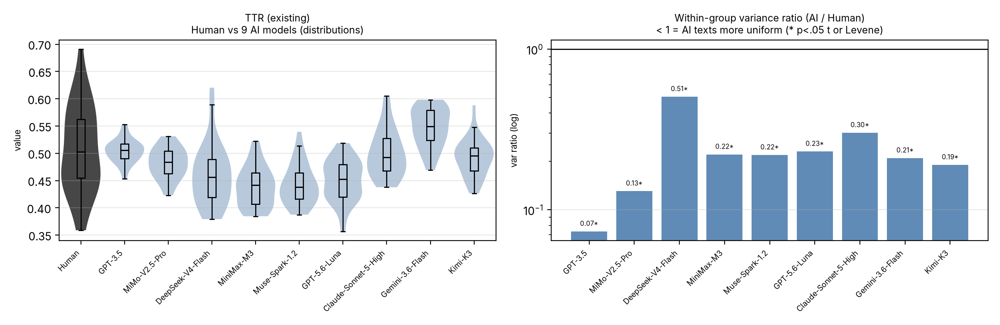
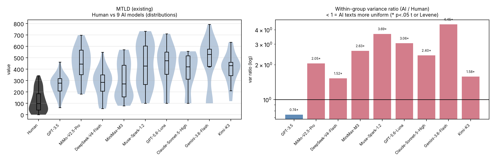
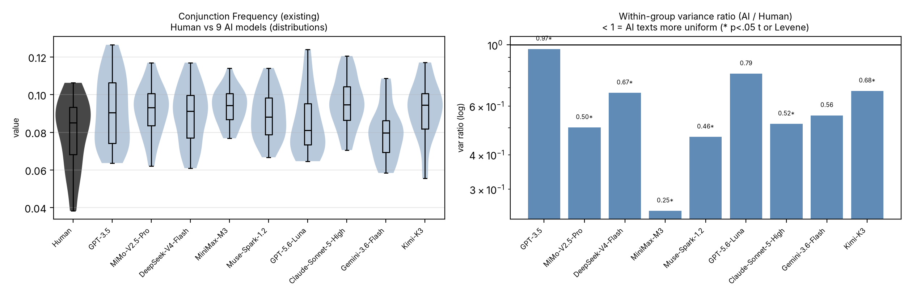
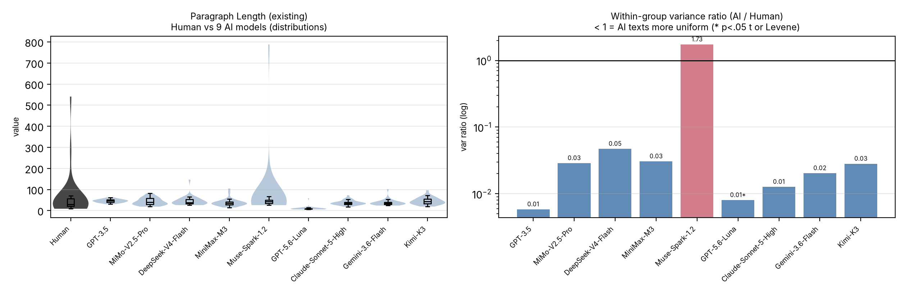
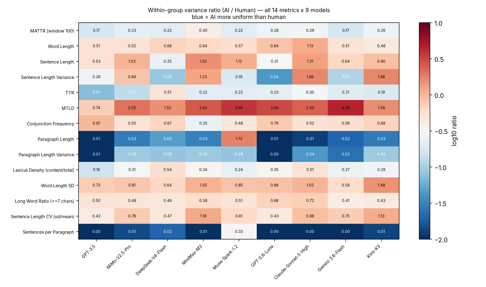

# 图表说明 · 组会图表包第二轮（15 张逐图）

> 图文版（图与说明同页）见 `图表说明-图文版.pdf` / `图表说明-图文版.typ`。

> 这份说明配合 `figures_round2/` 里的图与合集 PDF 使用。每张图给四样：**类型 / 含义 / 作用 / 怎么读 + 一句话看点**。
> PDF 页序与下方编号一致（p1–p15）。

## 通用口径（先说一次）

- 数据：30 个写作题目 × 10 个条件（人类 + 9 个 AI 模型）的英文短篇小说，与既有报告同一语料。
- 统计：每指标 × 每模型做独立样本 Welch t 检验（双尾、未校正）；「AI 内部一致性」＝组内方差比 `var(AI)/var(Human)` + Levene 方差齐性检验。N=30/组，属筛选性描述（未校正）。
- **所有单指标两联图的通用读法**：左格＝分布（黑色＝人类；蓝灰＝9 个 AI 模型；小提琴＝密度形状，箱线＝中位数与四分位）；右格＝方差比棒图（对数轴；蓝色 <1 ＝ AI 组内更「齐」；柱顶数字＝比值，`*`＝该模型 p<.05）。

---

## 一、新增 5 指标（本轮新做）

### 图 01 · `new_lexical_density.png`（p1）实词率 Lexical Density

{width=6.4in}

- **类型**：小提琴图＋箱线图（左）｜对数棒图（右）。
- **含义**：实词（名词/动词/形容词/副词/专名）占全部词的比例；越高＝内容词越密、虚词（冠词、介词、连词）越少。
- **作用**：检验「AI 用词是更实还是更空」，同时看 AI 彼此之间像不像。
- **怎么读**：左格看中位数位置是否与人类拉开；右格看每个模型的比值离 1 多远。
- **一句话看点**：均值上人机差别不大（中位 d = −0.13），但 AI 组内方差比中位仅 **0.31、9/9 模型更齐**（Levene 9/9 显著）——AI 的用词密度不是更高，而是**彼此更像**。

### 图 02 · `new_word_length_sd.png`（p2）词长标准差

{width=6.4in}

- **类型**：同上两联图。
- **含义**：每篇内部词长的离散程度（词长参差度）。
- **作用**：看 AI 用词长度是否更单一（词汇形态复杂度的一环）。
- **怎么读**：同通用读法。
- **一句话看点**：6/9 更齐（中位方差比 0.85）；均值 AI 略高（d +0.31）。方向较杂、属弱信号，汇报时放轻。

### 图 03 · `new_long_word_ratio.png`（p3）长词率（≥7 字符）

{width=6.4in}

- **类型**：同上两联图。
- **含义**：长度 ≥7 字母的词的比例——「用词分量」的粗指标。
- **作用**：看 AI 是否更依赖长词/复杂词，以及组内一致性。
- **怎么读**：同通用读法。
- **一句话看点**：**9/9 更齐**（0.50）且均值略低（d −0.30）——AI 长词用得更少、也更均匀，像「用词更保险」。

### 图 04 · `new_sentence_length_cv.png`（p4）句长变异系数

{width=6.4in}

- **类型**：同上两联图。
- **含义**：句长 SD/均值——剔除绝对长度后的「句长起伏」。
- **作用**：检验 AI 句子长短是否更均匀（与此前句长方差的发现互相印证）。
- **怎么读**：同通用读法。
- **一句话看点**：7/9 更齐（0.75）；与「AI 句长更齐」的既有结论一致，且 CV 版对长短不一的文本更稳。

### 图 05 · `new_sentences_per_paragraph.png`（p5）每段句数

{width=6.4in}

- **类型**：同上两联图。
- **含义**：段落平均句数——段落粒度/组织结构指标。
- **作用**：看 AI 的段落切分是否更规律。
- **怎么读**：同通用读法；注意右格汇率极端。
- **一句话看点**：9/9 更齐（方差比中位 0.006），⚠️ 但人类文本来自 Reddit、空行少，这个指标一半在反映**排版格式**——解读留余量，讲的时候说一句「格式敏感」。

---

## 二、既有 8 指标（本轮补图，统计沿用 9/21）

### 图 06 · `old_word_length.png`（p6）平均词长

{width=6.4in}

- 含义：字符/词。看点：8/9 组内更齐（0.57）；均值 AI 略高（d +0.39）。

### 图 07 · `old_sentence_length.png`（p7）平均句长

{width=6.4in}

- 含义：词/句。看点：均值 7/9 显著、AI 更长（d +0.57）；方差比 0.90——一致性差别最弱的之一。

### 图 08 · `old_sentence_length_var.png`（p8）句长方差

{width=6.4in}

- 含义：篇内句长方差。看点：6/9 更齐（0.28）；均值 AI 偏高（d +0.41）。

### 图 09 · `old_ttr.png`（p9）TTR

{width=6.4in}

- 含义：类符/形符比（受文本长度影响，报告已正面处理）。看点：9/9 更齐（0.22）；均值 AI 略低（d −0.42）。

### 图 10 · `old_mtld.png`（p10）MTLD

{width=6.4in}

- 含义：词汇多样性（移动窗口）。看点：**唯一反例**——AI 组内方差更大（中位比值 2.40、仅 1/9 更齐），均值远高于人类（d +2.03）。按既有口径标「存疑，等扩样本复核」，单列讲。

### 图 11 · `old_conj_freq.png`（p11）连接词频率

{width=6.4in}

- 含义：连接词占比。看点：9/9 更齐（0.56）；均值 AI 更高（d +0.66）。

### 图 12 · `old_paragraph_length.png`（p12）平均段长

{width=6.4in}

- 含义：词/段。看点：8/9 更齐（0.03——最极端之一）；均值差异弱（d −0.24）。⚠️ 同图 05，受切分影响。

### 图 13 · `old_paragraph_length_var.png`（p13）段长方差

{width=6.4in}

- 含义：篇内段长方差。看点：9/9 更齐（0.08）；均值弱（d −0.16）。

---

## 三、总览两张

### 图 14 · `overview_variance_ratio.png`（p14）方差比热图

{width=6.4in}

- **类型**：热图（14 指标 × 9 模型）。
- **含义**：每格＝该指标 × 该模型的组内方差比；越蓝（越小）＝AI 越「齐」；格内数字＝比值。
- **作用**：一页看「哪些层面 AI 最同质」——词汇层与段落层最深（低至 0.03–0.31），MTLD 那一行是红的。
- **怎么读**：先扫蓝色块集中在哪几行，再找红格（反例）。

### 图 15 · `overview_effect_sizes.png`（p15）效应量点阵图

{width=6.4in}

- **类型**：点阵图（dot plot）。
- **含义**：每格＝Cohen's d（AI − 人类）；红点＝|d| ≥ 0.8（强效应）。
- **作用**：看「差异有多大」——最红的是 MATTR（+1.66）与 MTLD（+2.03）；多数格在中小效应区。
- **怎么读**：横排看模型一致性、纵排看指标；点离 0 越远差异越大。

---

## 汇报顺序建议（口头用）

1. 先放**图 14** 一句话：词汇与段落层面，AI 比人类更「齐」（9 个模型 9 个方向一致）。
2. 再挑 1–2 个**新指标**细讲（推荐 01 实词率、03 长词率：结论干净）。
3. 主动交代**图 10（MTLD）**这个反例——单列、存疑、等扩样本。
4. 收尾用**图 15**：差异强度整体不大，红点集中在两个多样性指标上，方向与长度混淆问题一致。
5. 口径声明（一句）：双尾未校正、N=30，属筛选性结果，等 N=90 复核。
