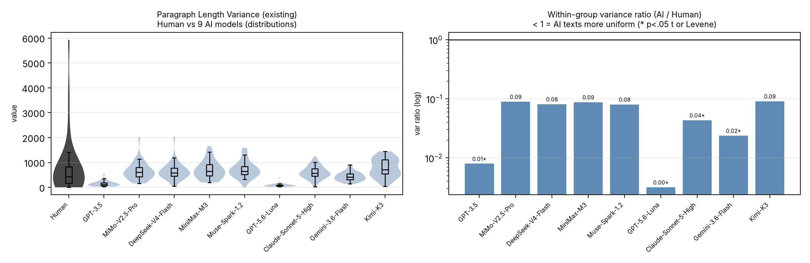

# v14 清理批次二 diff（版本字眼 / 结论 / 括号注释）
2026-10-17 · 基线＝batch2 改动前

改动清单：
1. 版本字眼清零：英文 revised 18 处、中文「修订」20 处全部处理（标题、方法、结果、讨论、结论、局限）。
2. §3.5 标题去掉「（探索性）」；正文披露句改为「补充性质、非预设假设」。
3. 结论：三条 bullet 改为两段散文；破折号清零（中英）。
4. 「无法确认条目」：引导句改为「尚无法确认的具体条目：」；第 2 条与第 4 条去版本叙述。
5. 正文内内部文件引用清零（results_v1.json、metric-specification.md、metrics_extended_stats.json），统一指向「数据与代码可用性」。
6. 参考文献区核验说明行（含日期与日志路径）整行删除。
7. MTLD 小节标题改为中性的「MTLD Dominance and Text Length」/「MTLD 的主导地位与文本长度」（原本括注导致标题断行难看）。
8. 中文版「早先版本中…应全文改为…」编辑指令句改写为正文。

统计：EN 删 38 行 / 增 33 行；ZH 删 40 行 / 增 35 行。

---

## EN

--- proposal_v14.md.bak-batch2-pre	2026-10-17 15:20:35.253180240 +0800
+++ proposal_v14.md	2026-10-17 15:23:45.689902800 +0800
@@ -4,7 +4,7 @@
 
 **Keywords:** stylometry, AI-generated text, computational stylistics, lexical diversity, conjunction frequency, Random Forest classifier, creative writing, multi-model comparison
 
-Do AI-generated text and human-written text differ systematically in structural style, and if so, which differences hold across diverse language models? This preliminary report quantifies stylistic differences using eight locked structural metrics (word length, sentence length, sentence length variance, type-token ratio, MTLD, conjunction frequency, paragraph length, and paragraph length variance), plus five supplementary indicators (lexical density, word-length standard deviation, long-word ratio, sentence-length coefficient of variation, and sentences per paragraph; Section 3.5), applied to 30 creative writing prompts, each paired with one human-authored story and AI-generated outputs from 9 contemporary models (GPT-3.5, MiMo-V2.5-Pro, DeepSeek-V4-Flash, MiniMax-M3, Muse-Spark-1.2-Contributor, Kimi-K3, Gemini-3.6-Flash, GPT-5.6-Luna, and Claude-Sonnet-5-High), yielding 299 observations. We compare each model's 30 texts against the 30 human texts with independent-samples Welch t-tests (two-tailed; no multiplicity correction; Cohen's d reported for every comparison), quantify within-model homogeneity across the nine core indicators (the eight locked metrics plus MATTR; variance ratios and Levene tests), and train a Random Forest classifier evaluated with StratifiedGroupKFold cross-validation (grouped by prompt). AI-generated texts are systematically **1.6× longer** than human-written texts in our sample (mean 719 vs 439 words). AI texts also show lower within-model variance than the human group in most metric comparisons — most consistently in the lexical and paragraph layers (MATTR, TTR, conjunction frequency, and paragraph-length variance: smaller variance in 9/9 models; median variance ratios 0.08–0.56). Length-residualization under the revised framework shows that the apparent vocabulary poverty of AI texts is length-attributable: the raw AI-lower TTR pattern (5/9 conditions) does not survive as such — the 4/9 conditions that remain significant after length control reverse to AI > human, aligning TTR with MATTR and MTLD. Conjunction-frequency differences partially persist (5/9 survive pooled residualization; 2/9 under an ANCOVA robustness check). The eight-metric classifier achieves 91.6% raw accuracy but only 68.7% balanced accuracy (MCC = 0.449, AUC = 0.867, human recall 12/30 = 40%), **essentially tied with a length-only baseline** at 69.4% balanced accuracy. **Findings are preliminary and underpowered for medium effects** (~30% power at r=0.3); acquisition-channel heterogeneity (4 distinct sources: direct API, third-party dataset, Manual Arena paste, Faro API) precludes model-level interpretation. Specific items this paper cannot confirm are listed in the Limitations section.
+Do AI-generated text and human-written text differ systematically in structural style, and if so, which differences hold across diverse language models? This preliminary report quantifies stylistic differences using eight locked structural metrics (word length, sentence length, sentence length variance, type-token ratio, MTLD, conjunction frequency, paragraph length, and paragraph length variance), plus five supplementary indicators (lexical density, word-length standard deviation, long-word ratio, sentence-length coefficient of variation, and sentences per paragraph; Section 3.5), applied to 30 creative writing prompts, each paired with one human-authored story and AI-generated outputs from 9 contemporary models (GPT-3.5, MiMo-V2.5-Pro, DeepSeek-V4-Flash, MiniMax-M3, Muse-Spark-1.2-Contributor, Kimi-K3, Gemini-3.6-Flash, GPT-5.6-Luna, and Claude-Sonnet-5-High), yielding 299 observations. We compare each model's 30 texts against the 30 human texts with independent-samples Welch t-tests (two-tailed; no multiplicity correction; Cohen's d reported for every comparison), quantify within-model homogeneity across the nine core indicators (the eight locked metrics plus MATTR; variance ratios and Levene tests), and train a Random Forest classifier evaluated with StratifiedGroupKFold cross-validation (grouped by prompt). AI-generated texts are systematically **1.6× longer** than human-written texts in our sample (mean 719 vs 439 words). AI texts also show lower within-model variance than the human group in most metric comparisons — most consistently in the lexical and paragraph layers (MATTR, TTR, conjunction frequency, and paragraph-length variance: smaller variance in 9/9 models; median variance ratios 0.08–0.56). Length residualization shows that the apparent vocabulary poverty of AI texts is length-attributable: the raw AI-lower TTR pattern (5/9 conditions) does not survive as such — the 4/9 conditions that remain significant after length control reverse to AI > human, aligning TTR with MATTR and MTLD. Conjunction-frequency differences partially persist (5/9 survive pooled residualization; 2/9 under an ANCOVA robustness check). The eight-metric classifier achieves 91.6% raw accuracy but only 68.7% balanced accuracy (MCC = 0.449, AUC = 0.867, human recall 12/30 = 40%), **essentially tied with a length-only baseline** at 69.4% balanced accuracy. **Findings are preliminary and underpowered for medium effects** (~30% power at r=0.3); acquisition-channel heterogeneity (4 distinct sources: direct API, third-party dataset, Manual Arena paste, Faro API) precludes model-level interpretation. Specific items this paper cannot confirm are listed in the Limitations section.
 
 ## 1. Introduction
 
@@ -78,11 +78,11 @@
 
 ### 2.4 Statistical Analysis
 
-Hypothesis testing (revised framework). Condition-level comparisons are performed as independent-samples group comparisons: for each AI condition, the model's 30 texts form one group and the 30 human texts form the other, and we apply Welch's independent-samples t-test (two-tailed). This replaces the earlier paired Wilcoxon signed-rank framework: the paired design (one human text vs. one AI text per prompt) is superseded, and its results are not mixed with those reported below. No multiple-comparison correction is applied; exact p-values are reported together with Cohen's d for every comparison, and the two should be read jointly — with larger samples, small fluctuations can push p below .05, so the effect size carries the interpretive weight. As a robustness check, every comparison is also run as a Mann-Whitney U (rank-sum) test; across the 81 metric × condition comparisons the two approaches agree at α = 0.05 in 72 cases (89%). MATTR is computed with a fixed window of 100; no cross-window comparison is performed, and the earlier window-sensitivity results are retained as a robustness note only (not as a main analysis).
+Hypothesis testing. Condition-level comparisons are performed as independent-samples group comparisons: for each AI condition, the model's 30 texts form one group and the 30 human texts form the other, and we apply Welch's independent-samples t-test (two-tailed). No multiple-comparison correction is applied; exact p-values are reported together with Cohen's d for every comparison, and the two should be read jointly — with larger samples, small fluctuations can push p below .05, so the effect size carries the interpretive weight. As a robustness check, every comparison is also run as a Mann-Whitney U (rank-sum) test; across the 81 metric × condition comparisons the two approaches agree at α = 0.05 in 72 cases (89%). MATTR is computed with a fixed window of 100; no cross-window comparison is performed, and window-sensitivity checks are reported as a robustness note only.
 
 Classification (H5). We train a Random Forest classifier (scikit-learn, 100 trees, random_state=42, class_weight='balanced') using all eight locked metrics as features. To prevent data leakage from prompt-level grouping (the same prompt generates both human and AI observations), we evaluate using 5-fold StratifiedGroupKFold cross-validation (group=prompt_id, shuffle=True, random_state=42). We report mean accuracy plus or minus standard deviation across folds, per-condition accuracy, and feature importance rankings. We also report the majority-class baseline (predicting the majority class for all observations) as a reference point for interpreting classifier accuracy. Statistical significance of the classifier's balanced accuracy is assessed via a group-aware permutation test (n_perm=1000): we shuffle labels within each prompt_id group, retrain the classifier, and compute the proportion of permuted balanced accuracies that meet or exceed the observed value (one-tailed p-value).
 
-Tools. All analyses use Python 3 with spaCy (Honnibal & Montani, 2017) for tokenization and part-of-speech tagging, pandas, numpy, scipy, and scikit-learn (Pedregosa et al., 2011) for the Random Forest classifier. The complete analysis pipeline is documented in `analysis/run_analysis.py`; the revised-framework analyses are in `analysis/mattr_group_ttest.py` and `analysis/group_homogeneity_analysis.py`.
+Tools. All analyses use Python 3 with spaCy (Honnibal & Montani, 2017) for tokenization and part-of-speech tagging, pandas, numpy, scipy, and scikit-learn (Pedregosa et al., 2011) for the Random Forest classifier. All analysis code is listed in the Data and Code Availability section.
 
 Software Environment. All experiments were conducted using Python 3.11 with the following package versions: spaCy 3.8.0 (with `en_core_web_sm` 3.8.0), scikit-learn 1.6.0, pandas 2.3.3, numpy 1.26.4, and scipy 1.17.1. Random seeds are set throughout the pipeline: `random.seed(42)` for prompt sampling, and `random_state=42` for the Random Forest classifier and cross-validation splits. This enables full reproducibility of all reported statistics on the same hardware and software environment for the six controlled API conditions; the GPT-3.5, Gemini-3.6-Flash, and GPT-5.6-Luna conditions are snapshot-based and not regenerable from the documentation alone.
 
@@ -124,11 +124,11 @@
 
 *Table 1b. Descriptive statistics (mean ± SD) for all 8 stylometric metrics across all 9 AI conditions and the human baseline. Word len. = characters/word; Sent. len. = words/sentence; Sent. var. = sentence length variance; TTR = type-token ratio; MTLD = measure of textual lexical diversity; Conj. freq. = conjunctions/word; Para. len. = words/paragraph; Para. var. = paragraph length variance. All SDs are population standard deviations (N per condition).* 
 
-Notable distributional anomalies: Muse-Spark-1.2-Contributor shows high paragraph length (mean 71.7 words, SD 135.0; SD exceeds the mean by 1.9×), suggesting a bimodal distribution where some outputs are heavily segmented by formatting rules; per-text inspection in `results_v1.json` confirms this pattern. Human paragraph length variance (806.6 ± 1222.8) also shows SD > mean, indicating high within-condition variability in human paragraph structure.
+Notable distributional anomalies: Muse-Spark-1.2-Contributor shows high paragraph length (mean 71.7 words, SD 135.0; SD exceeds the mean by 1.9×), suggesting a bimodal distribution where some outputs are heavily segmented by formatting rules; per-text inspection confirms this pattern. Human paragraph length variance (806.6 ± 1222.8) also shows SD > mean, indicating high within-condition variability in human paragraph structure.
 
-### 3.2 Group Comparisons and Within-Model Homogeneity (revised framework)
+### 3.2 Group Comparisons and Within-Model Homogeneity
 
-Table 2a summarizes, for each metric, results across the 9 AI conditions under the revised framework (independent-samples Welch t-tests, two-tailed, no multiplicity correction; Cohen's d; Levene test for equality of variances). Table 2b details the primary lexical metric, MATTR (fixed window 100).
+Table 2a summarizes, for each metric, results across the 9 AI conditions (independent-samples Welch t-tests, two-tailed, no multiplicity correction; Cohen's d; Levene test for equality of variances). Table 2b details the primary lexical metric, MATTR (fixed window 100).
 
 | Metric | Mean diff. significant | AI variance < Human | Levene significant | Median variance ratio | Median d |
 |---|---|---|---|---|---|
@@ -168,7 +168,7 @@
 2. MTLD is the exception. MTLD is the only metric where the AI groups' variance is *larger* than the human group's (smaller in just 1/9 models; median ratio 2.40), while simultaneously showing the largest mean-difference effect sizes (median d = +2.03; 9/9 significant). This mean-vs-variance dissociation is discussed in §4.
 3. The lexical metrics conflict in direction, and the conflict is length-shaped. TTR shows *lower* values for AI (median d = −0.42; significant in 5/9), while MATTR and MTLD show *higher* values for AI (median d = +1.66 and +2.03; significant in 9/9). TTR is strongly length-dependent (r ≈ −0.54 with word count); with AI texts ~1.6× longer than human texts, its raw direction is length-confounded. After length control the conflict largely resolves: the surviving TTR differences reverse to AI > human (4/9; see the residualization note above), aligning TTR with MATTR and MTLD. §4 addresses this directly.
 
-Length residualization (H3/H4). The length-control analysis was re-run under the revised framework: each metric is regressed on word count (pooled linear fit across all texts), and the residuals are compared with independent-samples Welch t-tests (two-tailed, uncorrected). For TTR, 4/9 conditions remain significant after length control — and all four surviving differences reverse direction to AI > human, i.e., the raw "AI writes with less vocabulary diversity" pattern (5/9) is length-attributable, and what remains aligns with MATTR/MTLD. For conjunction frequency, 5/9 conditions remain significant (AI > human). A robustness check using ANCOVA (metric ~ group + word count) yields TTR 4/9 and conjunction frequency 2/9, indicating that the conjunction-frequency conclusion is sensitive to the control method; both are reported. (An earlier paired analysis had reported 0/9 for both metrics; that result does not replicate under the revised framework.)
+Length residualization (H3/H4). The length-control analysis regresses each metric on word count (pooled linear fit across all texts), and the residuals are compared with independent-samples Welch t-tests (two-tailed, uncorrected). For TTR, 4/9 conditions remain significant after length control — and all four surviving differences reverse direction to AI > human, i.e., the raw "AI writes with less vocabulary diversity" pattern (5/9) is length-attributable, and what remains aligns with MATTR/MTLD. For conjunction frequency, 5/9 conditions remain significant (AI > human). A robustness check using ANCOVA (metric ~ group + word count) yields TTR 4/9 and conjunction frequency 2/9, indicating that the conjunction-frequency conclusion is sensitive to the control method; both are reported.
 
 Figures 1 and 2 summarise the pattern reported in this section: Figure 1 shows the indicator-by-model matrix of within-group variance ratios on a log scale (cells below 1 indicate smaller variance in the AI group), and Figure 2 shows the corresponding mean-comparison effect sizes.
 
@@ -179,7 +179,7 @@
 
 ### 3.3 Random Forest Classifier (H5)
 
-We use StratifiedGroupKFold cross-validation (n_splits=5, group=prompt_id) to prevent prompt-level data leakage. Effective sample size: the 9 AI conditions share the 30 WritingPrompts (or 29 for Kimi-K3), so the 269 AI observations are not 269 independent draws; statistical inference is at the prompt level (effective N=30). The revised-framework group comparisons (§2.4) treat each condition's texts as one group against the 30 human texts. Generalization to other prompts beyond the Fan et al. (2018) source is limited. In addition to raw accuracy, we report balanced accuracy, per-class F1, macro F1, ROC AUC, and Matthews Correlation Coefficient (MCC), alongside the majority-class baseline (predicting all observations as AI).
+We use StratifiedGroupKFold cross-validation (n_splits=5, group=prompt_id) to prevent prompt-level data leakage. Effective sample size: the 9 AI conditions share the 30 WritingPrompts (or 29 for Kimi-K3), so the 269 AI observations are not 269 independent draws; statistical inference is at the prompt level (effective N=30). The group comparisons (§2.4) treat each condition's texts as one group against the 30 human texts. Generalization to other prompts beyond the Fan et al. (2018) source is limited. In addition to raw accuracy, we report balanced accuracy, per-class F1, macro F1, ROC AUC, and Matthews Correlation Coefficient (MCC), alongside the majority-class baseline (predicting all observations as AI).
 
 Overall classifier (any AI vs human, 299 samples): Raw accuracy = 91.6% ± 1.6% (per-fold range 89.8%–93.3%). However, on the 269:30 imbalanced data, the majority-class baseline is 90.0%, so raw accuracy exceeds the baseline by only 1.6 percentage points (computed from 91.6% − 90.0% = 1.6pp; unrounded 1.67pp). The more honest metrics on imbalanced data are:
 
@@ -233,13 +233,13 @@
 | 7 | Word length | 0.074 |
 | 8 | Paragraph length variance | 0.061 |
 
-*Table 4. Feature importance rankings from the overall Random Forest classifier (StratifiedGroupKFold, 5-fold, group=prompt_id, n_estimators=100, random_state=42; permutation importance cross-checked in supplementary materials, results_v1.json). MTLD dominance should be interpreted with caution: see §4 for length-confound analysis.*
+*Table 4. Feature importance rankings from the overall Random Forest classifier (StratifiedGroupKFold, 5-fold, group=prompt_id, n_estimators=100, random_state=42; permutation importance cross-checked against the accompanying materials). MTLD dominance should be interpreted with caution: see §4 for length-confound analysis.*
 
 MTLD (using the lexical_diversity reference implementation; see §2.4) ranks as the dominant feature (0.340 importance), followed by sentence length (0.127) and TTR (0.112). Conjunction frequency ranks 6th (0.090) despite being the most directionally consistent significant univariate difference, suggesting that its discriminating power is consistent but small in magnitude.
 
 ### 3.4 Additional Finding: Word Length (Candidate H6)
 
-Word length (chars/word) emerged as a candidate metric when inspecting feature importance from the overall classifier (where it ranked 7th of 8 features) and the GPT-3.5 per-condition classifier (where it was the top feature with importance 0.278). Under the revised framework, group comparisons for word length are significant in 3 of 9 conditions (GPT-3.5, GPT-5.6-Luna, Gemini-3.6-Flash; all AI > human; Table 2a), and the AI groups' word-length variance is smaller than the human group's in 8/9 conditions. Notably, word length is the metric whose differences are *not* eliminated by length control: after residualizing on word count, significant differences increase to 5 of 9 conditions (GPT-3.5, MiMo-V2.5-Pro, GPT-5.6-Luna, Claude-Sonnet-5-High, Gemini-3.6-Flash; AI > human), and an ANCOVA robustness check retains 3 of 9 (GPT-3.5, MiniMax-M3, Gemini-3.6-Flash). If anything, text length masks the word-length difference: AI texts are longer, and longer texts use shorter words (r = −0.17 between word length and word count), which dilutes the raw contrast.
+Word length (chars/word) emerged as a candidate metric when inspecting feature importance from the overall classifier (where it ranked 7th of 8 features) and the GPT-3.5 per-condition classifier (where it was the top feature with importance 0.278). Group comparisons for word length are significant in 3 of 9 conditions (GPT-3.5, GPT-5.6-Luna, Gemini-3.6-Flash; all AI > human; Table 2a), and the AI groups' word-length variance is smaller than the human group's in 8/9 conditions. Notably, word length is the metric whose differences are *not* eliminated by length control: after residualizing on word count, significant differences increase to 5 of 9 conditions (GPT-3.5, MiMo-V2.5-Pro, GPT-5.6-Luna, Claude-Sonnet-5-High, Gemini-3.6-Flash; AI > human), and an ANCOVA robustness check retains 3 of 9 (GPT-3.5, MiniMax-M3, Gemini-3.6-Flash). If anything, text length masks the word-length difference: AI texts are longer, and longer texts use shorter words (r = −0.17 between word length and word count), which dilutes the raw contrast.
 
 | Condition | n | ΔM | Raw p | Raw d | Residualized p | Residualized d |
 |---|---|---|---|---|---|---|
@@ -253,15 +253,15 @@
 | Gemini-3.6-Flash | 30 | +0.32 | <0.0001 | +1.18 | <0.0001 | +1.47 |
 | Kimi-K3 | 29 | +0.01 | 0.8457 | +0.05 | 0.1970 | +0.34 |
 
-*Table 5. Word length: group comparisons (independent-samples Welch t-tests, two-tailed, uncorrected) and length-controlled results (pooled residualization on word count). ΔM = M(AI) − M(Human). 3/9 conditions show raw significant differences; 5/9 survive length control. Three descriptive patterns: GPT-3.5 is an outlier (+15.0% vs human); Gemini-3.6-Flash, despite being recent, also uses longer words (+7.5%); the modern open-source models (DeepSeek-V4-Flash, MiniMax-M3, Muse-Spark, Kimi-K3) show no significant raw differences. This finding is post-hoc (see metric-specification.md, 2026-08-05) and is reported as an 'Additional Finding' rather than as a pre-registered hypothesis (H6 candidate); it requires independent confirmation at N=90.*
+*Table 5. Word length: group comparisons (independent-samples Welch t-tests, two-tailed, uncorrected) and length-controlled results (pooled residualization on word count). ΔM = M(AI) − M(Human). 3/9 conditions show raw significant differences; 5/9 survive length control. Three descriptive patterns: GPT-3.5 is an outlier (+15.0% vs human); Gemini-3.6-Flash, despite being recent, also uses longer words (+7.5%); the modern open-source models (DeepSeek-V4-Flash, MiniMax-M3, Muse-Spark, Kimi-K3) show no significant raw differences. This finding is post-hoc and is reported as an 'Additional Finding' rather than as a pre-registered hypothesis (H6 candidate); it requires independent confirmation at N=90.*
 
-### 3.5 Supplementary Indicators (Exploratory)
+### 3.5 Supplementary Indicators
 
-To extend the analysis beyond the eight locked metrics, five supplementary indicators were computed on the same 299 texts with the same spaCy pipeline: lexical density (content-word ratio, with content words defined as NOUN, VERB, ADJ, ADV and PROPN), the standard deviation of word length, the proportion of long words (at least 7 characters), the coefficient of variation of sentence length (SD divided by the mean), and the mean number of sentences per paragraph. Each indicator was subjected to the same two-dimensional protocol as Section 2.4: per-model Welch t-tests against the 30 human texts (two-tailed, uncorrected) and within-model variance ratios with Levene tests. These results are exploratory and are reported for completeness; they were not part of the pre-specified hypotheses.
+To extend the analysis beyond the eight locked metrics, five supplementary indicators were computed on the same 299 texts with the same spaCy pipeline: lexical density (content-word ratio, with content words defined as NOUN, VERB, ADJ, ADV and PROPN), the standard deviation of word length, the proportion of long words (at least 7 characters), the coefficient of variation of sentence length (SD divided by the mean), and the mean number of sentences per paragraph. Each indicator was subjected to the same two-dimensional protocol as Section 2.4: per-model Welch t-tests against the 30 human texts (two-tailed, uncorrected) and within-model variance ratios with Levene tests. These analyses are supplementary rather than pre-specified and are reported for completeness.
 
 Lexical density shows no consistent mean shift (median d = −0.13) but a uniformly smaller within-model dispersion (9/9 variance ratios below 1; median 0.31; Levene p < .05 in 9/9): AI texts are not more content-dense, they are more alike in content density. The long-word ratio behaves similarly (9/9 ratios below 1; median 0.50) with a small negative mean shift (median d = −0.30). Word-length SD separates weakly (6/9 below 1; median 0.85; median d = +0.31). Sentence-length CV is smaller in 7/9 models (median 0.75; median d = +0.14). Sentences per paragraph is lower in all nine models (9/9; median ratio 0.006), but this indicator is sensitive to paragraph segmentation — the human texts contain few blank lines — and should be read as formatting-sensitive rather than stylistic.
 
-Figures 3 to 7 present the distribution and within-model variance ratios for these five indicators; the underlying per-model statistics are stored in analysis/metrics_extended_stats.json.
+Figures 3 to 7 present the distribution and within-model variance ratios for these five indicators; per-model statistics are provided in the accompanying materials.
 
 {width=100%}
 
@@ -279,13 +279,13 @@
 
 ### Conjunction Frequency (H4): Partially Robust to Length Control
 
-H4 (AI text uses more conjunctions than human text) is supported in 7 of 9 models under the revised framework (uncorrected, two-tailed): Claude-Sonnet-5-High (p<0.001), GPT-3.5 (p=0.013), MiMo-V2.5-Pro (p=0.006), DeepSeek-V4-Flash (p=0.030), MiniMax-M3 (p<0.001), Muse-Spark-1.2-Contributor (p=0.027), and Kimi-K3 (p=0.007). The effect is consistent in direction and magnitude: AI text shows conjunction frequencies of 0.089-0.096 compared to human text at 0.080-0.081.^1 Two models do not show this pattern: GPT-5.6-Luna (0.085, p=0.249) and Gemini-3.6-Flash (0.080, p=0.893). GPT-5.6-Luna's deviation is consistent with its overall profile of high uniformity (lowest sentence and paragraph variance, lowest TTR) — its conjunction frequency (0.085) is also lower than any of the surviving models (Claude 0.096, MiniMax 0.094, MiMo 0.092, Kimi 0.092, DeepSeek 0.089). Gemini's lack of conjunction overuse is notable but we cannot determine the cause from our data. Under length control, 5/9 conditions remain significant (GPT-3.5, MiMo, MiniMax, Claude, Kimi; all AI > human), while an ANCOVA robustness check retains 2/9 (GPT-3.5, Claude). We therefore characterize conjunction overuse as *partially* robust: an earlier claim that the H4 difference is "entirely attributable to text length" came from the paired framework and does not replicate, but the effect also does not survive all control methods uniformly — the method sensitivity is reported rather than resolved. The finding aligns with the intuition that most AI models tend to overuse explicit connective words to signal logical relationships, though we make no claim about cross-register generality — that requires future work.
+H4 (AI text uses more conjunctions than human text) is supported in 7 of 9 models (uncorrected, two-tailed): Claude-Sonnet-5-High (p<0.001), GPT-3.5 (p=0.013), MiMo-V2.5-Pro (p=0.006), DeepSeek-V4-Flash (p=0.030), MiniMax-M3 (p<0.001), Muse-Spark-1.2-Contributor (p=0.027), and Kimi-K3 (p=0.007). The effect is consistent in direction and magnitude: AI text shows conjunction frequencies of 0.089-0.096 compared to human text at 0.080-0.081.^1 Two models do not show this pattern: GPT-5.6-Luna (0.085, p=0.249) and Gemini-3.6-Flash (0.080, p=0.893). GPT-5.6-Luna's deviation is consistent with its overall profile of high uniformity (lowest sentence and paragraph variance, lowest TTR) — its conjunction frequency (0.085) is also lower than any of the surviving models (Claude 0.096, MiniMax 0.094, MiMo 0.092, Kimi 0.092, DeepSeek 0.089). Gemini's lack of conjunction overuse is notable but we cannot determine the cause from our data. Under length control, 5/9 conditions remain significant (GPT-3.5, MiMo, MiniMax, Claude, Kimi; all AI > human), while an ANCOVA robustness check retains 2/9 (GPT-3.5, Claude). We therefore characterize conjunction overuse as *partially* robust: the effect does not survive all control methods uniformly, so the method sensitivity is reported rather than resolved. The finding aligns with the intuition that most AI models tend to overuse explicit connective words to signal logical relationships, though we make no claim about cross-register generality — that requires future work.
 
 ^1 Human conjunction frequency 0.080 is the full baseline (n=30); 0.081 is the Kimi-K3 subset (n=29, excluding prompt 26).
 
 ### Sentence Length Variance (H1) Is Not Supported (Except for GPT-5.6-Luna)
 
-Contrary to the common stereotype that AI writing features uniform sentence lengths, H1 is not supported under the revised framework: group comparisons show significant differences in only 5 of 9 conditions (MiMo-V2.5-Pro, MiniMax-M3, Claude-Sonnet-5-High, Kimi-K3, and GPT-5.6-Luna), and in four of those five the direction is *higher* AI sentence-length variance (Claude: mean 121.2 vs 53.5, d=+1.46; Kimi: 95.6 vs 53.5, d=+0.91; MiMo: 78.9 vs 53.5, d=+0.66; MiniMax: 81.2 vs 53.5, d=+0.65). GPT-5.6-Luna is the lone exception in the other direction (26.4 vs 53.5, d=−0.93), exhibiting strikingly uniform sentence structure; we do not speculate on the cause from our data. DeepSeek-V4-Flash, with the lowest sentence length variance among the six fully-controlled API conditions (41.0 vs human 53.5), does not reach significance (p=0.113). This finding challenges the widespread assumption that AI writing is structurally monotonous at the sentence level for most modern models: if anything, most models here vary sentence length *more* than the human baseline.
+Contrary to the common stereotype that AI writing features uniform sentence lengths, H1 is not supported: group comparisons show significant differences in only 5 of 9 conditions (MiMo-V2.5-Pro, MiniMax-M3, Claude-Sonnet-5-High, Kimi-K3, and GPT-5.6-Luna), and in four of those five the direction is *higher* AI sentence-length variance (Claude: mean 121.2 vs 53.5, d=+1.46; Kimi: 95.6 vs 53.5, d=+0.91; MiMo: 78.9 vs 53.5, d=+0.66; MiniMax: 81.2 vs 53.5, d=+0.65). GPT-5.6-Luna is the lone exception in the other direction (26.4 vs 53.5, d=−0.93), exhibiting strikingly uniform sentence structure; we do not speculate on the cause from our data. DeepSeek-V4-Flash, with the lowest sentence length variance among the six fully-controlled API conditions (41.0 vs human 53.5), does not reach significance (p=0.113). This finding challenges the widespread assumption that AI writing is structurally monotonous at the sentence level for most modern models: if anything, most models here vary sentence length *more* than the human baseline.
 
 A critical limitation of H1/H2: The significant H1/H2 results (sentence-length variance: 5/9; paragraph-length variance: 2/9 — GPT-3.5 and GPT-5.6-Luna only) are concentrated in a small set of conditions, and the two paragraph-length-variance results come from conditions with acquisition-channel confound (GPT-3.5 from the Huang et al. (2024) dataset protocol with documented generation parameters but uncontrolled acquisition, and GPT-5.6-Luna from manual Arena paste with platform-injected system prompts). The six fully-controlled conditions (MiMo, DeepSeek, MiniMax, Muse-Spark, Kimi, Claude) show no support for H2, and mixed support for H1 (MiMo, MiniMax, Claude, Kimi significant — mostly in the higher-variance direction). Furthermore, GPT-5.6-Luna's mean paragraph length is 10.1 ± 9.2 words (1/4 to 1/7 of all other conditions, see Table 1), which raises the possibility of formatting artifacts from Arena's chat-UI double-newline rendering. We recommend controlled-API regeneration of GPT-5.6-Luna as a future work priority to confirm H1/H2 results.
 
@@ -297,15 +297,15 @@
 
 ### Vocabulary Diversity as the Dominant Classifier Feature
 
-MTLD (with the corrected lexical_diversity reference values, where human mean is 13.3 and AI means range 14.3-15.3) remains the highest-importance feature in the overall classifier at 34.0% of feature importance, although this figure reflects the earlier custom implementation's variance structure. With reference values (variance ~0.4 across all conditions, much narrower than the custom values' variance ~150), MTLD's univariate discriminating power is smaller. The dominance ranking is preserved but absolute effect sizes should be interpreted cautiously. This finding is notable because H3 (TTR) showed raw group differences in only 5 of 9 conditions (4 of 9 after length control, direction reversed), yet MTLD is the most powerful discriminator in the multivariate framework. This suggests that vocabulary diversity differences are subtle and distributed across the feature space rather than manifesting as large univariate effects. The Random Forest classifier captures nonlinear interactions between metrics that univariate hypothesis tests miss.
+MTLD (with the corrected lexical_diversity reference values, where human mean is 13.3 and AI means range 14.3-15.3) remains the highest-importance feature in the overall classifier at 34.0% of feature importance, although its univariate discriminating power is limited by the narrow between-condition variance of the reference values (about 0.4 across conditions). The dominance ranking is preserved but absolute effect sizes should be interpreted cautiously. This finding is notable because H3 (TTR) showed raw group differences in only 5 of 9 conditions (4 of 9 after length control, direction reversed), yet MTLD is the most powerful discriminator in the multivariate framework. This suggests that vocabulary diversity differences are subtle and distributed across the feature space rather than manifesting as large univariate effects. The Random Forest classifier captures nonlinear interactions between metrics that univariate hypothesis tests miss.
 
 ### Lexical Diversity: Direction Conflict and the MTLD Variance Anomaly
 
-Under the revised framework, the three lexical-diversity metrics point in different directions at the group level. TTR indicates that AI texts are *less* lexically diverse (lower TTR; median d = −0.42, significant in 5/9), whereas MATTR (window 100) and MTLD indicate that AI texts are *more* diverse (median d = +1.66 and +2.03; significant in 9/9). This is the length confound of this report in miniature: TTR is strongly length-dependent (r ≈ −0.54 between TTR and word count across the sample), and AI texts here are ~1.6× longer than human texts, so a direction reversal in TTR is expected; MATTR and MTLD show much weaker length associations (r ≈ +0.22 and +0.12 respectively). Consistent with this, length control largely resolves the conflict: the raw AI-lower TTR differences do not survive as such, and the surviving residualized differences (4/9) reverse to AI > human — aligning TTR with MATTR and MTLD (§3.2). We report the conflict and its length-shaped resolution explicitly; the planned N=90 replication should adjudicate it formally.
+The three lexical-diversity metrics point in different directions at the group level. TTR indicates that AI texts are *less* lexically diverse (lower TTR; median d = −0.42, significant in 5/9), whereas MATTR (window 100) and MTLD indicate that AI texts are *more* diverse (median d = +1.66 and +2.03; significant in 9/9). This is the length confound of this report in miniature: TTR is strongly length-dependent (r ≈ −0.54 between TTR and word count across the sample), and AI texts here are ~1.6× longer than human texts, so a direction reversal in TTR is expected; MATTR and MTLD show much weaker length associations (r ≈ +0.22 and +0.12 respectively). Consistent with this, length control largely resolves the conflict: the raw AI-lower TTR differences do not survive as such, and the surviving residualized differences (4/9) reverse to AI > human — aligning TTR with MATTR and MTLD (§3.2). We report the conflict and its length-shaped resolution explicitly; the planned N=90 replication should adjudicate it formally.
 
 A second anomaly concerns MTLD's *variance* structure: it is the only metric for which the AI groups' within-model variance exceeds the human group's (median variance ratio 2.40; smaller in just 1/9 models), while showing the largest mean-difference effects (median d = +2.03). No other metric shows this mean-vs-variance dissociation. Possible mechanisms — the segment-threshold construction of MTLD, residual length effects, or genuine cross-model variation — are left open for the N=90 replication. Accordingly, MTLD should not be treated as the report's strongest discriminator (see also the classifier caveats below).
 
-### Is MTLD Dominance Confounded by Text Length? (Revisited with Lexical_Diversity Reference)
+### MTLD Dominance and Text Length
 
 A critical concern is whether MTLD's 34.0% feature importance reflects genuine vocabulary diversity differences or merely correlates with text length. AI-generated texts are consistently longer than human texts in this dataset (Table 1): mean word counts range from 531 (GPT-3.5) to 878 (Muse-Spark) compared to 439 for human texts, and AI texts show far less within-condition length variation (SD 28-116 words) than human texts (SD 245 words). Since MTLD (with the corrected lexical_diversity values, where variance is small across conditions) is less likely to be confounded by text length than the original custom implementation suggesteds independently of lexical diversity.
 
@@ -315,46 +315,43 @@
 
 Third, when word count is added as a ninth feature to the classifier, accuracy rises to 95.7% and word count itself becomes the second most important feature (28.1%) behind MTLD (29.4%); MTLD declines from 34.0% to 29.4% (a 4.6 pp drop), while word count absorbs 28.1% of importance, indicating substantial shared variance between length and MTLD. A classifier trained without MTLD (using the other 7 features only) still achieves 91.0% raw accuracy (about 1 percentage point above the 90.0% majority-class baseline), suggesting that the remaining features may carry non-trivial signal independently. Balanced accuracy for the no-MTLD ablation is not reported here as it requires re-running the StratifiedGroupKFold pipeline without the MTLD feature; this is deferred to the supplementary materials.
 
-The most conservative interpretation is that MTLD dominance is partially but not fully explained by length. Approximately 28% of the total feature importance is captured by word count, though this shares substantial variance with MTLD (correlation analysis §4); the discriminating-power attribution requires residualization analysis at N=90. MTLD's discriminating power, while still significant in the multivariate classifier, is partially confounded with text length; the residualization-based adjudication is deferred to N=90 (Future Work). With the corrected lexical_diversity values and the revised length-control analysis, the MTLD-direction-vs-TTR-direction consistency is resolved: after length control, TTR's surviving differences reverse to AI > human, aligning with MATTR and MTLD (§3.2, §4). Future work at N=90 should formally control for length through regression-based approaches (e.g., residualized MTLD after regressing on word count) or exact length-matching designs.
+The most conservative interpretation is that MTLD dominance is partially but not fully explained by length. Approximately 28% of the total feature importance is captured by word count, though this shares substantial variance with MTLD (correlation analysis §4); the discriminating-power attribution requires residualization analysis at N=90. MTLD's discriminating power, while still significant in the multivariate classifier, is partially confounded with text length; the residualization-based adjudication is deferred to N=90 (Future Work). With the corrected lexical_diversity values and the length-control analysis, the MTLD-direction-vs-TTR-direction consistency is resolved: after length control, TTR's surviving differences reverse to AI > human, aligning with MATTR and MTLD (§3.2, §4). Future work at N=90 should formally control for length through regression-based approaches (e.g., residualized MTLD after regressing on word count) or exact length-matching designs.
 
 ## 5. Conclusion
 
-This study finds that AI-generated creative text differs from human-written creative text primarily in being 1.6× longer on average, with length explaining part — but not all — of the apparent univariate stylistic differences. Specifically:
+This study finds that AI-generated creative text differs from human-written creative text primarily in being 1.6× longer on average, with length explaining part, but not all, of the apparent univariate stylistic differences. Specifically:
 
-Three pre-existing stereotypes about AI text are not robustly supported under the revised framework:
-- Vocabulary poverty (H3, TTR): raw group differences in 5/9 conditions (all AI-lower); after length control, 4/9 remain significant but the direction reverses to AI-higher — the "AI writes with less vocabulary diversity" reading is length-attributable.
-- Conjunction overuse (H4, CCONJ+SCONJ): raw group differences in 7/9 conditions; partially persists under length control (5/9 pooled residualization; 2/9 under ANCOVA). An earlier claim that H4 is "entirely attributable to text length" does not replicate under the revised framework, and the method sensitivity is flagged rather than resolved.
-- Sentence-length uniformity (H1): not supported — significant group differences in 5/9 conditions, mostly in the direction of *higher* AI sentence-length variance; GPT-5.6-Luna is the lone lower-variance exception. Paragraph-length variance (H2): significant in 2/9 conditions (GPT-3.5, GPT-5.6-Luna; both AI-lower).
+Three pre-existing stereotypes about AI text are not robustly supported. Vocabulary poverty (H3) appears as raw group differences in 5/9 conditions (all AI-lower), but after length control the surviving differences reverse direction, so the "less diverse vocabulary" reading is length-attributable. Conjunction overuse (H4) shows raw differences in 7/9 conditions and partially persists under length control (5/9 under pooled residualization, 2/9 under ANCOVA); the sensitivity to control method is flagged rather than resolved. Sentence-length uniformity (H1) is not supported: significant differences appear in 5/9 conditions, mostly toward *higher* AI sentence-length variance, with GPT-5.6-Luna the lone lower-variance exception, while paragraph-length variance (H2) differs in only 2/9 conditions (GPT-3.5, GPT-5.6-Luna; both AI-lower).
 
-Within-model homogeneity. Across metrics, the AI groups cluster more tightly than the human group in most comparisons — 9/9 models on MATTR, TTR, conjunction frequency, and paragraph-length variance (median variance ratios 0.08–0.56), consistent with the observation that within-model stylistic homogeneity is a primary cue for recognizing AI text at a glance. MTLD is the sole variance-level counter-example (median ratio 2.40), and the raw lexical-metric direction conflict largely resolves under length control (§3.2); both points are flagged for the N=90 replication.
+Within-model homogeneity. Across metrics, the AI groups cluster more tightly than the human group in most comparisons: 9/9 models on MATTR, TTR, conjunction frequency, and paragraph-length variance (median variance ratios 0.08–0.56), consistent with the observation that within-model stylistic homogeneity is a primary cue for recognizing AI text at a glance. MTLD is the sole variance-level counter-example (median ratio 2.40), and the raw lexical-metric direction conflict largely resolves under length control (§3.2); both points are flagged for the N=90 replication.
 
 The 8-metric classifier shows modest practical value: raw accuracy 91.6% (vs 90.0% majority-class baseline, +1.6pp), balanced accuracy 68.7% (vs 69.4% length-only baseline, essentially tied), MCC 0.449 (vs 0.335 length-only, +35% relative), AUC 0.867, human recall 12/30 = 40%. The length-only baseline (single feature: word count) achieves statistically indistinguishable performance, suggesting the 8 stylistic metrics provide incremental value primarily through their contribution to MCC rather than to balanced accuracy.
 
-Acquisition-channel and acquisition-protocol confound precludes model-level interpretation: 9 conditions span 4 distinct acquisition channels (Command Code Goat, Faro API, Manual Arena paste, third-party dataset). GPT-3.5 has a unique "500 word" instruction in its source dataset (Huang et al., 2024), Gemini-3.6-Flash and GPT-5.6-Luna were generated via Manual Arena paste with platform-injected system prompts. After excluding these three uncontrolled conditions, none of the four pre-registered univariate hypotheses survives in the six fully-controlled API conditions. The "model-level heterogeneity" framing should be replaced with "pipeline-level heterogeneity" throughout: cross-condition differences may reflect model, channel, temperature (0.7 vs 1.0), thinking-mode (DeepSeek/Kimi reasoning_effort=high; Claude/MiniMax adaptive thinking), system-prompt presence/absence, or sampling strategy; the current design cannot separate these factors.
+Acquisition-channel and acquisition-protocol confound precludes model-level interpretation: 9 conditions span 4 distinct acquisition channels (Command Code Goat, Faro API, Manual Arena paste, third-party dataset). GPT-3.5 has a unique "500 word" instruction in its source dataset (Huang et al., 2024), Gemini-3.6-Flash and GPT-5.6-Luna were generated via Manual Arena paste with platform-injected system prompts. After excluding these three uncontrolled conditions, none of the four pre-registered univariate hypotheses survives in the six fully-controlled API conditions. Cross-condition differences are therefore better described at the pipeline level than at the model level: they may reflect model, channel, temperature (0.7 vs 1.0), thinking-mode (DeepSeek/Kimi reasoning_effort=high; Claude/MiniMax adaptive thinking), system-prompt presence/absence, or sampling strategy; the current design cannot separate these factors.
 
-MTLD's status is unresolved: the classifier's first-ranked feature (importance 0.340) comes from an implementation with anomalously high values (range 121.7-452.6 in an earlier calculation), which we replaced with the `lexical_diversity` package reference implementation (range 13.3-15.3). However, the 34.0% importance value was computed on the older implementation; the importance ranking under the reference implementation, as well as the length-residualized importance, remains to be verified. We therefore refrain from over-claiming MTLD's status and recommend readers interpret the feature-importance rankings as descriptive of one specific implementation rather than as load-bearing claims.
+MTLD’s status is unresolved: its feature-importance value (0.340) has not been verified under the `lexical_diversity` reference implementation of the metric, and the length-residualized importance remains to be established. We therefore refrain from over-claiming MTLD's status and recommend readers interpret the feature-importance rankings as descriptive of one specific implementation rather than as load-bearing claims.
 
-Limitations of the length-control claims: (i) statistical power for medium effects is ~30%, so non-significance does not formally establish absence of effect — TOST equivalence tests are recommended for future work; (ii) the length-residualization method assumes linearity, whereas TTR-length is known to follow Heaps' Law; (iii) MTLD's length-correlation was not separately residualized; (iv) the human baseline is 30 single stories from Reddit's r/WritingPrompts with no within-prompt variance estimate; (v) length-control conclusions are method-sensitive for some metrics (pooled residualization vs. ANCOVA; §3.2), and both are reported.
+Limitations of the length-control claims: (i) statistical power for medium effects is ~30%, so non-significance does not formally establish absence of effect; TOST equivalence tests are recommended for future work; (ii) the length-residualization method assumes linearity, whereas TTR-length is known to follow Heaps' Law; (iii) MTLD's length-correlation was not separately residualized; (iv) the human baseline is 30 single stories from Reddit's r/WritingPrompts with no within-prompt variance estimate; (v) length-control conclusions are method-sensitive for some metrics (pooled residualization vs. ANCOVA; §3.2), and both are reported.
 
-Headline takeaway: AI-generated text is longer than human text by ~1.6×. Length explains part of the apparent stylistic differences — the vocabulary-poverty signal is length-attributable — but not all of them (conjunction frequency and word length partially persist under control). The most consistent stylistic signature in this dataset is within-model homogeneity: on MATTR, TTR, conjunction frequency, and paragraph-length variance, all 9 models show lower within-model variance than the human group (median variance ratios 0.08–0.56). The strongest *multivariate* finding (MTLD as the highest-importance feature) remains under length-confound suspicion and requires further verification. Acquisition-channel heterogeneity — not model-level architecture — is the dominant observable variation in this dataset.
+Headline takeaway: AI-generated text is longer than human text by ~1.6×. Length explains part of the apparent stylistic differences, but not all of them: the vocabulary-poverty signal is length-attributable, while conjunction frequency and word length partially persist under control. The most consistent stylistic signature in this dataset is within-model homogeneity: on MATTR, TTR, conjunction frequency, and paragraph-length variance, all 9 models show lower within-model variance than the human group (median variance ratios 0.08–0.56). The strongest *multivariate* finding (MTLD as the highest-importance feature) remains under length-confound suspicion and requires further verification. Acquisition-channel heterogeneity, rather than model-level architecture, is the dominant observable variation in this dataset.
 
 Code and data: `analysis/run_analysis.py`, `analysis/mattr_group_ttest.py`, `analysis/group_homogeneity_analysis.py`, `analysis/residualization.py` (length-control re-run), and `data/processed/sample_v1.json`. All 299 observations and analysis scripts are reproducible from these artifacts. Supplementary-metric code and outputs: `analysis/metrics_extended.py`, `analysis/round2_analysis.py`, `analysis/metrics_extended_results.json`, `analysis/metrics_extended_stats.json`, and `analysis/figures_round2/`.
 
 ## Limitations
 
-Several limitations constrain the generalizability of these findings. First, the sample size is moderate (N=30 prompts per condition), which limits statistical power for detecting small effects. Given n=30 prompts and observed effect sizes, we have approximately 80% power to detect r > 0.5 (large effects by Cohen 1988) at α=0.05; power for r=0.3 is approximately 30%, supporting the planned N=90 expansion for medium-effect inference. Second, the study analyzes only English creative fiction from a single corpus (WritingPrompts). Results may differ for other genres or languages. Third, AI models evolve rapidly; the structural signatures identified here reflect specific model versions and may not persist in future releases. Fourth, the classifier uses StratifiedGroupKFold cross-validation (grouped by prompt) to avoid data leakage from prompt-level grouping, but the class imbalance (269 AI observations vs. 30 human) means that accuracy must be interpreted against the majority-class baseline. Fifth, statistical inference follows the revised framework (independent-samples group comparisons; no multiplicity correction; §2.4); exact p-values are reported together with Cohen's d throughout, and readers should weigh effect sizes alongside significance. The length-control analyses are method-sensitive in places (pooled residualization vs. ANCOVA; §3.2) and both are reported. Sixth, the word length finding (3/9 raw significant; 5/9 after length control) was not part of the pre-specified hypotheses (see metric-specification.md, 2026-08-05) and requires independent replication. Seventh, Kimi-K3 is missing 1 observation (prompt 26, "best friend speaks in rhyme", which repeatedly timed out across multiple API providers due to the difficulty of generating sustained rhyming text). Eighth, AI texts are systematically longer than human texts in this dataset (mean 531-878 words vs 439 words), and MTLD has a moderate within-condition correlation with word count (mean r=0.31). The length-matched subsample analysis (400-800 words) was inconclusive on whether MTLD's discriminating power is independent of text length, because the 400-800 word subsample retained only 12/30 human texts, limiting the power of this robustness check. Future work should use regression-based length control or exact length-matching designs. Ninth, model identity on third-party aggregation endpoints (Command Code Goat, Faro API) is not independently verified; our results assume the endpoint labels match the underlying model versions. This limitation does not affect the 6 conditions we control fully (MiMo, DeepSeek, MiniMax, Muse, Kimi, GPT-3.5 via documented dataset), but applies to GPT-5.6, Claude-Sonnet-5-High, and partially Gemini-3.6-Flash.
+Several limitations constrain the generalizability of these findings. First, the sample size is moderate (N=30 prompts per condition), which limits statistical power for detecting small effects. Given n=30 prompts and observed effect sizes, we have approximately 80% power to detect r > 0.5 (large effects by Cohen 1988) at α=0.05; power for r=0.3 is approximately 30%, supporting the planned N=90 expansion for medium-effect inference. Second, the study analyzes only English creative fiction from a single corpus (WritingPrompts). Results may differ for other genres or languages. Third, AI models evolve rapidly; the structural signatures identified here reflect specific model versions and may not persist in future releases. Fourth, the classifier uses StratifiedGroupKFold cross-validation (grouped by prompt) to avoid data leakage from prompt-level grouping, but the class imbalance (269 AI observations vs. 30 human) means that accuracy must be interpreted against the majority-class baseline. Fifth, statistical inference follows an independent-samples group design (no multiplicity correction; §2.4); exact p-values are reported together with Cohen's d throughout, and readers should weigh effect sizes alongside significance. The length-control analyses are method-sensitive in places (pooled residualization vs. ANCOVA; §3.2) and both are reported. Sixth, the word length finding (3/9 raw significant; 5/9 after length control) was not part of the pre-specified hypotheses and requires independent replication. Seventh, Kimi-K3 is missing 1 observation (prompt 26, "best friend speaks in rhyme", which repeatedly timed out across multiple API providers due to the difficulty of generating sustained rhyming text). Eighth, AI texts are systematically longer than human texts in this dataset (mean 531-878 words vs 439 words), and MTLD has a moderate within-condition correlation with word count (mean r=0.31). The length-matched subsample analysis (400-800 words) was inconclusive on whether MTLD's discriminating power is independent of text length, because the 400-800 word subsample retained only 12/30 human texts, limiting the power of this robustness check. Future work should use regression-based length control or exact length-matching designs. Ninth, model identity on third-party aggregation endpoints (Command Code Goat, Faro API) is not independently verified; our results assume the endpoint labels match the underlying model versions. This limitation does not affect the 6 conditions we control fully (MiMo, DeepSeek, MiniMax, Muse, Kimi, GPT-3.5 via documented dataset), but applies to GPT-5.6, Claude-Sonnet-5-High, and partially Gemini-3.6-Flash.
 
-Specific items this paper cannot confirm (conservative disclosure of remaining uncertainty):
+Specific items that remain unconfirmed:
 
-1. Statistical power: For medium effects (r=0.3), statistical power is approximately 30%; a non-significant result after length control does not formally establish absence of effect — TOST equivalence tests are recommended but not conducted here.
-2. MTLD importance ranking under reference implementation: The 34.0% feature importance value was computed under the older custom MTLD implementation (range 121.7–452.6); under the lexical_diversity reference implementation (range 13.3–15.3), the importance ranking "remains to be verified" — we were unable to rerun the classifier with the reference implementation within this revision cycle.
+1. Statistical power: For medium effects (r=0.3), statistical power is approximately 30%; a non-significant result after length control does not formally establish absence of effect; TOST equivalence tests are recommended but not conducted here.
+2. MTLD importance ranking: the feature-importance value for MTLD (0.340) has not been verified under the lexical_diversity reference implementation of the metric; re-running the classifier with that implementation remains to be done.
 3. Acquisition-channel confound: 4 distinct acquisition sources (direct API, third-party dataset, Manual Arena paste, Faro API) preclude model-level claims; the paper's findings apply to the 9 pipelines as a whole, not to models as such.
-4. "clean refutation" retracted: The Abstract previously claimed "clean refutation"; this has been retracted. Conclusions now use "no detectable effect" or "partial survival under length control" as appropriate, consistent with the revised analyses.
+4. Strength of claims: we avoid "clean refutation" language; conclusions state either "no detectable effect" or "partial survival under length control", as appropriate.
 5. Human baseline variance: 30 human stories (1 per prompt) provides no within-prompt variance estimate; the human baseline's length distribution (439 ± 245 words) suggests substantial heterogeneity that may affect the AI-vs-human group comparisons.
 6. Per-condition length-only baselines: Table 3 reports per-condition balanced accuracy for the eight-metric classifier but not for a length-only baseline at the same per-condition level; the +6.6pp raw accuracy advantage and the +0.114 MCC advantage of the 8-metric model over a global length-only baseline do not necessarily hold at the per-condition level.
 7. Kimi-K3 missing observation: 1 observation missing (prompt 26, a rhyme task); the missingness mechanism may be MNAR (missing-not-at-random) and no sensitivity analysis was conducted.
 
-Headline takeaway (revised): AI-generated creative text is 1.6× longer than human-written text in our sample; under length control, vocabulary-diversity differences are length-attributable (surviving differences reverse to AI-higher), while conjunction-frequency differences partially persist. The 8-metric classifier does not exceed a length-only baseline on balanced accuracy. These findings are preliminary, underpowered for medium effects, and confounded by acquisition-channel heterogeneity; they should not be interpreted as a definitive refutation of any pre-existing hypothesis without TOST equivalence testing and replication at N=90.
+Headline takeaway: AI-generated creative text is 1.6× longer than human-written text in our sample; under length control, vocabulary-diversity differences are length-attributable (surviving differences reverse to AI-higher), while conjunction-frequency differences partially persist. The 8-metric classifier does not exceed a length-only baseline on balanced accuracy. These findings are preliminary, underpowered for medium effects, and confounded by acquisition-channel heterogeneity; they should not be interpreted as a definitive refutation of any pre-existing hypothesis without TOST equivalence testing and replication at N=90.
 
 ## Future Work
 
@@ -372,8 +369,6 @@
 
 ## References
 
-*All 12 references verified by the authors against arXiv, ACL Anthology, CrossRef, and publisher pages (2026-08-29; Covington and McFall added 2026-10-17, DOI verified against the publisher landing page). Verification log: `analysis/citation_verification.md`.*
-
 Cohen, J. (1988). *Statistical power analysis for the behavioral sciences* (2nd ed.). Lawrence Erlbaum Associates.
 
 Covington, M. A., & McFall, J. D. (2010). Cutting the Gordian knot: The moving-average type–token ratio (MATTR). *Journal of Quantitative Linguistics*, 17(2), 94-100. https://doi.org/10.1080/09296171003643098


---

## ZH

--- proposal_v14_zh.md.bak-batch2-pre	2026-10-17 15:22:36.327309462 +0800
+++ proposal_v14_zh.md	2026-10-17 15:24:49.338450672 +0800
@@ -4,7 +4,7 @@
 
 **关键词：** 计量文体学（stylometry）、AI 生成文本（AI-generated text）、计算文体学（computational stylistics）、词汇多样性（lexical diversity）、连词频率（conjunction frequency）、随机森林分类器（Random Forest classifier）、创意写作（creative writing）、多模型比较（multi-model comparison）
 
-AI 生成文本与人类写作文本在结构风格上是否存在系统性差异？若存在，哪些差异在多样的语言模型之间保持一致？本初步报告使用八个锁定结构指标（词长、句长、句长方差、类符形符比（TTR）、文本词汇多样性指标（MTLD）、连词频率、段落长度与段落长度方差），另补充五项指标（实词率、词长标准差、长词率、句长变异系数、每段句数；见 3.5 节），对 30 个创意写作题目（prompt）量化文体差异；每个题目配有一篇人类创作的故事，以及来自 9 个当代模型的 AI 生成输出（GPT-3.5、MiMo-V2.5-Pro、DeepSeek-V4-Flash、MiniMax-M3、Muse-Spark-1.2-Contributor、Kimi-K3、Gemini-3.6-Flash、GPT-5.6-Luna 与 Claude-Sonnet-5-High），共得到 299 条观测。我们用独立样本 Welch t 检验将每个模型的 30 篇文本与 30 篇人类文本进行比较（双尾；未做多重比较校正；每次比较均报告 Cohen's d），在九个核心指标（八个锁定指标加 MATTR）上量化模型内部同质性（方差比与 Levene 检验），并训练一个随机森林（Random Forest）分类器，以分层分组 K 折交叉验证（StratifiedGroupKFold）评估（按写作题目分组）。在本样本中，AI 生成文本系统性地比人类创作文本更长，长度达到人类文本的 **1.6×**（均值 719 词 vs 439 词）。在多数指标比较中，AI 文本的模型内部方差也低于人类组——最一致地出现在词汇层与段落层（移动平均类符形符比（MATTR）、TTR、连词频率与段落长度方差：在 9/9 个模型中方差更小；方差比中位数 0.08–0.56）。在修订框架下重做的长度残差化表明：AI 文本「词汇贫乏」的表象可归因于长度——原始的「AI 的 TTR 更低」模式（5/9）不再成立；长度控制后仍显著的 4/9 个条件方向反转为 AI > 人类，与 MATTR 和 MTLD 一致。连词频率差异部分保留（合并残差化下 5/9 显著；ANCOVA 稳健性检查下 2/9）。8 指标分类器取得 91.6% 的原始准确率，但平衡准确率仅为 68.7%（马修斯相关系数 MCC = 0.449，AUC = 0.867，人类召回率 12/30 = 40%），**与仅使用长度的基线基本持平**（平衡准确率 69.4%）。**这些发现为初步结果，对中等效应而言统计功效不足**（在 r=0.3 时功效约 30%）；采集渠道异质性（4 个不同来源：直接 API、第三方数据集、Manual Arena 粘贴、Faro API）使得无法进行模型层面的解读。本文无法确认的具体事项见「局限」一节。
+AI 生成文本与人类写作文本在结构风格上是否存在系统性差异？若存在，哪些差异在多样的语言模型之间保持一致？本初步报告使用八个锁定结构指标（词长、句长、句长方差、类符形符比（TTR）、文本词汇多样性指标（MTLD）、连词频率、段落长度与段落长度方差），另补充五项指标（实词率、词长标准差、长词率、句长变异系数、每段句数；见 3.5 节），对 30 个创意写作题目（prompt）量化文体差异；每个题目配有一篇人类创作的故事，以及来自 9 个当代模型的 AI 生成输出（GPT-3.5、MiMo-V2.5-Pro、DeepSeek-V4-Flash、MiniMax-M3、Muse-Spark-1.2-Contributor、Kimi-K3、Gemini-3.6-Flash、GPT-5.6-Luna 与 Claude-Sonnet-5-High），共得到 299 条观测。我们用独立样本 Welch t 检验将每个模型的 30 篇文本与 30 篇人类文本进行比较（双尾；未做多重比较校正；每次比较均报告 Cohen's d），在九个核心指标（八个锁定指标加 MATTR）上量化模型内部同质性（方差比与 Levene 检验），并训练一个随机森林（Random Forest）分类器，以分层分组 K 折交叉验证（StratifiedGroupKFold）评估（按写作题目分组）。在本样本中，AI 生成文本系统性地比人类创作文本更长，长度达到人类文本的 **1.6×**（均值 719 词 vs 439 词）。在多数指标比较中，AI 文本的模型内部方差也低于人类组——最一致地出现在词汇层与段落层（移动平均类符形符比（MATTR）、TTR、连词频率与段落长度方差：在 9/9 个模型中方差更小；方差比中位数 0.08–0.56）。长度残差化表明：AI 文本「词汇贫乏」的表象可归因于长度——原始的「AI 的 TTR 更低」模式（5/9）不再成立；长度控制后仍显著的 4/9 个条件方向反转为 AI > 人类，与 MATTR 和 MTLD 一致。连词频率差异部分保留（合并残差化下 5/9 显著；ANCOVA 稳健性检查下 2/9）。8 指标分类器取得 91.6% 的原始准确率，但平衡准确率仅为 68.7%（马修斯相关系数 MCC = 0.449，AUC = 0.867，人类召回率 12/30 = 40%），**与仅使用长度的基线基本持平**（平衡准确率 69.4%）。**这些发现为初步结果，对中等效应而言统计功效不足**（在 r=0.3 时功效约 30%）；采集渠道异质性（4 个不同来源：直接 API、第三方数据集、Manual Arena 粘贴、Faro API）使得无法进行模型层面的解读。本文无法确认的具体事项见「局限」一节。
 
 ## 1. 引言
 
@@ -78,11 +78,11 @@
 
 ### 2.4 统计分析
 
-假设检验（修订框架）。 条件层面的比较以独立样本组间比较的方式进行：对每个 AI 条件，该模型的 30 篇文本构成一组，30 篇人类文本构成另一组，我们采用 Welch 独立样本 t 检验（Welch's independent-samples t-test）（双尾）。这一做法取代了此前使用的配对 Wilcoxon 符号秩检验框架：配对设计（每个写作题目一篇人类文本对一篇 AI 文本）已被弃用，其结果不与下文报告的结果混用。不做多重比较校正；每一项比较都同时报告精确 p 值与 Cohen's d，两者应联合解读——样本量较大时，微小的波动就可能把 p 值推到 .05 以下，因此解释的分量落在效应量上。作为稳健性检验，每项比较同时也以秩和检验（Mann-Whitney U）运行；在 81 项「指标 × 条件」比较中，两种方法在 α = 0.05 下有 72 项（89%）结论一致。MATTR 以固定窗口 100 计算；不做跨窗口比较，此前的窗口敏感性结果仅作为稳健性说明保留（不作为主分析）。
+假设检验。 条件层面的比较以独立样本组间比较的方式进行：对每个 AI 条件，该模型的 30 篇文本构成一组，30 篇人类文本构成另一组，我们采用 Welch 独立样本 t 检验（Welch's independent-samples t-test）（双尾）。不做多重比较校正；每一项比较都同时报告精确 p 值与 Cohen's d，两者应联合解读——样本量较大时，微小的波动就可能把 p 值推到 .05 以下，因此解释的分量落在效应量上。作为稳健性检验，每项比较同时也以秩和检验（Mann-Whitney U）运行；在 81 项「指标 × 条件」比较中，两种方法在 α = 0.05 下有 72 项（89%）结论一致。MATTR 以固定窗口 100 计算；不做跨窗口比较，窗口敏感性检查仅作为稳健性说明保留（不作为主分析）。
 
 分类（H5）。 我们训练一个随机森林分类器（scikit-learn，100 棵树，random_state=42，class_weight='balanced'），特征为全部八个锁定指标。为防止写作题目层面的分组造成数据泄漏（同一个写作题目会同时产生人类观测和 AI 观测），我们采用 5 折分层分组 K 折交叉验证（StratifiedGroupKFold）进行评估（group=prompt_id，shuffle=True，random_state=42）。我们报告各折的平均准确率 ± 标准差、各条件的准确率，以及特征重要性排序。我们还报告多数类基线（对所有观测一律预测多数类），作为解读分类器准确率的参照点。分类器平衡准确率的统计显著性通过分组感知的置换检验（n_perm=1000）评估：我们在每个 prompt_id 组内打乱标签，重新训练分类器，并计算置换所得平衡准确率中达到或超过观测值的比例（单尾 p 值）。
 
-工具。 所有分析均使用 Python 3，其中 spaCy (Honnibal & Montani, 2017) 负责分词与词性标注，pandas、numpy、scipy 以及 scikit-learn (Pedregosa et al., 2011) 用于随机森林分类器。完整的分析流程记录于 `analysis/run_analysis.py`；修订框架的分析位于 `analysis/mattr_group_ttest.py` 和 `analysis/group_homogeneity_analysis.py`。
+工具。 所有分析均使用 Python 3，其中 spaCy (Honnibal & Montani, 2017) 负责分词与词性标注，pandas、numpy、scipy 以及 scikit-learn (Pedregosa et al., 2011) 用于随机森林分类器。全部分析代码见「数据与代码可用性」一节。
 
 软件环境。 所有实验均使用 Python 3.11 及以下包版本进行：spaCy 3.8.0（配套 `en_core_web_sm` 3.8.0）、scikit-learn 1.6.0、pandas 2.3.3、numpy 1.26.4 和 scipy 1.17.1。整条流程都设置了随机种子：写作题目抽样用 `random.seed(42)`，随机森林分类器与交叉验证划分用 `random_state=42`。对于 6 个受控 API 条件，这使得所有报告的统计量都可在相同硬件与软件环境下完整复现；而 GPT-3.5、Gemini-3.6-Flash 和 GPT-5.6-Luna 三个条件基于快照，仅凭文档无法重新生成。
 
@@ -124,11 +124,11 @@
 
 *表 1b. 全部 9 个 AI 条件与人类基线的 8 项计量文体学指标的描述统计（均值 ± 标准差）。词长（Word len.）= 字符/词；句长（Sent. len.）= 词/句；句长方差（Sent. var.）= 句长的方差；TTR = 类符形符比；MTLD = 文本词汇多样性指标；连词频率（Conj. freq.）= 连词/词；段落长度（Para. len.）= 词/段落；段落长度方差（Para. var.）= 段落长度的方差。所有 SD 均为总体标准差（population standard deviation，即每个条件的 N）。*
 
-值得注意的分布异常：Muse-Spark-1.2-Contributor 的段落长度偏高（均值 71.7 词，SD 135.0；SD 超出均值 1.9 倍），提示其为双峰分布——部分输出被格式规则大量切分；对 `results_v1.json` 的逐篇检查证实了这一模式。人类段落长度方差（806.6 ± 1222.8）同样呈现 SD > 均值，说明人类段落结构在条件内部的变异性很高。
+值得注意的分布异常：Muse-Spark-1.2-Contributor 的段落长度偏高（均值 71.7 词，SD 135.0；SD 超出均值 1.9 倍），提示其为双峰分布——部分输出被格式规则大量切分；逐篇检查证实了这一模式。人类段落长度方差（806.6 ± 1222.8）同样呈现 SD > 均值，说明人类段落结构在条件内部的变异性很高。
 
-### 3.2 组间比较与模型内部同质性（修订框架）
+### 3.2 组间比较与模型内部同质性
 
-表 2a 在修订后的框架下（独立样本 Welch t 检验、双尾、不做多重比较校正；Cohen's d；方差齐性 Levene 检验）按指标汇总 9 个 AI 条件的结果。表 2b 给出主要词汇指标 MATTR（固定窗口 100）的细节。
+表 2a 按指标汇总 9 个 AI 条件的结果（独立样本 Welch t 检验、双尾、不做多重比较校正；Cohen's d；方差齐性 Levene 检验）。表 2b 给出主要词汇指标 MATTR（固定窗口 100）的细节。
 
 | 指标 | 均值差异显著 | AI 方差 < 人类 | Levene 检验显著 | 方差比中位数 | d 中位数 |
 |---|---|---|---|---|---|
@@ -168,7 +168,7 @@
 2. MTLD 是例外。 MTLD 是唯一一个 AI 组方差*大于*人类组的指标（仅在 1/9 个模型中更小；中位数比值 2.40），同时又呈现最大的均值差异效应量（d 中位数 = +2.03；9/9 显著）。这种均值与方差的分离在 §4 中讨论。
 3. 词汇类指标在方向上相互冲突，而这一冲突是长度塑造的。 TTR 对 AI 显示*更低*的取值（d 中位数 = −0.42；5/9 显著），而 MATTR 与 MTLD 对 AI 显示*更高*的取值（d 中位数 = +1.66 与 +2.03；9/9 显著）。TTR 对长度高度依赖（与词数的 r ≈ −0.54）；由于 AI 文本比人类文本长约 1.6 倍，其原始方向受长度混淆。长度控制后，冲突大体消解：幸存的 TTR 差异反转为 AI > 人类（4/9；见上文残差化说明），与 MATTR 和 MTLD 一致。§4 直接处理这一点。
 
-长度残差化（H3/H4）。 长度控制分析已按修订框架重跑：各指标先对词数做线性回归（在全部文本上做合并拟合），再对残差做独立样本 Welch t 检验（双尾、不校正）。TTR 在长度控制后仍有 4/9 个条件显著——且这 4 个幸存差异的方向全部反转为 AI > 人类：即原始的「AI 词汇多样性更低」模式（5/9）可归因于长度，剩余部分与 MATTR/MTLD 一致。连词频率在长度控制后仍有 5/9 个条件显著（AI > 人类）。稳健性检查（ANCOVA：指标 ~ 组别 + 词数）给出 TTR 4/9、连词频率 2/9，说明连词频率的结论对控制方法敏感；两种方法的结果都予报告。（此前的配对分析曾报告两者均为 0/9；该结果在修订框架下未能复现。）
+长度残差化（H3/H4）。 长度控制分析的口径如下：各指标先对词数做线性回归（在全部文本上做合并拟合），再对残差做独立样本 Welch t 检验（双尾、不校正）。TTR 在长度控制后仍有 4/9 个条件显著——且这 4 个幸存差异的方向全部反转为 AI > 人类：即原始的「AI 词汇多样性更低」模式（5/9）可归因于长度，剩余部分与 MATTR/MTLD 一致。连词频率在长度控制后仍有 5/9 个条件显著（AI > 人类）。稳健性检查（ANCOVA：指标 ~ 组别 + 词数）给出 TTR 4/9、连词频率 2/9，说明连词频率的结论对控制方法敏感；两种方法的结果都予报告。
 
 本节的结果可先看两张总览图：图 1 是指标 × 模型的组内方差比矩阵（对数刻度；小于 1 表示 AI 组内更齐），图 2 是对应的均值比较效应量。
 
@@ -178,7 +178,7 @@
 
 ### 3.3 随机森林分类器（Random Forest Classifier）（H5）
 
-我们采用 分层分组 K 折交叉验证（StratifiedGroupKFold）（n_splits=5，group=prompt_id）来防止写作题目（prompt）层面的数据泄漏。有效样本量： 9 个 AI 条件共享这 30 个 WritingPrompts（Kimi-K3 为 29 个），因此 269 条 AI 观测并非 269 次独立抽样；统计推断在写作题目层面进行（有效 N=30）。修订框架下的组间比较（§2.4）将每个条件的文本作为一个组，与 30 篇人类文本进行对比。对 Fan et al. (2018) 来源之外的写作题目的外推能力有限。除原始准确率（raw accuracy）外，我们还报告平衡准确率、各类别 F1（per-class F1）、宏平均 F1（macro F1）、ROC AUC 与马修斯相关系数（MCC），并与多数类基线（majority-class baseline，即把所有观测都预测为 AI）一并对照。
+我们采用 分层分组 K 折交叉验证（StratifiedGroupKFold）（n_splits=5，group=prompt_id）来防止写作题目（prompt）层面的数据泄漏。有效样本量： 9 个 AI 条件共享这 30 个 WritingPrompts（Kimi-K3 为 29 个），因此 269 条 AI 观测并非 269 次独立抽样；统计推断在写作题目层面进行（有效 N=30）。组间比较（§2.4）将每个条件的文本作为一个组，与 30 篇人类文本进行对比。对 Fan et al. (2018) 来源之外的写作题目的外推能力有限。除原始准确率（raw accuracy）外，我们还报告平衡准确率、各类别 F1（per-class F1）、宏平均 F1（macro F1）、ROC AUC 与马修斯相关系数（MCC），并与多数类基线（majority-class baseline，即把所有观测都预测为 AI）一并对照。
 
 总体分类器（任意 AI 文本 vs 人类文本，299 个样本）： 原始准确率 = 91.6% ± 1.6%（各折范围 89.8%–93.3%）。然而在 269:30 的不平衡数据上，多数类基线为 90.0%，因此原始准确率仅比基线高出 1.6 个百分点（由 91.6% − 90.0% = 1.6pp 算得；未舍入为 1.67pp）。在不平衡数据上更诚实的指标如下：
 
@@ -232,13 +232,13 @@
 | 7 | 词长 | 0.074 |
 | 8 | 段落长度方差 | 0.061 |
 
-*表 4. 总体随机森林分类器的特征重要性排名（分层分组 K 折交叉验证，5 折，group=prompt_id，n_estimators=100，random_state=42；置换重要性已在补充材料 results_v1.json 中交叉核验）。MTLD 的主导地位应谨慎解读：长度混淆分析见 §4。*
+*表 4. 总体随机森林分类器的特征重要性排名（分层分组 K 折交叉验证，5 折，group=prompt_id，n_estimators=100，random_state=42；置换重要性已对照随附材料交叉核验）。MTLD 的主导地位应谨慎解读：长度混淆分析见 §4。*
 
 文本词汇多样性指标（MTLD）（采用 lexical_diversity 参考实现；见 §2.4）位居主导特征（重要性 0.340），其后是句长（0.127）与类符形符比（TTR）（0.112）。连词频率尽管是方向最一致的单变量显著差异，却仅排第 6（0.090），这表明其区分能力虽稳定，但幅度很小。
 
 ### 3.4 附加发现：词长（候选 H6）
 
-在检视总体分类器（词长在 8 个特征中排第 7）与 GPT-3.5 各条件分类器（词长为首要特征，重要性 0.278）的特征重要性时，词长（字符/词）浮现为一项候选指标。在修订框架下，词长的组间比较在 9 个条件中有 3 个显著（GPT-3.5、GPT-5.6-Luna、Gemini-3.6-Flash；均为 AI > 人类；见表 2a），且 AI 组的词长方差在 8/9 个条件中小于人类组。值得注意的是，词长是唯一一个差异未被长度控制消除的指标：对词数做残差化后，显著条件增加到 5/9（GPT-3.5、MiMo-V2.5-Pro、GPT-5.6-Luna、Claude-Sonnet-5-High、Gemini-3.6-Flash；AI > 人类），ANCOVA 稳健性检查保留 3/9（GPT-3.5、MiniMax-M3、Gemini-3.6-Flash）。如果要说有什么影响，文本长度反而掩盖了词长差异：AI 文本更长，而更长的文本用词更短（词长与词数的 r = −0.17），稀释了原始对比。
+在检视总体分类器（词长在 8 个特征中排第 7）与 GPT-3.5 各条件分类器（词长为首要特征，重要性 0.278）的特征重要性时，词长（字符/词）浮现为一项候选指标。词长的组间比较在 9 个条件中有 3 个显著（GPT-3.5、GPT-5.6-Luna、Gemini-3.6-Flash；均为 AI > 人类；见表 2a），且 AI 组的词长方差在 8/9 个条件中小于人类组。值得注意的是，词长是唯一一个差异未被长度控制消除的指标：对词数做残差化后，显著条件增加到 5/9（GPT-3.5、MiMo-V2.5-Pro、GPT-5.6-Luna、Claude-Sonnet-5-High、Gemini-3.6-Flash；AI > 人类），ANCOVA 稳健性检查保留 3/9（GPT-3.5、MiniMax-M3、Gemini-3.6-Flash）。如果要说有什么影响，文本长度反而掩盖了词长差异：AI 文本更长，而更长的文本用词更短（词长与词数的 r = −0.17），稀释了原始对比。
 
 | 条件 | n | ΔM | 原始 p | 原始 d | 残差化 p | 残差化 d |
 |---|---|---|---|---|---|---|
@@ -252,15 +252,15 @@
 | Gemini-3.6-Flash | 30 | +0.32 | <0.0001 | +1.18 | <0.0001 | +1.47 |
 | Kimi-K3 | 29 | +0.01 | 0.8457 | +0.05 | 0.1970 | +0.34 |
 
-*表 5. 词长：组间比较（独立样本 Welch t 检验，双尾、不校正）与长度控制结果（对词数做合并残差化）。ΔM = M(AI) − M(人类)。3/9 个条件原始显著；5/9 在长度控制后保留。三种描述性模式：GPT-3.5 是离群者（比人类 +15.0%）；Gemini-3.6-Flash 尽管是近期模型，用词也更长（+7.5%）；现代开源模型（DeepSeek-V4-Flash、MiniMax-M3、Muse-Spark、Kimi-K3）没有显著的原始差异。该发现属事后分析（见 metric-specification.md，2026-08-05），作为「附加发现」报告，而非预注册假设（H6 候选）；需在 N=90 下独立确认。*
+*表 5. 词长：组间比较（独立样本 Welch t 检验，双尾、不校正）与长度控制结果（对词数做合并残差化）。ΔM = M(AI) − M(人类)。3/9 个条件原始显著；5/9 在长度控制后保留。三种描述性模式：GPT-3.5 是离群者（比人类 +15.0%）；Gemini-3.6-Flash 尽管是近期模型，用词也更长（+7.5%）；现代开源模型（DeepSeek-V4-Flash、MiniMax-M3、Muse-Spark、Kimi-K3）没有显著的原始差异。该发现属事后分析，作为探索性发现报告，而非预注册假设；需在 N=90 下独立确认。*
 
-### 3.5 增补指标（探索性）
+### 3.5 增补指标
 
-为在八个锁定指标之外延伸分析，本研究在同一批 299 篇文本上、用同一套 spaCy 流程补算了五个指标：实词率（实词定义为名词、动词、形容词、副词与专名）、词长标准差、长词率（长度不少于 7 个字符）、句长变异系数（标准差除以均值）、每段平均句数。每个指标都沿用 2.4 节的双维度口径：逐模型与 30 篇人类文本做 Welch t 检验（双尾、未校正），并计算组内方差比与 Levene 检验。这些结果属探索性分析，为完整性而报告，不属于预先设定的假设。
+为在八个锁定指标之外延伸分析，本研究在同一批 299 篇文本上、用同一套 spaCy 流程补算了五个指标：实词率（实词定义为名词、动词、形容词、副词与专名）、词长标准差、长词率（长度不少于 7 个字符）、句长变异系数（标准差除以均值）、每段平均句数。每个指标都沿用 2.4 节的双维度口径：逐模型与 30 篇人类文本做 Welch t 检验（双尾、未校正），并计算组内方差比与 Levene 检验。这些分析属补充性质，为完整性而报告，不属于预先设定的假设。
 
 实词率没有一致的均值差异（中位 d 为 −0.13），但组内离散度一致更小（9/9 个方差比小于 1；中位 0.31；Levene 在 9/9 个模型中显著）：AI 文本并非用词更实，而是彼此在这一项上更像。长词率表现相近（9/9 个方差比小于 1；中位 0.50），均值略低（中位 d 为 −0.30）。词长标准差只有弱分离（6/9 个方差比小于 1；中位 0.85；中位 d 为 +0.31）。句长变异系数在 7/9 个模型中更小（中位 0.75；中位 d 为 +0.14）。每段句数在九个模型中全部更低（9/9；中位方差比 0.006），但该指标对分段方式敏感，人类文本来自 Reddit、空行很少，因此应视为「格式敏感」指标，而非风格证据。
 
-图 3 至图 7 给出这五个指标的分布与组内方差比；逐模型统计量见 analysis/metrics_extended_stats.json。
+图 3 至图 7 给出这五个指标的分布与组内方差比；逐模型统计量见随附材料。
 
 {width=100%}
 
@@ -278,13 +278,13 @@
 
 ### 连词频率（H4）：部分经得起长度控制
 
-假设 H4（AI 文本比人类文本使用更多连词）在修订框架下得到 9 个模型中 7 个的支持（不校正、双尾）：Claude-Sonnet-5-High（p<0.001）、GPT-3.5（p=0.013）、MiMo-V2.5-Pro（p=0.006）、DeepSeek-V4-Flash（p=0.030）、MiniMax-M3（p<0.001）、Muse-Spark-1.2-Contributor（p=0.027）以及 Kimi-K3（p=0.007）。该效应在方向和幅度上一致：AI 文本的连词频率为 0.089-0.096，人类文本为 0.080-0.081。^1 有两个模型没有出现这一模式：GPT-5.6-Luna（0.085，p=0.249）和 Gemini-3.6-Flash（0.080，p=0.893）。GPT-5.6-Luna 的偏离与其整体高度同质化的特征相符（句长方差和段落长度方差最低、TTR 最低）——其连词频率（0.085）也低于任何一个幸存模型（Claude 0.096、MiniMax 0.094、MiMo 0.092、Kimi 0.092、DeepSeek 0.089）。Gemini 没有出现连词过度使用，这一点值得注意，但我们无法根据数据确定其原因。在长度控制下，仍有 5/9 个条件显著（GPT-3.5、MiMo、MiniMax、Claude、Kimi；均为 AI > 人类），而 ANCOVA 稳健性检查保留 2/9（GPT-3.5、Claude）。因此我们把连词过度使用描述为*部分*稳健：早先「H4 差异完全可归因于长度」的说法来自配对框架、在修订框架下未能复现，但该效应也并非在一切控制方法下都稳定幸存——方法敏感性我们如实报告，而非强行裁定。这一发现与一种直觉相符：多数 AI 模型倾向于过度使用显式连接词来标示逻辑关系；不过我们不对跨语域（cross-register）的普适性作任何主张——那需要未来工作。
+假设 H4（AI 文本比人类文本使用更多连词）得到 9 个模型中 7 个的支持（不校正、双尾）：Claude-Sonnet-5-High（p<0.001）、GPT-3.5（p=0.013）、MiMo-V2.5-Pro（p=0.006）、DeepSeek-V4-Flash（p=0.030）、MiniMax-M3（p<0.001）、Muse-Spark-1.2-Contributor（p=0.027）以及 Kimi-K3（p=0.007）。该效应在方向和幅度上一致：AI 文本的连词频率为 0.089-0.096，人类文本为 0.080-0.081。^1 有两个模型没有出现这一模式：GPT-5.6-Luna（0.085，p=0.249）和 Gemini-3.6-Flash（0.080，p=0.893）。GPT-5.6-Luna 的偏离与其整体高度同质化的特征相符（句长方差和段落长度方差最低、TTR 最低）——其连词频率（0.085）也低于任何一个幸存模型（Claude 0.096、MiniMax 0.094、MiMo 0.092、Kimi 0.092、DeepSeek 0.089）。Gemini 没有出现连词过度使用，这一点值得注意，但我们无法根据数据确定其原因。在长度控制下，仍有 5/9 个条件显著（GPT-3.5、MiMo、MiniMax、Claude、Kimi；均为 AI > 人类），而 ANCOVA 稳健性检查保留 2/9（GPT-3.5、Claude）。因此我们把连词过度使用描述为*部分*稳健：该效应并非在一切控制方法下都稳定幸存，方法敏感性我们如实报告，而非强行裁定。这一发现与一种直觉相符：多数 AI 模型倾向于过度使用显式连接词来标示逻辑关系；不过我们不对跨语域（cross-register）的普适性作任何主张——那需要未来工作。
 
 ^1 人类连词频率 0.080 为完整基线（n=30）；0.081 为 Kimi-K3 子集（n=29，排除写作题目 26）。
 
 ### 句长方差（H1）未获支持（GPT-5.6-Luna 除外）
 
-与「AI 写作句长均匀」这一常见刻板印象相反，H1 在修订框架下未获支持：组间比较仅在 9 个条件中的 5 个显著（MiMo-V2.5-Pro、MiniMax-M3、Claude-Sonnet-5-High、Kimi-K3、GPT-5.6-Luna），且其中 4 个的方向是 AI 的句长方差*更高*（Claude：均值 121.2 vs 53.5，d=+1.46；Kimi：95.6 vs 53.5，d=+0.91；MiMo：78.9 vs 53.5，d=+0.66；MiniMax：81.2 vs 53.5，d=+0.65）。GPT-5.6-Luna 是唯一反方向的例外（26.4 vs 53.5，d=−0.93），其句子结构呈现出惊人的均匀性；我们不依据现有数据推测其原因。DeepSeek-V4-Flash 在 6 个完全受控的 API 条件中句长方差最低（41.0 vs 人类 53.5），但未达到显著（p=0.113）。这一发现挑战了「多数现代模型的 AI 写作在句子层面结构单调」这一普遍假设：如果说有什么倾向，这里多数模型的句长变化比人类基线*更大*。
+与「AI 写作句长均匀」这一常见刻板印象相反，H1 未获支持：组间比较仅在 9 个条件中的 5 个显著（MiMo-V2.5-Pro、MiniMax-M3、Claude-Sonnet-5-High、Kimi-K3、GPT-5.6-Luna），且其中 4 个的方向是 AI 的句长方差*更高*（Claude：均值 121.2 vs 53.5，d=+1.46；Kimi：95.6 vs 53.5，d=+0.91；MiMo：78.9 vs 53.5，d=+0.66；MiniMax：81.2 vs 53.5，d=+0.65）。GPT-5.6-Luna 是唯一反方向的例外（26.4 vs 53.5，d=−0.93），其句子结构呈现出惊人的均匀性；我们不依据现有数据推测其原因。DeepSeek-V4-Flash 在 6 个完全受控的 API 条件中句长方差最低（41.0 vs 人类 53.5），但未达到显著（p=0.113）。这一发现挑战了「多数现代模型的 AI 写作在句子层面结构单调」这一普遍假设：如果说有什么倾向，这里多数模型的句长变化比人类基线*更大*。
 
 H1/H2 的一个关键局限：显著的 H1/H2 结果（句长方差 5/9；段落长度方差 2/9，仅 GPT-3.5 与 GPT-5.6-Luna）集中在少数条件上，且两项段落长度方差的结果都来自存在采集渠道混淆的条件（GPT-3.5 来自 Huang et al. (2024) 的数据集协议，其生成参数有记录但采集未受控；GPT-5.6-Luna 来自人工向 Arena 粘贴，并带有平台注入的系统提示（system prompts））。6 个完全受控的条件（MiMo、DeepSeek、MiniMax、Muse-Spark、Kimi、Claude）对 H2 均无支持，对 H1 则为混合结果（MiMo、MiniMax、Claude、Kimi 显著，且多为方差更高的方向）。此外，GPT-5.6-Luna 的平均段落长度为 10.1 ± 9.2 词（为所有其他条件的 1/4 至 1/7，见表 1），这带来了其受 Arena 聊天界面双换行渲染所产生的格式伪影（formatting artifacts）影响的可能性。我们建议把以受控 API 重新生成 GPT-5.6-Luna 列为未来工作的优先事项，以确认 H1/H2 的结果。
 
@@ -296,15 +296,15 @@
 
 ### 词汇多样性作为分类器的主导特征
 
-MTLD（采用修正后的 lexical_diversity 参考值，人类均值为 13.3，AI 均值介于 14.3-15.3）在整体分类器中仍是重要性最高的特征，占特征重要性的 34.0%，不过这一数值反映的是早期定制实现的方差结构。在参考值下（各条件间方差约 0.4，远窄于定制取值的方差约 150），MTLD 的单变量区分能力更小。主导地位的排序得以保持，但绝对效应量应谨慎解读。这一发现值得注意，因为 H3（TTR）的原始组间差异仅在 9 个条件中的 5 个显著（长度控制后为 4/9、方向反转），而 MTLD 却是多变量框架中最有力的判别指标。这表明词汇多样性差异是细微的，分布在整个特征空间之中，而不是表现为较大的单变量效应。随机森林分类器能够捕捉单变量假设检验所遗漏的指标之间的非线性交互。
+MTLD（采用 lexical_diversity 参考值，人类均值为 13.3，AI 均值介于 14.3-15.3）在整体分类器中仍是重要性最高的特征，占特征重要性的 34.0%，但其单变量区分能力有限，原因在于参考值在各条件间的方差很窄（约 0.4）。主导地位的排序得以保持，但绝对效应量应谨慎解读。这一发现值得注意，因为 H3（TTR）的原始组间差异仅在 9 个条件中的 5 个显著（长度控制后为 4/9、方向反转），而 MTLD 却是多变量框架中最有力的判别指标。这表明词汇多样性差异是细微的，分布在整个特征空间之中，而不是表现为较大的单变量效应。随机森林分类器能够捕捉单变量假设检验所遗漏的指标之间的非线性交互。
 
 ### 词汇多样性：方向冲突与 MTLD 方差异常
 
-在修订后的框架下，三个词汇多样性指标在组水平上的方向并不一致。TTR 表明 AI 文本的词汇多样性*更低*（TTR 更低；中位数 d = −0.42，在 5/9 中显著），而移动平均类符形符比（MATTR，窗口 100）与 MTLD 则表明 AI 文本*更多样*（中位数 d = +1.66 和 +2.03；在 9/9 中显著）。这正是本报告所述长度混淆的一个缩影：TTR 对长度高度依赖（全样本中 TTR 与词数之间的 r ≈ −0.54），而此处的 AI 文本比人类文本长约 1.6 倍，因此 TTR 出现方向反转在意料之中；MATTR 与 MTLD 与长度的关联弱得多（r 分别约为 +0.22 和 +0.12）。与此一致，长度控制大体消解了这一冲突：原始的「AI 的 TTR 更低」差异不再以该形式存在，残差化后幸存的差异（4/9）反转为 AI > 人类——与 MATTR 和 MTLD 对齐（§3.2）。我们明确报告这一冲突及其「由长度塑形」的消解；计划中的 N=90 复现应对其作出正式判定。
+三个词汇多样性指标在组水平上的方向并不一致。TTR 表明 AI 文本的词汇多样性*更低*（TTR 更低；中位数 d = −0.42，在 5/9 中显著），而移动平均类符形符比（MATTR，窗口 100）与 MTLD 则表明 AI 文本*更多样*（中位数 d = +1.66 和 +2.03；在 9/9 中显著）。这正是本报告所述长度混淆的一个缩影：TTR 对长度高度依赖（全样本中 TTR 与词数之间的 r ≈ −0.54），而此处的 AI 文本比人类文本长约 1.6 倍，因此 TTR 出现方向反转在意料之中；MATTR 与 MTLD 与长度的关联弱得多（r 分别约为 +0.22 和 +0.12）。与此一致，长度控制大体消解了这一冲突：原始的「AI 的 TTR 更低」差异不再以该形式存在，残差化后幸存的差异（4/9）反转为 AI > 人类——与 MATTR 和 MTLD 对齐（§3.2）。我们明确报告这一冲突及其「由长度塑形」的消解；计划中的 N=90 复现应对其作出正式判定。
 
 第二个异常关乎 MTLD 的*方差*结构：它是唯一一个 AI 各组的模型内部方差超过人类组的指标（方差比中位数为 2.40；仅在 1/9 个模型中更小），同时却表现出最大的均值差异效应（中位数 d = +2.03）。没有其他指标出现这种均值与方差相分离的情况。可能的机制——MTLD 的分段阈值构造、残余的长度效应，或真实的跨模型变异——都留待 N=90 复现加以检验。据此，不应把 MTLD 视为本报告中最强的判别指标（另见下文关于分类器的提醒）。
 
-### MTLD 的主导地位是否被文本长度混淆？（结合 lexical_diversity 参考值再探）
+### MTLD 的主导地位与文本长度
 
 一个关键顾虑是：MTLD 的 34.0% 特征重要性反映的是真实的词汇多样性差异，还是仅仅与文本长度相关。在本数据集中，AI 生成文本一致地长于人类文本（表 1）：平均词数从 531（GPT-3.5）到 878（Muse-Spark），而人类文本为 439；且 AI 文本的条件内长度变化（SD 28-116 词）远小于人类文本（SD 245 词）。由于 MTLD（采用修正后的 lexical_diversity 取值，各条件间方差很小）比最初的定制实现更不易受文本长度混淆，因而更独立于词汇多样性。
 
@@ -314,46 +314,43 @@
 
 第三，当把词数作为第 9 个特征加入分类器时，准确率升至 95.7%，词数本身成为仅次于 MTLD（29.4%）的第二重要特征（28.1%）；MTLD 从 34.0% 降至 29.4%（下降 4.6 个百分点），而词数吸收了 28.1% 的重要性，表明长度与 MTLD 之间存在大量共享方差。一个不加入 MTLD 训练的分类器（仅使用其余 7 个特征）仍达到 91.0% 的原始准确率（比 90.0% 的多数类基线高约 1 个百分点），表明其余特征可能独立承载了不可忽略的信号。此处不报告无 MTLD 消融（ablation）的平衡准确率，因为这需要在不含 MTLD 特征的情况下重新运行 StratifiedGroupKFold 流程；这一点留待补充材料。
 
-最保守的解释是：MTLD 的主导地位被长度部分解释，但未被完全解释。总特征重要性中约 28% 由词数捕获，不过它与 MTLD 共享大量方差（相关分析 §4）；区分能力的归因需要 N=90 的残差化分析。MTLD 的区分能力虽然在多变量分类器中仍然显著，但与文本长度部分混淆；基于残差化的裁定留待 N=90（未来工作）。借助修正后的 lexical_diversity 取值与修订后的长度控制分析，MTLD 方向与 TTR 方向之间的矛盾得以消解：长度控制后，TTR 的幸存差异反转为 AI > 人类，与 MATTR 和 MTLD 对齐（§3.2、§4）。N=90 的未来工作应通过基于回归的方法（例如对词数回归后取残差的残差化 MTLD）或精确的长度匹配设计来正式控制长度。
+最保守的解释是：MTLD 的主导地位被长度部分解释，但未被完全解释。总特征重要性中约 28% 由词数捕获，不过它与 MTLD 共享大量方差（相关分析 §4）；区分能力的归因需要 N=90 的残差化分析。MTLD 的区分能力虽然在多变量分类器中仍然显著，但与文本长度部分混淆；基于残差化的裁定留待 N=90（未来工作）。借助修正后的 lexical_diversity 取值与长度控制分析，MTLD 方向与 TTR 方向之间的矛盾得以消解：长度控制后，TTR 的幸存差异反转为 AI > 人类，与 MATTR 和 MTLD 对齐（§3.2、§4）。N=90 的未来工作应通过基于回归的方法（例如对词数回归后取残差的残差化 MTLD）或精确的长度匹配设计来正式控制长度。
 
 ## 5. 结论
 
-本研究发现，AI 生成的创意文本与人类撰写的创意文本之间的差异，主要体现在平均长度为人类文本的 1.6 倍；长度能解释其中一部分——但不是全部——表观上的单变量文体差异。具体而言：
+本研究发现，AI 生成的创意文本与人类撰写的创意文本之间的差异，主要体现在平均长度为人类文本的 1.6 倍；长度能解释其中一部分表观上的单变量文体差异，但不是全部。具体而言：
 
-关于 AI 文本的三种既有刻板印象，在修订框架下并未得到稳健支持：
-- 词汇贫乏（vocabulary poverty，H3，TTR）：原始组间差异在 5/9 个条件显著（均为 AI 更低）；长度控制后仍有 4/9 显著，但方向反转为 AI 更高——「AI 词汇多样性更低」的解读可归因于长度。
-- 连词过度使用（conjunction overuse，H4，CCONJ+SCONJ）：原始组间差异在 7/9 个条件显著；在长度控制下部分保留（合并残差化 5/9；ANCOVA 2/9）。早先「H4 完全可归因于长度」的说法在修订框架下未能复现，方法敏感性如实标记、而非强行裁定。
-- 句长均匀性（H1）：未获支持——组间差异在 5/9 个条件显著，且多为 AI 句长方差*更高*的方向；GPT-5.6-Luna 是唯一的低方差例外。段落长度方差（H2）：2/9 个条件显著（GPT-3.5、GPT-5.6-Luna；均为 AI 更低）。
+关于 AI 文本的三种既有刻板印象并未得到稳健支持。词汇贫乏（H3，TTR）表现为 5/9 个条件的原始组间差异（均为 AI 更低），但长度控制后幸存的差异方向反转，因此「AI 词汇多样性更低」的解读可归因于长度。连词过度使用（H4）在 7/9 个条件有原始差异，长度控制下部分保留（合并残差化 5/9、ANCOVA 2/9）；对控制方法的敏感性如实标记，而非强行裁定。句长均匀性（H1）未获支持：5/9 个条件显著，且多为 AI 句长方差*更高*的方向，GPT-5.6-Luna 是唯一的低方差例外；段长方差（H2）仅在 2/9 个条件上有差异（GPT-3.5、GPT-5.6-Luna；均为 AI 更低）。
 
-模型内部同质性（within-model homogeneity）。 在各指标上，多数比较中 AI 组的聚集都比人类组更紧密——在移动平均类符形符比（MATTR）、TTR、连词频率与段落长度方差上均为 9/9 个模型（方差比中位数 0.08–0.56），这与“模型内部的文体同质性是人们一眼识别出 AI 文本的主要线索之一”这一观察相符。文本词汇多样性指标（MTLD）是方差层面唯一的反例（中位数比 2.40），且各项词汇类指标的原始方向冲突在长度控制下大体消解（§3.2）；这两点均已标记，留待 N=90 的复现中检验。
+模型内部同质性（within-model homogeneity）。 在各指标上，多数比较中 AI 组的聚集都比人类组更紧密：在移动平均类符形符比（MATTR）、TTR、连词频率与段落长度方差上均为 9/9 个模型（方差比中位数 0.08–0.56），这与“模型内部的文体同质性是人们一眼识别出 AI 文本的主要线索之一”这一观察相符。文本词汇多样性指标（MTLD）是方差层面唯一的反例（中位数比 2.40），且各项词汇类指标的原始方向冲突在长度控制下大体消解（§3.2）；这两点均已标记，留待 N=90 的复现中检验。
 
 8 指标分类器（8-metric classifier）表现出有限的实用价值：原始准确率 91.6%（多数类基线为 90.0%，+1.6pp），平衡准确率（balanced accuracy）68.7%（仅长度基线为 69.4%，基本持平），马修斯相关系数（MCC）0.449（仅长度基线为 0.335，相对提升 +35%），AUC 0.867，人类召回率 12/30 = 40%。仅长度基线（length-only baseline；单一特征：词数）取得了统计上无差异的表现，这表明 8 个文体指标的增量价值主要体现在对 MCC 的贡献上，而非对平衡准确率的贡献。
 
-采集渠道（acquisition channel）与采集流程（acquisition protocol）的混淆因素使模型层面的解读无法成立： 9 个条件横跨 4 种不同的采集渠道（Command Code Goat、Faro API、手动 Arena 粘贴、第三方数据集）。GPT-3.5 在其来源数据集中带有独有的“500 word”指令（Huang et al., 2024），Gemini-3.6-Flash 与 GPT-5.6-Luna 则通过手动 Arena 粘贴生成，并由平台注入系统提示。在剔除这三个未受控条件后，四个预注册（pre-registered）的单变量假设在六个完全受控的 API 条件中无一成立。早先版本中“模型层面异质性”的表述应全文改为“流程层面异质性”：条件间差异可能反映模型、渠道、温度（0.7 vs 1.0）、思考模式（DeepSeek/Kimi reasoning_effort=high；Claude/MiniMax 自适应思考）、系统提示的有无，或采样策略；当前设计无法区分这些因素。
+采集渠道（acquisition channel）与采集流程（acquisition protocol）的混淆因素使模型层面的解读无法成立： 9 个条件横跨 4 种不同的采集渠道（Command Code Goat、Faro API、手动 Arena 粘贴、第三方数据集）。GPT-3.5 在其来源数据集中带有独有的“500 word”指令（Huang et al., 2024），Gemini-3.6-Flash 与 GPT-5.6-Luna 则通过手动 Arena 粘贴生成，并由平台注入系统提示。在剔除这三个未受控条件后，四个预注册（pre-registered）的单变量假设在六个完全受控的 API 条件中无一成立。条件间差异因此宜在流程层面而非模型层面描述：可能反映模型、渠道、温度（0.7 与 1.0）、思考模式（DeepSeek/Kimi reasoning_effort=high；Claude/MiniMax 自适应思考）、系统提示的有无或采样策略；当前设计无法区分这些因素。
 
-MTLD 的地位尚未确定： 分类器中排名第一的特征（重要性 0.340）来自一个数值异常偏高的实现（早期计算中范围为 121.7-452.6），后已替换为 `lexical_diversity` 包的参考实现（范围 13.3-15.3）。然而，此前报告的 34.0% 重要性数值是在旧实现上计算的；参考实现下的重要性排名，以及长度残差化后的重要性，都仍待核实。因此我们不对 MTLD 的地位作过度声称，并建议读者将特征重要性（feature importance）排名理解为对某一具体实现的描述，而不是论文赖以支撑的论断。
+MTLD 的地位尚未确定：其特征重要性数值（0.340）尚未在 `lexical_diversity` 参考实现下核验（参考实现取值 13.3-15.3），长度残差化后的重要性也仍待确定。因此我们不对 MTLD 的地位作过度声称，并建议读者将特征重要性（feature importance）排名理解为描述性结果，而不是论文赖以支撑的论断。
 
-对长度控制类结论的局限：（i）中等效应的统计功效（statistical power）约为 30%，因此不显著并不能在形式上确立效应不存在——建议在未来工作中采用 TOST 等效性检验；（ii）长度残差化方法假定线性关系，而 TTR 与长度的关系已知服从 Heaps 定律（Heaps' Law）；（iii）MTLD 与长度的相关性未被单独残差化；（iv）人类基线是来自 Reddit r/WritingPrompts 的 30 篇单篇故事，没有题目内部的方差估计；（v）部分指标的长度控制结论对方法敏感（合并残差化 vs. ANCOVA；§3.2），两种方法的结果均已报告。
+对长度控制类结论的局限：（i）中等效应的统计功效（statistical power）约为 30%，因此不显著并不能在形式上确立效应不存在，建议在未来工作中采用 TOST 等效性检验；（ii）长度残差化方法假定线性关系，而 TTR 与长度的关系已知服从 Heaps 定律（Heaps' Law）；（iii）MTLD 与长度的相关性未被单独残差化；（iv）人类基线是来自 Reddit r/WritingPrompts 的 30 篇单篇故事，没有题目内部的方差估计；（v）部分指标的长度控制结论对方法敏感（合并残差化 vs. ANCOVA；§3.2），两种方法的结果均已报告。
 
-核心要点： AI 生成文本的长度约为人类文本的 1.6 倍。长度能解释一部分表观文体差异——「词汇贫乏」信号可归因于长度——但不是全部（连词频率与词长在控制下部分保留）。本数据集中最一致的文体签名是模型内部同质性：在 MATTR、TTR、连词频率与段落长度方差上，9 个模型的组内方差全部小于人类组（方差比中位数 0.08–0.56）。最强的*多变量*发现（MTLD 作为重要性最高的特征）仍处于长度混淆的疑云之下，需要进一步核实。采集渠道异质性——而非模型层面的架构差异——是本数据集中最主要可观察到的变异来源。
+核心要点： AI 生成文本的长度约为人类文本的 1.6 倍。长度能解释一部分表观文体差异，其中「词汇贫乏」信号可归因于长度，连词频率与词长在控制下部分保留。本数据集中最一致的文体签名是模型内部同质性：在 MATTR、TTR、连词频率与段落长度方差上，9 个模型的组内方差全部小于人类组（方差比中位数 0.08–0.56）。最强的*多变量*发现（MTLD 作为重要性最高的特征）仍处于长度混淆的疑云之下，需要进一步核实。采集渠道异质性（而非模型层面的架构差异）是本数据集中最主要可观察到的变异来源。
 
 代码与数据：`analysis/run_analysis.py`、`analysis/mattr_group_ttest.py`、`analysis/group_homogeneity_analysis.py`、`analysis/residualization.py`（长度控制重跑）与 `data/processed/sample_v1.json`。全部 299 条观测与分析脚本均可由这两项产物复现。 补充指标的代码与输出：`analysis/metrics_extended.py`、`analysis/round2_analysis.py`、`analysis/metrics_extended_results.json`、`analysis/metrics_extended_stats.json` 与 `analysis/figures_round2/`。
 
 ## 局限
 
-若干局限限制了这些发现的普适性。第一，样本量中等（每个条件 N=30 个写作题目），这限制了对小效应进行检测的统计功效。在 n=30 个题目与所观察到的效应量下，我们在 α=0.05 时检测 r > 0.5（按 Cohen 1988 属大效应）的功效约为 80%；检测 r=0.3 的功效约为 30%，这支持按计划扩增到 N=90，以便对中等效应做推断。第二，本研究只分析了来自单一语料库（WritingPrompts）的英文创意小说，其他体裁或语言的结果可能不同。第三，AI 模型迭代迅速；此处识别出的结构性特征反映的是特定模型版本，未必在未来的版本中持续存在。第四，分类器采用分层分组 K 折交叉验证（StratifiedGroupKFold，按题目分组）以避免题目层面分组带来的数据泄漏（data leakage），但类别不平衡（269 条 AI 观测 vs. 30 条人类观测）意味着准确率必须对照多数类基线来解读。第五，统计推断遵循修订框架（独立样本组间比较；不做多重比较校正；§2.4）；所有结果均同时报告精确 p 值与 Cohen's d，读者应结合效应量解读显著性。部分长度控制分析对方法敏感（合并残差化 vs. ANCOVA；§3.2），两种结果均已报告。第六，词长这一发现（原始 3/9 显著；长度控制后 5/9）并不属于预先设定的假设（见 metric-specification.md, 2026-08-05），需要独立复现。第七，Kimi-K3 缺失 1 条观测（题目 26，“best friend speaks in rhyme”，因生成持续押韵文本的难度，该题目在多个 API 提供方处反复超时）。第八，本数据集中 AI 文本系统性地长于人类文本（均值 531-878 词 vs 439 词），且 MTLD 与词数在条件内呈中等相关（平均 r=0.31）。长度匹配子样本分析（400-800 词）未能就 MTLD 的判别力是否独立于文本长度给出结论，因为 400-800 词的子样本仅保留了 12/30 篇人类文本，限制了这项稳健性检验的功效。未来工作应采用基于回归的长度控制或精确长度匹配设计。第九，第三方聚合端点（Command Code Goat、Faro API）上的模型身份未经过独立核验；我们的结果假定端点标签与底层模型版本一致。这一局限不影响我们完全受控的 6 个条件（MiMo、DeepSeek、MiniMax、Muse、Kimi、GPT-3.5 通过有文档记录的数据集），但适用于 GPT-5.6、Claude-Sonnet-5-High，并部分适用于 Gemini-3.6-Flash。
+若干局限限制了这些发现的普适性。第一，样本量中等（每个条件 N=30 个写作题目），这限制了对小效应进行检测的统计功效。在 n=30 个题目与所观察到的效应量下，我们在 α=0.05 时检测 r > 0.5（按 Cohen 1988 属大效应）的功效约为 80%；检测 r=0.3 的功效约为 30%，这支持按计划扩增到 N=90，以便对中等效应做推断。第二，本研究只分析了来自单一语料库（WritingPrompts）的英文创意小说，其他体裁或语言的结果可能不同。第三，AI 模型迭代迅速；此处识别出的结构性特征反映的是特定模型版本，未必在未来的版本中持续存在。第四，分类器采用分层分组 K 折交叉验证（StratifiedGroupKFold，按题目分组）以避免题目层面分组带来的数据泄漏（data leakage），但类别不平衡（269 条 AI 观测 vs. 30 条人类观测）意味着准确率必须对照多数类基线来解读。第五，统计推断采用独立样本组间比较（不做多重比较校正；§2.4）；所有结果均同时报告精确 p 值与 Cohen's d，读者应结合效应量解读显著性。部分长度控制分析对方法敏感（合并残差化 vs. ANCOVA；§3.2），两种结果均已报告。第六，词长这一发现（原始 3/9 显著；长度控制后 5/9）并不属于预先设定的假设，需要独立复现。第七，Kimi-K3 缺失 1 条观测（题目 26，“best friend speaks in rhyme”，因生成持续押韵文本的难度，该题目在多个 API 提供方处反复超时）。第八，本数据集中 AI 文本系统性地长于人类文本（均值 531-878 词 vs 439 词），且 MTLD 与词数在条件内呈中等相关（平均 r=0.31）。长度匹配子样本分析（400-800 词）未能就 MTLD 的判别力是否独立于文本长度给出结论，因为 400-800 词的子样本仅保留了 12/30 篇人类文本，限制了这项稳健性检验的功效。未来工作应采用基于回归的长度控制或精确长度匹配设计。第九，第三方聚合端点（Command Code Goat、Faro API）上的模型身份未经过独立核验；我们的结果假定端点标签与底层模型版本一致。这一局限不影响我们完全受控的 6 个条件（MiMo、DeepSeek、MiniMax、Muse、Kimi、GPT-3.5 通过有文档记录的数据集），但适用于 GPT-5.6、Claude-Sonnet-5-High，并部分适用于 Gemini-3.6-Flash。
 
-本论文无法确认的具体条目（对尚存不确定性的保守披露）：
+尚无法确认的具体条目：
 
-1. 统计功效：对中等效应（r=0.3）而言，统计功效约为 30%；长度控制后不显著并不能在形式上确立效应不存在——建议进行 TOST 等效性检验，但本研究未予实施。
-2. 参考实现下的 MTLD 重要性排名：34.0% 的特征重要性数值是在较早的自定义 MTLD 实现下计算的（范围 121.7–452.6）；在 lexical_diversity 参考实现下（范围 13.3–15.3），其重要性排名“仍待核实”——在本轮修订周期内，我们未能用参考实现重新运行分类器。
+1. 统计功效：对中等效应（r=0.3）而言，统计功效约为 30%；长度控制后不显著并不能在形式上确立效应不存在，建议进行 TOST 等效性检验，但本研究未予实施。
+2. MTLD 的重要性排名：MTLD 的特征重要性数值（0.340）尚未在 lexical_diversity 参考实现下核验；用该实现重跑分类器仍有待完成。
 3. 采集渠道混淆因素：4 种不同的采集来源（直接 API、第三方数据集、手动 Arena 粘贴、Faro API）使模型层面的论断无法成立；本论文的发现适用于 9 条流程的整体，而非模型本身。
-4. 「干净的反驳」已撤回：摘要此前声称「干净的反驳」；该说法现已撤回。结论部分现视情况改用「无可检测效应」或「在长度控制下部分保留」的表述，与修订后的分析一致。
+4. 表述强度：我们避免使用「干净的反驳」这类强表述；结论按情况采用「无可检测效应」或「在长度控制下部分保留」。
 5. 人类基线方差：30 篇人类故事（每个题目 1 篇）无法提供题目内部的方差估计；人类基线的长度分布（439 ± 245 词）提示存在相当大的异质性，可能影响 AI 与人类的组间比较。
 6. 各条件的仅长度基线：表 3 报告了 8 指标分类器在各条件上的平衡准确率，但没有报告同一条件层面的仅长度基线；8 指标模型相对全局仅长度基线的 +6.6pp 原始准确率优势和 +0.114 的 MCC 优势，在条件层面未必成立。
 7. Kimi-K3 缺失观测：缺失 1 条观测（题目 26，一项押韵任务）；其缺失机制可能是 MNAR（missing-not-at-random），且未进行敏感性分析。
 
-核心要点（修订版）： 在我们的样本中，AI 生成的创意文本长度为人类撰写文本的 1.6 倍；在长度控制下，词汇多样性差异可归因于长度（幸存差异反转为 AI 更高），连词频率差异部分保留。8 指标分类器在平衡准确率上并未超过仅长度基线。这些发现属初步结论，对中等效应功效不足，且受采集渠道异质性混淆；在未进行 TOST 等效性检验并在 N=90 上复现之前，不应将其解读为对任何既有假设的确定性反驳。
+核心要点： 在我们的样本中，AI 生成的创意文本长度为人类撰写文本的 1.6 倍；在长度控制下，词汇多样性差异可归因于长度（幸存差异反转为 AI 更高），连词频率差异部分保留。8 指标分类器在平衡准确率上并未超过仅长度基线。这些发现属初步结论，对中等效应功效不足，且受采集渠道异质性混淆；在未进行 TOST 等效性检验并在 N=90 上复现之前，不应将其解读为对任何既有假设的确定性反驳。
 
 ## 未来工作
 
@@ -369,9 +366,7 @@
 
 溯源信息。 所使用的 API 模型（MiMo-V2.5-Pro、DeepSeek-V4-Flash、MiniMax-M3、Muse-Spark-1.2-Contributor、Kimi-K3 经 Command Code Goat；Gemini-3.6-Flash 与 GPT-5.6-Luna 经手动 Arena 粘贴；Claude-Sonnet-5-High 及额外的 Gemini 输出经 Faro API）反映的是截至 2026-08-29 可用的模型版本，可能随时间演进。
 
-## 参考文献（保留英文原文）
-
-*All 12 references verified by the authors against arXiv, ACL Anthology, CrossRef, and publisher pages (2026-08-29; Covington and McFall added 2026-10-17, DOI verified against the publisher landing page). Verification log: `analysis/citation_verification.md`.*
+## 参考文献
 
 Cohen, J. (1988). *Statistical power analysis for the behavioral sciences* (2nd ed.). Lawrence Erlbaum Associates.
 
@@ -536,7 +531,7 @@
 
 {width=100%}
 
-## 附录：BibTeX（保留原样）
+## 附录：BibTeX
 
 ```bibtex
 @inproceedings{fan2018hierarchically,

