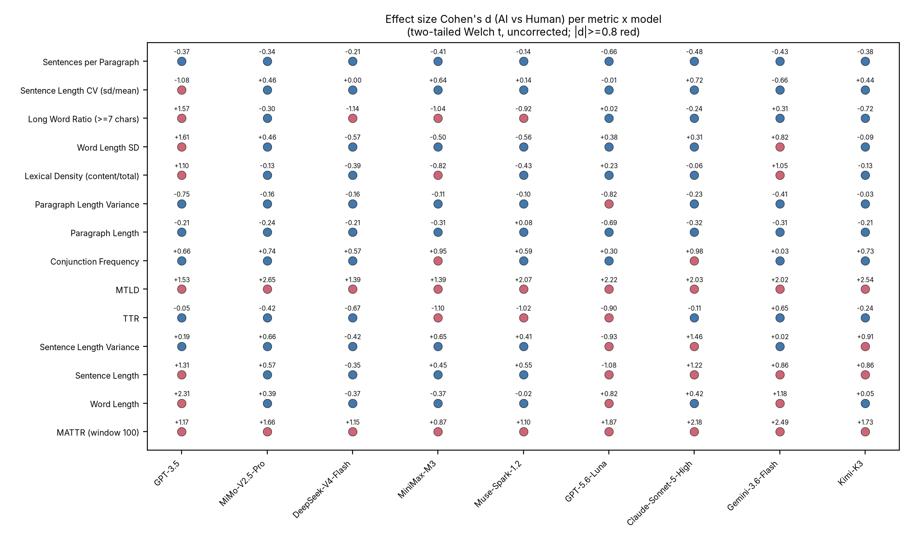
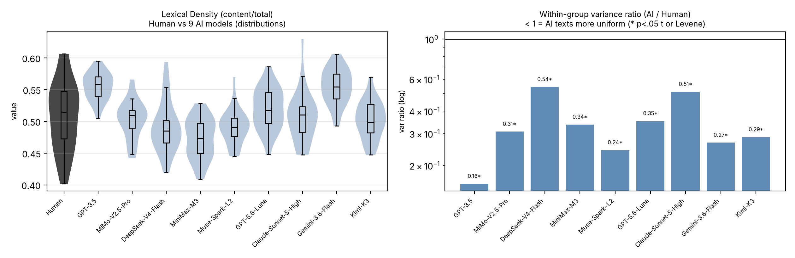
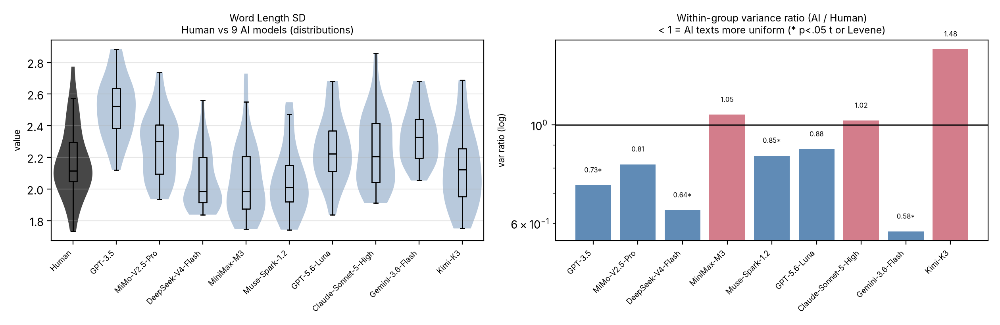
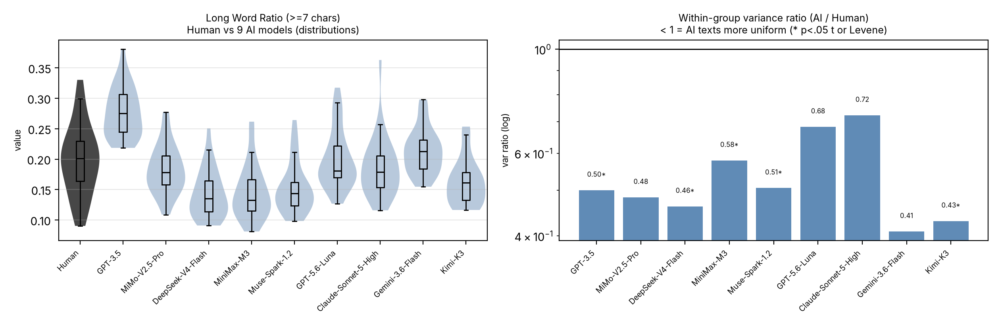
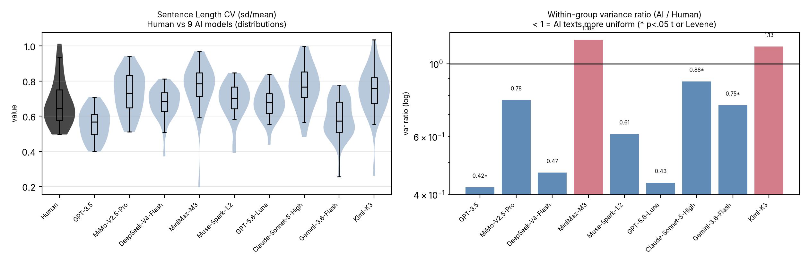
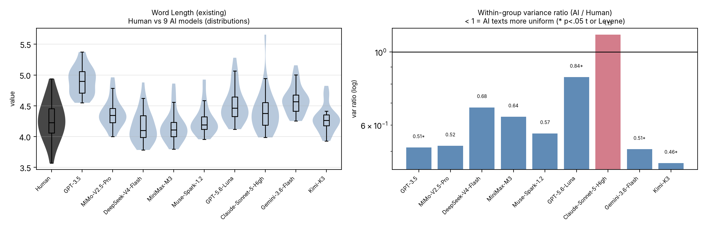
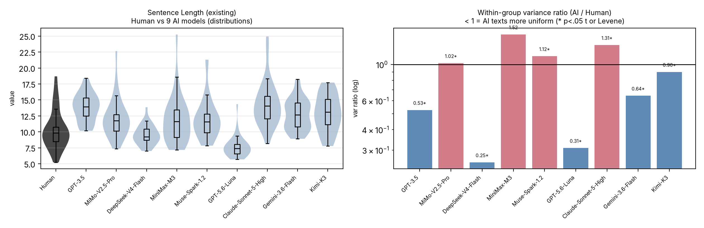
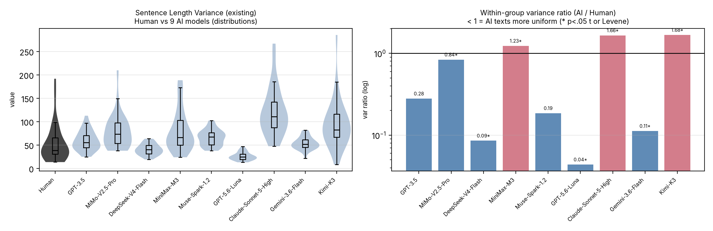

# 图注瘦身 + 中文引号修复 diff
2026-10-17

## 图注处理
- 图 1、图 2 图注只保留标题；颜色含义、指标构成、红点阈值（|d| ≥ 0.8）等说明移入 §3.2 正文引导句。
- 图 3、图 5 图注去掉括号注释；图 3 至图 7 的「左分布、右方差比」说明移入正文。
- 图 8、图 9 图注去掉单位括号；附录 B 引导句改为散文并补上单位说明（词长＝字符/词、句长＝词/句、段长＝词/段）。

## 中文引号修复
- 3 处直引号紧贴中文（「最难／最易」「离群」「较老一代」），排版器把开引号也判成右引号，出现两个右引号；已改为弯引号「“ ”」，核验 0 残留。

---

## EN

--- proposal_v14.md.bak-caps-pre	2026-10-17 16:09:25.825159812 +0800
+++ proposal_v14.md	2026-10-17 16:10:51.497963370 +0800
@@ -187,12 +187,12 @@
 
 Length residualization (H3/H4). The length-control analysis regresses each metric on word count (pooled linear fit across all texts), and the residuals are compared with independent-samples Welch t-tests (two-tailed, uncorrected). For TTR, 4/9 conditions remain significant after length control — and all four surviving differences reverse direction to AI > human, i.e., the raw "AI writes with less vocabulary diversity" pattern (5/9) is length-attributable, and what remains aligns with MATTR/MTLD. For conjunction frequency, 5/9 conditions remain significant (AI > human). A robustness check using ANCOVA (metric ~ group + word count) yields TTR 4/9 and conjunction frequency 2/9, indicating that the conjunction-frequency conclusion is sensitive to the control method; both are reported.
 
-Figures 1 and 2 summarise the pattern reported in this section: Figure 1 shows the indicator-by-model matrix of within-group variance ratios on a log scale, where cells below 1 indicate smaller variance in the AI group; Figure 2 shows the corresponding mean-comparison effect sizes.
+Figures 1 and 2 summarise the pattern reported in this section: Figure 1 shows the indicator-by-model matrix of within-group variance ratios on a log scale, where cells below 1 indicate smaller variance in the AI group and blue marks that side; it covers the nine core indicators, the eight locked metrics of Section 2.2 plus MATTR, together with the five supplementary indicators of Section 3.5. Figure 2 shows the corresponding mean-comparison effect sizes, with red points marking cells where |d| ≥ 0.8.
 
 
-{width=100%}
+{width=100%}
 
-{width=100%}
+{width=100%}
 
 ### 3.3 Random Forest Classifier (H5)
 
@@ -278,13 +278,13 @@
 
 Lexical density shows no consistent mean shift (median d = −0.13) but a uniformly smaller within-model dispersion (9/9 variance ratios below 1; median 0.31; Levene p < .05 in 9/9): AI texts are not more content-dense, they are more alike in content density. The long-word ratio behaves similarly (9/9 ratios below 1; median 0.50) with a small negative mean shift (median d = −0.30). Word-length SD separates weakly (6/9 below 1; median 0.85; median d = +0.31). Sentence-length CV is smaller in 7/9 models (median 0.75; median d = +0.14). Sentences per paragraph is lower in all nine models (9/9; median ratio 0.006), but this indicator is sensitive to paragraph segmentation — the human texts contain few blank lines — and should be read as formatting-sensitive rather than stylistic.
 
-Figures 3 to 7 present the distribution and within-model variance ratios for these five indicators; per-model statistics are provided in the accompanying materials.
+Figures 3 to 7 present, for each of these five indicators, the distribution on the left and the within-model variance ratio on the right; per-model statistics are provided in the accompanying materials.
 
-{width=100%}
+{width=100%}
 
 {width=100%}
 
-{width=100%}
+{width=100%}
 
 {width=100%}
 
@@ -521,11 +521,11 @@
 
 ## Appendix B: Per-metric distributions (locked metrics)
 
-Figures 8 to 15 give the two-panel representation (left: distributions across the human baseline and the nine AI models; right: within-group variance ratios with test markers) for the eight locked metrics. MATTR has no per-sample records in the analysis dataset and therefore appears only in Figures 1 and 2.
+Figures 8 to 15 show the eight locked metrics, each as a two-panel figure: the left panel gives the distributions across the human baseline and the nine AI models, and the right panel the within-group variance ratio with test markers. Word length is measured in characters per word, sentence length in words per sentence, and paragraph length in words per paragraph. MATTR has no per-sample records in the analysis dataset and therefore appears only in Figures 1 and 2.
 
-{width=100%}
+{width=100%}
 
-{width=100%}
+{width=100%}
 
 {width=100%}
 

---

## ZH

--- proposal_v14_zh.md.bak-caps-pre	2026-10-17 16:09:25.826349764 +0800
+++ proposal_v14_zh.md	2026-10-17 16:10:51.499345723 +0800
@@ -187,11 +187,11 @@
 
 长度残差化（H3/H4）。 长度控制分析的口径如下：各指标先对词数做线性回归（在全部文本上做合并拟合），再对残差做独立样本 Welch t 检验（双尾、不校正）。TTR 在长度控制后仍有 4/9 个条件显著——且这 4 个幸存差异的方向全部反转为 AI > 人类：即原始的「AI 词汇多样性更低」模式（5/9）可归因于长度，剩余部分与 MATTR/MTLD 一致。连词频率在长度控制后仍有 5/9 个条件显著（AI > 人类）。稳健性检查（ANCOVA：指标 ~ 组别 + 词数）给出 TTR 4/9、连词频率 2/9，说明连词频率的结论对控制方法敏感；两种方法的结果都予报告。
 
-本节的结果可先看两张总览图：图 1 以对数刻度展示指标 × 模型的组内方差比矩阵，其中小于 1 表示 AI 组内更齐；图 2 是对应的均值比较效应量。
+本节的结果可先看两张总览图：图 1 以对数刻度展示指标 × 模型的组内方差比矩阵，其中小于 1 表示 AI 组内更齐，蓝色即这一侧；它同时覆盖九个核心指标（2.2 节的八个锁定指标加 MATTR）与 3.5 节的五项增补指标。图 2 是对应的均值比较效应量，红点标出 |d| ≥ 0.8 的格子。
 
-{width=100%}
+{width=100%}
 
-{width=100%}
+{width=100%}
 
 ### 3.3 随机森林分类器（Random Forest Classifier）（H5）
 
@@ -234,7 +234,7 @@
 
 *表 3b. 总体随机森林分类器的混淆矩阵（299 个样本，跨 5 折分层分组 K 折交叉验证求和）。分类器正确识别出 262/269 篇 AI 文本，召回率 97.4%，但仅识别出 12/30 篇人类文本，召回率 40.0%，这反映了类别不平衡，以及在以 AI 文本为主的语料中检测人类写作的难度。*
 
-Gemini-3.6-Flash 与 GPT-3.5 并列最容易分类的条件（点估计均为 96.7%）；DeepSeek-V4-Flash 最难（78.3%）。不过，跨 5 折的 t 检验显示，Gemini 与 DeepSeek 之间的差异在统计上并不显著（t=1.581，p=0.189）；18.4 个百分点的差距落在折间噪声范围内，因此"最难／最易"的排序应理解为描述性的，而非推断性的。各条件的范围（78–97%）比总体分类器准确率所暗示的要宽得多，因为各条件设计是平衡的，避开了 269:30 的不平衡混淆。
+Gemini-3.6-Flash 与 GPT-3.5 并列最容易分类的条件（点估计均为 96.7%）；DeepSeek-V4-Flash 最难（78.3%）。不过，跨 5 折的 t 检验显示，Gemini 与 DeepSeek 之间的差异在统计上并不显著（t=1.581，p=0.189）；18.4 个百分点的差距落在折间噪声范围内，因此“最难／最易”的排序应理解为描述性的，而非推断性的。各条件的范围（78–97%）比总体分类器准确率所暗示的要宽得多，因为各条件设计是平衡的，避开了 269:30 的不平衡混淆。
 
 特征重要性（总体分类器，表 4）：
 
@@ -277,13 +277,13 @@
 
 实词率没有一致的均值差异（中位 d 为 −0.13），但组内离散度一致更小（9/9 个方差比小于 1；中位 0.31；Levene 在 9/9 个模型中显著）：AI 文本并非用词更实，而是彼此在这一项上更像。长词率表现相近（9/9 个方差比小于 1；中位 0.50），均值略低（中位 d 为 −0.30）。词长标准差只有弱分离（6/9 个方差比小于 1；中位 0.85；中位 d 为 +0.31）。句长变异系数在 7/9 个模型中更小（中位 0.75；中位 d 为 +0.14）。每段句数在九个模型中全部更低（9/9；中位方差比 0.006），但该指标对分段方式敏感，人类文本来自 Reddit、空行很少，因此应视为「格式敏感」指标，而非风格证据。
 
-图 3 至图 7 给出这五个指标的分布与组内方差比；逐模型统计量见随附材料。
+图 3 至图 7 给出这五个指标的两联图，左为分布、右为组内方差比；逐模型统计量见随附材料。
 
-{width=100%}
+{width=100%}
 
 {width=100%}
 
-{width=100%}
+{width=100%}
 
 {width=100%}
 
@@ -425,7 +425,7 @@
 - 用户写作题目模板："Write a 500 word story for the following prompt: {prompt_text}"（Huang et al. 2024 §3.1）
 - 解码参数：温度（Temperature）= 0.95（依据 Huang et al. 2024 §3.1）；来源未指明 max_tokens；未报告 top_p
 - 每个写作题目的生成数：约 2 次/题目（Huang et al. 2024 §3.1）；我们在每个写作题目可用的故事中随机选取 1 篇
-- 关键局限：生成参数由 Huang et al. (2024) 记录，而非来自 API 日志（撰写本文时未曾对照已发表论文进行核实；上述参数系事后依据已发表论文的 §3.1 与 §3.2 确认）。"500 word" 这一指令在我们的 9 个条件中为该条件所独有；这在一定程度上解释了为何 GPT-3.5 的字数（531 ± 40）低于其他无指令条件（664-878）。因此，GPT-3.5 表面上"离群"的文体特征，最好解释为一种数据集协议效应（长度指令 + 温度 0.95 + 双系统角色变体），而非"较老一代"模型的属性。
+- 关键局限：生成参数由 Huang et al. (2024) 记录，而非来自 API 日志（撰写本文时未曾对照已发表论文进行核实；上述参数系事后依据已发表论文的 §3.1 与 §3.2 确认）。"500 word" 这一指令在我们的 9 个条件中为该条件所独有；这在一定程度上解释了为何 GPT-3.5 的字数（531 ± 40）低于其他无指令条件（664-878）。因此，GPT-3.5 表面上“离群”的文体特征，最好解释为一种数据集协议效应（长度指令 + 温度 0.95 + 双系统角色变体），而非“较老一代”模型的属性。
 
 ### A.2 MiMo-V2.5-Pro (Xiaomi)
 - 服务商：Command Code Goat API（`https://api.commandcode.ai/provider/v1`，OpenAI 兼容）
@@ -521,11 +521,11 @@
 
 ## 附录 B：逐指标分布（锁定指标）
 
-图 8 至图 15 给出八个锁定指标的两联图（左：人类基线与九个 AI 模型的分布；右：带检验标记的组内方差比）。MATTR 在分析数据中没有逐篇记录，因此只出现在图 1 与图 2 中。
+图 8 至图 15 给出八个锁定指标的两联图：左为人类基线与九个 AI 模型的分布，右为带检验标记的组内方差比。词长单位为字符/词，句长为词/句，段落长度为词/段。MATTR 在分析数据中没有逐篇记录，因此只出现在图 1 与图 2 中。
 
-{width=100%}
+{width=100%}
 
-{width=100%}
+{width=100%}
 
 {width=100%}
 

