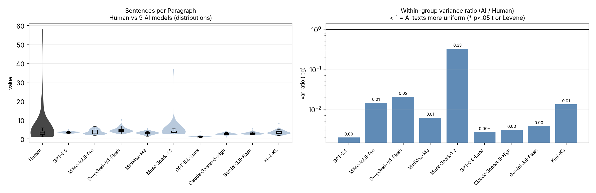

# §2「相关工作」折叠为引言 inline（审阅用 diff）
2026-10-17 · length-confound-archive · 基线为折叠前版本（当时名为 proposal_v13.md；折叠后已升版为 proposal_v14.md）

## 本次改动一览
1. 删除 ## 2. Related Work / ## 2. 相关工作 整章（各 10 段）。
2. 内容压缩为引言里两段 inline：P1＝人类 vs AI 文体比较（O'Sullivan 2025；GPT-WritingPrompts 与 Huang 等；Fan 等；Chakrabarty 2024a/2024b；Lucy & Bamman），P2＝测量问题（TTR 长度敏感 → MTLD 与 MATTR；连词与词汇多样性既有支持最强）。
3. 章号整体前移：3→2、4→3、5→4、6→5（含子节，中英两版）。
4. 交叉引用同步：§3.4→§2.4、§4.2→§3.2、§4.3→§3.3、§5→§4、Section 4.5→Section 3.5 等，约 30 处。
5. 参考文献 12 条全部仍被正文引用（逐条核过）。

## 统计
- EN：删 51 行 / 增 35 行
- ZH：删 51 行 / 增 35 行

---

## EN diff（proposal_v13.md）

--- proposal_v13.md.bak-sect2fold	2026-10-17 14:45:49.127713253 +0800
+++ proposal_v13.md	2026-10-17 14:47:10.199371628 +0800
@@ -4,7 +4,7 @@
 
 **Keywords:** stylometry, AI-generated text, computational stylistics, lexical diversity, conjunction frequency, Random Forest classifier, creative writing, multi-model comparison
 
-Do AI-generated text and human-written text differ systematically in structural style, and if so, which differences hold across diverse language models? This preliminary report quantifies stylistic differences using eight locked structural metrics (word length, sentence length, sentence length variance, type-token ratio, MTLD, conjunction frequency, paragraph length, and paragraph length variance), plus five supplementary indicators (lexical density, word-length standard deviation, long-word ratio, sentence-length coefficient of variation, and sentences per paragraph; Section 4.5), applied to 30 creative writing prompts, each paired with one human-authored story and AI-generated outputs from 9 contemporary models (GPT-3.5, MiMo-V2.5-Pro, DeepSeek-V4-Flash, MiniMax-M3, Muse-Spark-1.2-Contributor, Kimi-K3, Gemini-3.6-Flash, GPT-5.6-Luna, and Claude-Sonnet-5-High), yielding 299 observations. We compare each model's 30 texts against the 30 human texts with independent-samples Welch t-tests (two-tailed; no multiplicity correction; Cohen's d reported for every comparison), quantify within-model homogeneity across the nine core indicators (the eight locked metrics plus MATTR; variance ratios and Levene tests), and train a Random Forest classifier evaluated with StratifiedGroupKFold cross-validation (grouped by prompt). AI-generated texts are systematically **1.6× longer** than human-written texts in our sample (mean 719 vs 439 words). AI texts also show lower within-model variance than the human group in most metric comparisons — most consistently in the lexical and paragraph layers (MATTR, TTR, conjunction frequency, and paragraph-length variance: smaller variance in 9/9 models; median variance ratios 0.08–0.56). Length-residualization under the revised framework shows that the apparent vocabulary poverty of AI texts is length-attributable: the raw AI-lower TTR pattern (5/9 conditions) does not survive as such — the 4/9 conditions that remain significant after length control reverse to AI > human, aligning TTR with MATTR and MTLD. Conjunction-frequency differences partially persist (5/9 survive pooled residualization; 2/9 under an ANCOVA robustness check). The eight-metric classifier achieves 91.6% raw accuracy but only 68.7% balanced accuracy (MCC = 0.449, AUC = 0.867, human recall 12/30 = 40%), **essentially tied with a length-only baseline** at 69.4% balanced accuracy. **Findings are preliminary and underpowered for medium effects** (~30% power at r=0.3); acquisition-channel heterogeneity (4 distinct sources: direct API, third-party dataset, Manual Arena paste, Faro API) precludes model-level interpretation. Specific items this paper cannot confirm are listed in §6 Limitations.
+Do AI-generated text and human-written text differ systematically in structural style, and if so, which differences hold across diverse language models? This preliminary report quantifies stylistic differences using eight locked structural metrics (word length, sentence length, sentence length variance, type-token ratio, MTLD, conjunction frequency, paragraph length, and paragraph length variance), plus five supplementary indicators (lexical density, word-length standard deviation, long-word ratio, sentence-length coefficient of variation, and sentences per paragraph; Section 3.5), applied to 30 creative writing prompts, each paired with one human-authored story and AI-generated outputs from 9 contemporary models (GPT-3.5, MiMo-V2.5-Pro, DeepSeek-V4-Flash, MiniMax-M3, Muse-Spark-1.2-Contributor, Kimi-K3, Gemini-3.6-Flash, GPT-5.6-Luna, and Claude-Sonnet-5-High), yielding 299 observations. We compare each model's 30 texts against the 30 human texts with independent-samples Welch t-tests (two-tailed; no multiplicity correction; Cohen's d reported for every comparison), quantify within-model homogeneity across the nine core indicators (the eight locked metrics plus MATTR; variance ratios and Levene tests), and train a Random Forest classifier evaluated with StratifiedGroupKFold cross-validation (grouped by prompt). AI-generated texts are systematically **1.6× longer** than human-written texts in our sample (mean 719 vs 439 words). AI texts also show lower within-model variance than the human group in most metric comparisons — most consistently in the lexical and paragraph layers (MATTR, TTR, conjunction frequency, and paragraph-length variance: smaller variance in 9/9 models; median variance ratios 0.08–0.56). Length-residualization under the revised framework shows that the apparent vocabulary poverty of AI texts is length-attributable: the raw AI-lower TTR pattern (5/9 conditions) does not survive as such — the 4/9 conditions that remain significant after length control reverse to AI > human, aligning TTR with MATTR and MTLD. Conjunction-frequency differences partially persist (5/9 survive pooled residualization; 2/9 under an ANCOVA robustness check). The eight-metric classifier achieves 91.6% raw accuracy but only 68.7% balanced accuracy (MCC = 0.449, AUC = 0.867, human recall 12/30 = 40%), **essentially tied with a length-only baseline** at 69.4% balanced accuracy. **Findings are preliminary and underpowered for medium effects** (~30% power at r=0.3); acquisition-channel heterogeneity (4 distinct sources: direct API, third-party dataset, Manual Arena paste, Faro API) precludes model-level interpretation. Specific items this paper cannot confirm are listed in the Limitations section.
 
 ## 1. Introduction
 
@@ -14,35 +14,19 @@
 
 Most existing work on AI text characterization has focused on semantic coherence, factual accuracy, or surface-level detection. Fewer studies have employed computational stylometry, quantitative analysis of writing style features, to systematically compare AI and human text. Stylometric methods have a long history in authorship attribution and forensic linguistics (Juola, 2008), and they offer a principled framework for identifying structural patterns that persist across topics and genres.
 
-The present study addresses this gap by comparing 8 structural metrics across 9 contemporary AI models and human-authored stories, all written in response to the same 30 creative writing prompts. This design controls for topic and genre effects through prompt matching, compares each model's outputs against the human baseline as independent groups, and combines hypothesis-driven testing with machine learning classification.
+This study sits at the intersection of two strands of prior work. First, recent applications of stylometry reach high accuracy in distinguishing human from AI creative writing (O'Sullivan, 2025). Corpus work on prompt-matched stories, in particular the GPT-WritingPrompts collection, documents systematic human-versus-GPT-3.5 differences in character portrayal (Huang et al., 2024); our human baseline and prompt set come from the parent WritingPrompts corpus (Fan et al., 2018), and the shorter stories in the GPT-3.5 condition (531 ± 40 words) reflect that collection's 500-word instruction rather than a model property. Second, studies of LLM creativity find that AI prose is fluent but comparatively lacking in idiosyncratic style (Chakrabarty et al., 2024a) and that writers edit model output to inject personal voice (Chakrabarty et al., 2024b), while genre conventions further shape model output (Lucy & Bamman, 2021); together these findings suggest that AI text may be more uniform than human text, the prediction that our variance-based tests target directly.
 
-Our study makes three contributions. First, it examines multiple AI systems rather than treating "AI text" as monolithic. Second, it uses a prompt-matched design that controls for prompt-level confounds. Third, it combines independent-samples group tests for specific directional hypotheses with Random Forest classification for overall discriminability.
-
-The analysis focuses on creative short fiction from Reddit's r/WritingPrompts, a genre where structural variation is naturally high and where AI writing assistance is increasingly common. By quantifying which structural stereotypes hold empirically and which do not, this study provides a more nuanced, evidence-based understanding of how AI writing differs from human writing.
-
-## 2. Related Work
-
-The study builds on several lines of research in computational stylometry, AI text generation, and creative writing evaluation.
-
-Fan, Lewis, and Dauphin (2018) introduced the WritingPrompts dataset, a large-scale collection of over 300,000 human-written stories paired with creative prompts from Reddit's r/WritingPrompts. The dataset's prompt-matched structure makes it ideal for controlled comparisons between human and AI text. We draw our human baseline and prompt set from this corpus.
+A second strand concerns measurement. Vocabulary-richness indices differ in how they treat text length: raw type-token ratio is length-sensitive, which motivated length-controlled alternatives such as MTLD (McCarthy & Jarvis, 2010) and MATTR with a moving window (Covington & McFall, 2010; the window is fixed at 100 tokens in this study). Because length covaries with stylistic variables more broadly, comparisons that ignore it risk reporting the statistics of length rather than of style. Within our hypothesis set, conjunction frequency and vocabulary diversity have the strongest prior support, whereas the evidence on sentence- and paragraph-length variance is more mixed; the report therefore tests four directional hypotheses plus one classification benchmark (H5) across nine contemporary models.
 
-Huang et al. (2024) extended the WritingPrompts corpus by generating GPT-3.5 responses to the same prompts, creating the GPT-WritingPrompts dataset. Their analysis characterized GPT-3.5 vs human-written stories along six dimensions of character portrayal (valence, arousal, dominance, intellect, appearance, power); they did not directly report word count, dialogue frequency, or emotional description differences. Our finding that GPT-3.5 word counts are lower than other conditions (531 ± 40 vs 664-878) reflects the '500 word story' instruction in their data-collection protocol rather than a model-intrinsic property. The GPT-3.5 condition in our analysis uses stories from this dataset, representing an "older generation" AI baseline.
+The present study addresses this gap by comparing eight locked structural metrics across 9 contemporary AI models and human-authored stories, all written in response to the same 30 creative writing prompts. This design controls for topic and genre effects through prompt matching, compares each model's outputs against the human baseline as independent groups, and combines hypothesis-driven testing with machine learning classification.
 
-Chakrabarty et al. (2024a) examined whether LLMs can serve as creative writing assistants, finding that while AI text is fluent and coherent, it tends to lack the stylistic idiosyncrasies that characterize individual human writers. This supports the hypothesis that AI text may be structurally more uniform than human text, a prediction we test with our variance-based metrics.
-
-Chakrabarty et al. (2024b) extended this line of inquiry by studying how professional writers interact with LLMs during the creative process. They found that writers often edit AI-generated text to inject personal style, suggesting that AI text lacks the stylistic fingerprints of individual authorship. This motivates our focus on vocabulary diversity metrics (TTR and MTLD).
-
-Lucy and Bamman (2021) analyzed genre biases in language model outputs, finding that AI-generated fiction tends to reproduce stereotypical genre conventions. Their work suggests that structural features of AI text may vary by genre, and that creative fiction may amplify certain AI tendencies such as conjunction overuse. Our study controls for genre by using a single corpus (creative fiction).
-
-O'Sullivan (2025) applied Burrows' Delta, a classical stylometric method, to distinguish human from AI-generated creative writing, demonstrating that traditional authorship attribution techniques remain effective for AI detection. This supports our use of stylometric metrics and motivates the inclusion of MTLD and TTR.
-
-McCarthy and Jarvis (2010) validated MTLD as a robust alternative to TTR. Unlike TTR, which is sensitive to text length, MTLD controls for length by computing the mean length of word sequences that maintain a TTR above a threshold. We include both metrics to capture complementary aspects of vocabulary diversity.
+Our study makes three contributions. First, it examines multiple AI systems rather than treating "AI text" as monolithic. Second, it uses a prompt-matched design that controls for prompt-level confounds. Third, it combines independent-samples group tests for specific directional hypotheses with Random Forest classification for overall discriminability.
 
-Collectively, these studies suggest that conjunction frequency and vocabulary diversity have the strongest prior literature support among our hypotheses, while sentence and paragraph length variance findings are more mixed. Our study extends this work by testing 4 directional hypotheses plus 1 classification benchmark (H5) across 9 contemporary AI models.
+The analysis focuses on creative short fiction from Reddit's r/WritingPrompts, a genre where structural variation is naturally high and where AI writing assistance is increasingly common. By quantifying which structural stereotypes hold empirically and which do not, this study provides a more nuanced, evidence-based understanding of how AI writing differs from human writing.
 
-## 3. Method
+## 2. Method
 
-### 3.1 Data
+### 2.1 Data
 
 The study uses 30 writing prompts from the Reddit WritingPrompts corpus (Fan et al., 2018). For each prompt, we collected one human-authored story and one AI-generated story from each of 9 AI models, yielding up to 30 prompt-matched observations per condition.
 
@@ -64,9 +48,9 @@
 
 Kimi-K3 is missing 1 observation (prompt 26, "best friend speaks in rhyme", repeatedly timed out across multiple API providers). All other AI conditions have complete N=30 coverage.
 
-### 3.2 Metrics
+### 2.2 Metrics
 
-We extract eight locked structural metrics from each text using spaCy (en_core_web_sm) for tokenization, sentence splitting, and POS tagging, plus custom Python functions for paragraph analysis. Five supplementary indicators at the word, sentence and paragraph levels (Section 4.5) are analysed separately and are not part of the locked set.
+We extract eight locked structural metrics from each text using spaCy (en_core_web_sm) for tokenization, sentence splitting, and POS tagging, plus custom Python functions for paragraph analysis. Five supplementary indicators at the word, sentence and paragraph levels (Section 3.5) are analysed separately and are not part of the locked set.
 
 | # | Metric | Definition | Implementation |
 |---|--------|------------|----------------|
@@ -79,7 +63,7 @@
 | 7 | Paragraph length | Mean words per paragraph | Average word count per paragraph (split on double newline) |
 | 8 | Paragraph length variance | Population variance of paragraph lengths | `numpy.var` over paragraph word counts |
 
-### 3.3 Hypotheses
+### 2.3 Hypotheses
 
 We test 4 directional hypotheses using condition-level group comparisons (each AI condition's texts are compared as one group against the 30 human texts):
 
@@ -92,7 +76,7 @@
 
 H5 tests whether a Random Forest classifier using all eight locked metrics achieves balanced accuracy significantly above the 50% chance baseline (permutation test, p<0.05, n_perm=1000), evaluated with 5-fold StratifiedGroupKFold cross-validation (group=prompt_id).
 
-### 3.4 Statistical Analysis
+### 2.4 Statistical Analysis
 
 Hypothesis testing (revised framework). Condition-level comparisons are performed as independent-samples group comparisons: for each AI condition, the model's 30 texts form one group and the 30 human texts form the other, and we apply Welch's independent-samples t-test (two-tailed). This replaces the earlier paired Wilcoxon signed-rank framework: the paired design (one human text vs. one AI text per prompt) is superseded, and its results are not mixed with those reported below. No multiple-comparison correction is applied; exact p-values are reported together with Cohen's d for every comparison, and the two should be read jointly — with larger samples, small fluctuations can push p below .05, so the effect size carries the interpretive weight. As a robustness check, every comparison is also run as a Mann-Whitney U (rank-sum) test; across the 81 metric × condition comparisons the two approaches agree at α = 0.05 in 72 cases (89%). MATTR is computed with a fixed window of 100; no cross-window comparison is performed, and the earlier window-sensitivity results are retained as a robustness note only (not as a main analysis).
 
@@ -106,9 +90,9 @@
 
 MTLD Implementation Note. The MTLD metric was implemented following the algorithm described in McCarthy and Jarvis (2010), using a TTR threshold of 0.72 and segment size of 10. The implementation computes forward and backward pass MTLD and reports their mean. Independent replication using the `lexical_diversity` Python package (which provides the original authors' reference implementation) is recommended for confirmation studies. MATTR Implementation Note. The MATTR metric (moving-average type–token ratio) follows Covington and McFall (2010), who introduce the moving-window algorithm and show that the resulting measure is independent of text length. The window size is fixed at 100 tokens for every text and every condition; because MATTR values depend on the window size, the window is held constant rather than tuned.
 
-## 4. Results
+## 3. Results
 
-### 4.1 Descriptive Statistics
+### 3.1 Descriptive Statistics
 
 Tables 1a and 1b present the mean and standard deviation of word count and each stylometric metric across all 9 analyzed AI conditions and the human baseline.
 
@@ -142,7 +126,7 @@
 
 Notable distributional anomalies: Muse-Spark-1.2-Contributor shows high paragraph length (mean 71.7 words, SD 135.0; SD exceeds the mean by 1.9×), suggesting a bimodal distribution where some outputs are heavily segmented by formatting rules; per-text inspection in `results_v1.json` confirms this pattern. Human paragraph length variance (806.6 ± 1222.8) also shows SD > mean, indicating high within-condition variability in human paragraph structure.
 
-### 4.2 Group Comparisons and Within-Model Homogeneity (revised framework)
+### 3.2 Group Comparisons and Within-Model Homogeneity (revised framework)
 
 Table 2a summarizes, for each metric, results across the 9 AI conditions under the revised framework (independent-samples Welch t-tests, two-tailed, no multiplicity correction; Cohen's d; Levene test for equality of variances). Table 2b details the primary lexical metric, MATTR (fixed window 100).
 
@@ -181,21 +165,21 @@
 Three readings across metrics.
 
 1. Homogeneity is strongest in the lexical and paragraph layers. On MATTR, TTR, conjunction frequency, and paragraph-length variance, the AI groups show smaller within-model variance than the human group in 9/9 models (median variance ratios 0.08–0.56). In this sample, what makes AI text recognizable at a glance is not primarily where its means sit, but how tightly it clusters.
-2. MTLD is the exception. MTLD is the only metric where the AI groups' variance is *larger* than the human group's (smaller in just 1/9 models; median ratio 2.40), while simultaneously showing the largest mean-difference effect sizes (median d = +2.03; 9/9 significant). This mean-vs-variance dissociation is discussed in §5.
-3. The lexical metrics conflict in direction, and the conflict is length-shaped. TTR shows *lower* values for AI (median d = −0.42; significant in 5/9), while MATTR and MTLD show *higher* values for AI (median d = +1.66 and +2.03; significant in 9/9). TTR is strongly length-dependent (r ≈ −0.54 with word count); with AI texts ~1.6× longer than human texts, its raw direction is length-confounded. After length control the conflict largely resolves: the surviving TTR differences reverse to AI > human (4/9; see the residualization note above), aligning TTR with MATTR and MTLD. §5 addresses this directly.
+2. MTLD is the exception. MTLD is the only metric where the AI groups' variance is *larger* than the human group's (smaller in just 1/9 models; median ratio 2.40), while simultaneously showing the largest mean-difference effect sizes (median d = +2.03; 9/9 significant). This mean-vs-variance dissociation is discussed in §4.
+3. The lexical metrics conflict in direction, and the conflict is length-shaped. TTR shows *lower* values for AI (median d = −0.42; significant in 5/9), while MATTR and MTLD show *higher* values for AI (median d = +1.66 and +2.03; significant in 9/9). TTR is strongly length-dependent (r ≈ −0.54 with word count); with AI texts ~1.6× longer than human texts, its raw direction is length-confounded. After length control the conflict largely resolves: the surviving TTR differences reverse to AI > human (4/9; see the residualization note above), aligning TTR with MATTR and MTLD. §4 addresses this directly.
 
 Length residualization (H3/H4). The length-control analysis was re-run under the revised framework: each metric is regressed on word count (pooled linear fit across all texts), and the residuals are compared with independent-samples Welch t-tests (two-tailed, uncorrected). For TTR, 4/9 conditions remain significant after length control — and all four surviving differences reverse direction to AI > human, i.e., the raw "AI writes with less vocabulary diversity" pattern (5/9) is length-attributable, and what remains aligns with MATTR/MTLD. For conjunction frequency, 5/9 conditions remain significant (AI > human). A robustness check using ANCOVA (metric ~ group + word count) yields TTR 4/9 and conjunction frequency 2/9, indicating that the conjunction-frequency conclusion is sensitive to the control method; both are reported. (An earlier paired analysis had reported 0/9 for both metrics; that result does not replicate under the revised framework.)
 
 Figures 1 and 2 summarise the pattern reported in this section: Figure 1 shows the indicator-by-model matrix of within-group variance ratios on a log scale (cells below 1 indicate smaller variance in the AI group), and Figure 2 shows the corresponding mean-comparison effect sizes.
 
 
-{width=100%}
+{width=100%}
 
 {width=100%}
 
-### 4.3 Random Forest Classifier (H5)
+### 3.3 Random Forest Classifier (H5)
 
-We use StratifiedGroupKFold cross-validation (n_splits=5, group=prompt_id) to prevent prompt-level data leakage. Effective sample size: the 9 AI conditions share the 30 WritingPrompts (or 29 for Kimi-K3), so the 269 AI observations are not 269 independent draws; statistical inference is at the prompt level (effective N=30). The revised-framework group comparisons (§3.4) treat each condition's texts as one group against the 30 human texts. Generalization to other prompts beyond the Fan et al. (2018) source is limited. In addition to raw accuracy, we report balanced accuracy, per-class F1, macro F1, ROC AUC, and Matthews Correlation Coefficient (MCC), alongside the majority-class baseline (predicting all observations as AI).
+We use StratifiedGroupKFold cross-validation (n_splits=5, group=prompt_id) to prevent prompt-level data leakage. Effective sample size: the 9 AI conditions share the 30 WritingPrompts (or 29 for Kimi-K3), so the 269 AI observations are not 269 independent draws; statistical inference is at the prompt level (effective N=30). The revised-framework group comparisons (§2.4) treat each condition's texts as one group against the 30 human texts. Generalization to other prompts beyond the Fan et al. (2018) source is limited. In addition to raw accuracy, we report balanced accuracy, per-class F1, macro F1, ROC AUC, and Matthews Correlation Coefficient (MCC), alongside the majority-class baseline (predicting all observations as AI).
 
 Overall classifier (any AI vs human, 299 samples): Raw accuracy = 91.6% ± 1.6% (per-fold range 89.8%–93.3%). However, on the 269:30 imbalanced data, the majority-class baseline is 90.0%, so raw accuracy exceeds the baseline by only 1.6 percentage points (computed from 91.6% − 90.0% = 1.6pp; unrounded 1.67pp). The more honest metrics on imbalanced data are:
 
@@ -249,11 +233,11 @@
 | 7 | Word length | 0.074 |
 | 8 | Paragraph length variance | 0.061 |
 
-*Table 4. Feature importance rankings from the overall Random Forest classifier (StratifiedGroupKFold, 5-fold, group=prompt_id, n_estimators=100, random_state=42; permutation importance cross-checked in supplementary materials, results_v1.json). MTLD dominance should be interpreted with caution: see §5 for length-confound analysis.*
+*Table 4. Feature importance rankings from the overall Random Forest classifier (StratifiedGroupKFold, 5-fold, group=prompt_id, n_estimators=100, random_state=42; permutation importance cross-checked in supplementary materials, results_v1.json). MTLD dominance should be interpreted with caution: see §4 for length-confound analysis.*
 
-MTLD (using the lexical_diversity reference implementation; see §3.4) ranks as the dominant feature (0.340 importance), followed by sentence length (0.127) and TTR (0.112). Conjunction frequency ranks 6th (0.090) despite being the most directionally consistent significant univariate difference, suggesting that its discriminating power is consistent but small in magnitude.
+MTLD (using the lexical_diversity reference implementation; see §2.4) ranks as the dominant feature (0.340 importance), followed by sentence length (0.127) and TTR (0.112). Conjunction frequency ranks 6th (0.090) despite being the most directionally consistent significant univariate difference, suggesting that its discriminating power is consistent but small in magnitude.
 
-### 4.4 Additional Finding: Word Length (Candidate H6)
+### 3.4 Additional Finding: Word Length (Candidate H6)
 
 Word length (chars/word) emerged as a candidate metric when inspecting feature importance from the overall classifier (where it ranked 7th of 8 features) and the GPT-3.5 per-condition classifier (where it was the top feature with importance 0.278). Under the revised framework, group comparisons for word length are significant in 3 of 9 conditions (GPT-3.5, GPT-5.6-Luna, Gemini-3.6-Flash; all AI > human; Table 2a), and the AI groups' word-length variance is smaller than the human group's in 8/9 conditions. Notably, word length is the metric whose differences are *not* eliminated by length control: after residualizing on word count, significant differences increase to 5 of 9 conditions (GPT-3.5, MiMo-V2.5-Pro, GPT-5.6-Luna, Claude-Sonnet-5-High, Gemini-3.6-Flash; AI > human), and an ANCOVA robustness check retains 3 of 9 (GPT-3.5, MiniMax-M3, Gemini-3.6-Flash). If anything, text length masks the word-length difference: AI texts are longer, and longer texts use shorter words (r = −0.17 between word length and word count), which dilutes the raw contrast.
 
@@ -271,9 +255,9 @@
 
 *Table 5. Word length: group comparisons (independent-samples Welch t-tests, two-tailed, uncorrected) and length-controlled results (pooled residualization on word count). ΔM = M(AI) − M(Human). 3/9 conditions show raw significant differences; 5/9 survive length control. Three descriptive patterns: GPT-3.5 is an outlier (+15.0% vs human); Gemini-3.6-Flash, despite being recent, also uses longer words (+7.5%); the modern open-source models (DeepSeek-V4-Flash, MiniMax-M3, Muse-Spark, Kimi-K3) show no significant raw differences. This finding is post-hoc (see metric-specification.md, 2026-08-05) and is reported as an 'Additional Finding' rather than as a pre-registered hypothesis (H6 candidate); it requires independent confirmation at N=90.*
 
-### 4.5 Supplementary Indicators (Exploratory)
+### 3.5 Supplementary Indicators (Exploratory)
 
-To extend the analysis beyond the eight locked metrics, five supplementary indicators were computed on the same 299 texts with the same spaCy pipeline: lexical density (content-word ratio, with content words defined as NOUN, VERB, ADJ, ADV and PROPN), the standard deviation of word length, the proportion of long words (at least 7 characters), the coefficient of variation of sentence length (SD divided by the mean), and the mean number of sentences per paragraph. Each indicator was subjected to the same two-dimensional protocol as Section 3.4: per-model Welch t-tests against the 30 human texts (two-tailed, uncorrected) and within-model variance ratios with Levene tests. These results are exploratory and are reported for completeness; they were not part of the pre-specified hypotheses.
+To extend the analysis beyond the eight locked metrics, five supplementary indicators were computed on the same 299 texts with the same spaCy pipeline: lexical density (content-word ratio, with content words defined as NOUN, VERB, ADJ, ADV and PROPN), the standard deviation of word length, the proportion of long words (at least 7 characters), the coefficient of variation of sentence length (SD divided by the mean), and the mean number of sentences per paragraph. Each indicator was subjected to the same two-dimensional protocol as Section 2.4: per-model Welch t-tests against the 30 human texts (two-tailed, uncorrected) and within-model variance ratios with Levene tests. These results are exploratory and are reported for completeness; they were not part of the pre-specified hypotheses.
 
 Lexical density shows no consistent mean shift (median d = −0.13) but a uniformly smaller within-model dispersion (9/9 variance ratios below 1; median 0.31; Levene p < .05 in 9/9): AI texts are not more content-dense, they are more alike in content density. The long-word ratio behaves similarly (9/9 ratios below 1; median 0.50) with a small negative mean shift (median d = −0.30). Word-length SD separates weakly (6/9 below 1; median 0.85; median d = +0.31). Sentence-length CV is smaller in 7/9 models (median 0.75; median d = +0.14). Sentences per paragraph is lower in all nine models (9/9; median ratio 0.006), but this indicator is sensitive to paragraph segmentation — the human texts contain few blank lines — and should be read as formatting-sensitive rather than stylistic.
 
@@ -289,7 +273,7 @@
 
 {width=100%}
 
-## 5. Discussion
+## 4. Discussion
 
 The results paint a nuanced picture of how AI-generated text differs structurally from human writing.
 
@@ -309,7 +293,7 @@
 
 ### Model-Level Heterogeneity Across Models
 
-The data reveal a clear pattern across model generations and architectures. GPT-3.5 shows the strongest structural differences from human text in this dataset: it uses markedly longer words (4.91 vs 4.27, +15.0%), produces far more uniform paragraph lengths (variance 147.7 vs 806.6), and is among the easiest to classify (96.7% accuracy). GPT-5.6-Luna, while more recent, takes uniformity even further — its mean paragraph length is 10.1 ± 9.2 words (1/4 to 1/7 of all other conditions), raising formatting concerns discussed in §5 H1/H2 limitation and newline sensitivity paragraphs. This condition currently shows the lowest sentence length variance (26.4), lowest paragraph length variance (86.5), and lowest TTR (0.450); classification accuracy is 91.7% (per Table 3). In contrast, newer open-source models (MiMo-V2.5-Pro, DeepSeek-V4-Flash, Muse-Spark, MiniMax-M3) show smaller structural differences: their word lengths are closer to human norms (4.16–4.38 chars/word vs. human 4.27), their paragraph structures are more varied, and they are harder to classify (78.3-85.0% accuracy, per Table 3). This suggests that as language models improve and diversify architecturally, they show pipeline-level heterogeneity, with several recent open-source models showing smaller differences on some metrics than older models, though some models like GPT-3.5 and the GPT-5.6 series remain clearly distinguishable. Gemini-3.6-Flash is a notable outlier: despite being a recent model, it is tied with GPT-3.5 at 96.7% classification accuracy as the most easily classified condition, driven by its distinctive vocabulary diversity profile (TTR 0.547, the highest among all conditions, and MTLD 14.92 [lexical_diversity reference value, see §3.4]). Note that Gemini's 28/30 Arena-generated stories (with 2/30 from Faro API for content-policy-blocked prompts p3 and p10) reflect content-policy restrictions rather than methodological choices; the condition's N=30 is complete.
+The data reveal a clear pattern across model generations and architectures. GPT-3.5 shows the strongest structural differences from human text in this dataset: it uses markedly longer words (4.91 vs 4.27, +15.0%), produces far more uniform paragraph lengths (variance 147.7 vs 806.6), and is among the easiest to classify (96.7% accuracy). GPT-5.6-Luna, while more recent, takes uniformity even further — its mean paragraph length is 10.1 ± 9.2 words (1/4 to 1/7 of all other conditions), raising formatting concerns discussed in §4 H1/H2 limitation and newline sensitivity paragraphs. This condition currently shows the lowest sentence length variance (26.4), lowest paragraph length variance (86.5), and lowest TTR (0.450); classification accuracy is 91.7% (per Table 3). In contrast, newer open-source models (MiMo-V2.5-Pro, DeepSeek-V4-Flash, Muse-Spark, MiniMax-M3) show smaller structural differences: their word lengths are closer to human norms (4.16–4.38 chars/word vs. human 4.27), their paragraph structures are more varied, and they are harder to classify (78.3-85.0% accuracy, per Table 3). This suggests that as language models improve and diversify architecturally, they show pipeline-level heterogeneity, with several recent open-source models showing smaller differences on some metrics than older models, though some models like GPT-3.5 and the GPT-5.6 series remain clearly distinguishable. Gemini-3.6-Flash is a notable outlier: despite being a recent model, it is tied with GPT-3.5 at 96.7% classification accuracy as the most easily classified condition, driven by its distinctive vocabulary diversity profile (TTR 0.547, the highest among all conditions, and MTLD 14.92 [lexical_diversity reference value, see §2.4]). Note that Gemini's 28/30 Arena-generated stories (with 2/30 from Faro API for content-policy-blocked prompts p3 and p10) reflect content-policy restrictions rather than methodological choices; the condition's N=30 is complete.
 
 ### Vocabulary Diversity as the Dominant Classifier Feature
 
@@ -317,7 +301,7 @@
 
 ### Lexical Diversity: Direction Conflict and the MTLD Variance Anomaly
 
-Under the revised framework, the three lexical-diversity metrics point in different directions at the group level. TTR indicates that AI texts are *less* lexically diverse (lower TTR; median d = −0.42, significant in 5/9), whereas MATTR (window 100) and MTLD indicate that AI texts are *more* diverse (median d = +1.66 and +2.03; significant in 9/9). This is the length confound of this report in miniature: TTR is strongly length-dependent (r ≈ −0.54 between TTR and word count across the sample), and AI texts here are ~1.6× longer than human texts, so a direction reversal in TTR is expected; MATTR and MTLD show much weaker length associations (r ≈ +0.22 and +0.12 respectively). Consistent with this, length control largely resolves the conflict: the raw AI-lower TTR differences do not survive as such, and the surviving residualized differences (4/9) reverse to AI > human — aligning TTR with MATTR and MTLD (§4.2). We report the conflict and its length-shaped resolution explicitly; the planned N=90 replication should adjudicate it formally.
+Under the revised framework, the three lexical-diversity metrics point in different directions at the group level. TTR indicates that AI texts are *less* lexically diverse (lower TTR; median d = −0.42, significant in 5/9), whereas MATTR (window 100) and MTLD indicate that AI texts are *more* diverse (median d = +1.66 and +2.03; significant in 9/9). This is the length confound of this report in miniature: TTR is strongly length-dependent (r ≈ −0.54 between TTR and word count across the sample), and AI texts here are ~1.6× longer than human texts, so a direction reversal in TTR is expected; MATTR and MTLD show much weaker length associations (r ≈ +0.22 and +0.12 respectively). Consistent with this, length control largely resolves the conflict: the raw AI-lower TTR differences do not survive as such, and the surviving residualized differences (4/9) reverse to AI > human — aligning TTR with MATTR and MTLD (§3.2). We report the conflict and its length-shaped resolution explicitly; the planned N=90 replication should adjudicate it formally.
 
 A second anomaly concerns MTLD's *variance* structure: it is the only metric for which the AI groups' within-model variance exceeds the human group's (median variance ratio 2.40; smaller in just 1/9 models), while showing the largest mean-difference effects (median d = +2.03). No other metric shows this mean-vs-variance dissociation. Possible mechanisms — the segment-threshold construction of MTLD, residual length effects, or genuine cross-model variation — are left open for the N=90 replication. Accordingly, MTLD should not be treated as the report's strongest discriminator (see also the classifier caveats below).
 
@@ -331,9 +315,9 @@
 
 Third, when word count is added as a ninth feature to the classifier, accuracy rises to 95.7% and word count itself becomes the second most important feature (28.1%) behind MTLD (29.4%); MTLD declines from 34.0% to 29.4% (a 4.6 pp drop), while word count absorbs 28.1% of importance, indicating substantial shared variance between length and MTLD. A classifier trained without MTLD (using the other 7 features only) still achieves 91.0% raw accuracy (about 1 percentage point above the 90.0% majority-class baseline), suggesting that the remaining features may carry non-trivial signal independently. Balanced accuracy for the no-MTLD ablation is not reported here as it requires re-running the StratifiedGroupKFold pipeline without the MTLD feature; this is deferred to the supplementary materials.
 
-The most conservative interpretation is that MTLD dominance is partially but not fully explained by length. Approximately 28% of the total feature importance is captured by word count, though this shares substantial variance with MTLD (correlation analysis §5); the discriminating-power attribution requires residualization analysis at N=90. MTLD's discriminating power, while still significant in the multivariate classifier, is partially confounded with text length; the residualization-based adjudication is deferred to N=90 (Future Work). With the corrected lexical_diversity values and the revised length-control analysis, the MTLD-direction-vs-TTR-direction consistency is resolved: after length control, TTR's surviving differences reverse to AI > human, aligning with MATTR and MTLD (§4.2, §5). Future work at N=90 should formally control for length through regression-based approaches (e.g., residualized MTLD after regressing on word count) or exact length-matching designs.
+The most conservative interpretation is that MTLD dominance is partially but not fully explained by length. Approximately 28% of the total feature importance is captured by word count, though this shares substantial variance with MTLD (correlation analysis §4); the discriminating-power attribution requires residualization analysis at N=90. MTLD's discriminating power, while still significant in the multivariate classifier, is partially confounded with text length; the residualization-based adjudication is deferred to N=90 (Future Work). With the corrected lexical_diversity values and the revised length-control analysis, the MTLD-direction-vs-TTR-direction consistency is resolved: after length control, TTR's surviving differences reverse to AI > human, aligning with MATTR and MTLD (§3.2, §4). Future work at N=90 should formally control for length through regression-based approaches (e.g., residualized MTLD after regressing on word count) or exact length-matching designs.
 
-## 6. Conclusion
+## 5. Conclusion
 
 This study finds that AI-generated creative text differs from human-written creative text primarily in being 1.6× longer on average, with length explaining part — but not all — of the apparent univariate stylistic differences. Specifically:
 
@@ -342,7 +326,7 @@
 - Conjunction overuse (H4, CCONJ+SCONJ): raw group differences in 7/9 conditions; partially persists under length control (5/9 pooled residualization; 2/9 under ANCOVA). An earlier claim that H4 is "entirely attributable to text length" does not replicate under the revised framework, and the method sensitivity is flagged rather than resolved.
 - Sentence-length uniformity (H1): not supported — significant group differences in 5/9 conditions, mostly in the direction of *higher* AI sentence-length variance; GPT-5.6-Luna is the lone lower-variance exception. Paragraph-length variance (H2): significant in 2/9 conditions (GPT-3.5, GPT-5.6-Luna; both AI-lower).
 
-Within-model homogeneity. Across metrics, the AI groups cluster more tightly than the human group in most comparisons — 9/9 models on MATTR, TTR, conjunction frequency, and paragraph-length variance (median variance ratios 0.08–0.56), consistent with the observation that within-model stylistic homogeneity is a primary cue for recognizing AI text at a glance. MTLD is the sole variance-level counter-example (median ratio 2.40), and the raw lexical-metric direction conflict largely resolves under length control (§4.2); both points are flagged for the N=90 replication.
+Within-model homogeneity. Across metrics, the AI groups cluster more tightly than the human group in most comparisons — 9/9 models on MATTR, TTR, conjunction frequency, and paragraph-length variance (median variance ratios 0.08–0.56), consistent with the observation that within-model stylistic homogeneity is a primary cue for recognizing AI text at a glance. MTLD is the sole variance-level counter-example (median ratio 2.40), and the raw lexical-metric direction conflict largely resolves under length control (§3.2); both points are flagged for the N=90 replication.
 
 The 8-metric classifier shows modest practical value: raw accuracy 91.6% (vs 90.0% majority-class baseline, +1.6pp), balanced accuracy 68.7% (vs 69.4% length-only baseline, essentially tied), MCC 0.449 (vs 0.335 length-only, +35% relative), AUC 0.867, human recall 12/30 = 40%. The length-only baseline (single feature: word count) achieves statistically indistinguishable performance, suggesting the 8 stylistic metrics provide incremental value primarily through their contribution to MCC rather than to balanced accuracy.
 
@@ -350,7 +334,7 @@
 
 MTLD's status is unresolved: the classifier's first-ranked feature (importance 0.340) comes from an implementation with anomalously high values (range 121.7-452.6 in an earlier calculation), which we replaced with the `lexical_diversity` package reference implementation (range 13.3-15.3). However, the 34.0% importance value was computed on the older implementation; the importance ranking under the reference implementation, as well as the length-residualized importance, remains to be verified. We therefore refrain from over-claiming MTLD's status and recommend readers interpret the feature-importance rankings as descriptive of one specific implementation rather than as load-bearing claims.
 
-Limitations of the length-control claims: (i) statistical power for medium effects is ~30%, so non-significance does not formally establish absence of effect — TOST equivalence tests are recommended for future work; (ii) the length-residualization method assumes linearity, whereas TTR-length is known to follow Heaps' Law; (iii) MTLD's length-correlation was not separately residualized; (iv) the human baseline is 30 single stories from Reddit's r/WritingPrompts with no within-prompt variance estimate; (v) length-control conclusions are method-sensitive for some metrics (pooled residualization vs. ANCOVA; §4.2), and both are reported.
+Limitations of the length-control claims: (i) statistical power for medium effects is ~30%, so non-significance does not formally establish absence of effect — TOST equivalence tests are recommended for future work; (ii) the length-residualization method assumes linearity, whereas TTR-length is known to follow Heaps' Law; (iii) MTLD's length-correlation was not separately residualized; (iv) the human baseline is 30 single stories from Reddit's r/WritingPrompts with no within-prompt variance estimate; (v) length-control conclusions are method-sensitive for some metrics (pooled residualization vs. ANCOVA; §3.2), and both are reported.
 
 Headline takeaway: AI-generated text is longer than human text by ~1.6×. Length explains part of the apparent stylistic differences — the vocabulary-poverty signal is length-attributable — but not all of them (conjunction frequency and word length partially persist under control). The most consistent stylistic signature in this dataset is within-model homogeneity: on MATTR, TTR, conjunction frequency, and paragraph-length variance, all 9 models show lower within-model variance than the human group (median variance ratios 0.08–0.56). The strongest *multivariate* finding (MTLD as the highest-importance feature) remains under length-confound suspicion and requires further verification. Acquisition-channel heterogeneity — not model-level architecture — is the dominant observable variation in this dataset.
 
@@ -358,7 +342,7 @@
 
 ## Limitations
 
-Several limitations constrain the generalizability of these findings. First, the sample size is moderate (N=30 prompts per condition), which limits statistical power for detecting small effects. Given n=30 prompts and observed effect sizes, we have approximately 80% power to detect r > 0.5 (large effects by Cohen 1988) at α=0.05; power for r=0.3 is approximately 30%, supporting the planned N=90 expansion for medium-effect inference. Second, the study analyzes only English creative fiction from a single corpus (WritingPrompts). Results may differ for other genres or languages. Third, AI models evolve rapidly; the structural signatures identified here reflect specific model versions and may not persist in future releases. Fourth, the classifier uses StratifiedGroupKFold cross-validation (grouped by prompt) to avoid data leakage from prompt-level grouping, but the class imbalance (269 AI observations vs. 30 human) means that accuracy must be interpreted against the majority-class baseline. Fifth, statistical inference follows the revised framework (independent-samples group comparisons; no multiplicity correction; §3.4); exact p-values are reported together with Cohen's d throughout, and readers should weigh effect sizes alongside significance. The length-control analyses are method-sensitive in places (pooled residualization vs. ANCOVA; §4.2) and both are reported. Sixth, the word length finding (3/9 raw significant; 5/9 after length control) was not part of the pre-specified hypotheses (see metric-specification.md, 2026-08-05) and requires independent replication. Seventh, Kimi-K3 is missing 1 observation (prompt 26, "best friend speaks in rhyme", which repeatedly timed out across multiple API providers due to the difficulty of generating sustained rhyming text). Eighth, AI texts are systematically longer than human texts in this dataset (mean 531-878 words vs 439 words), and MTLD has a moderate within-condition correlation with word count (mean r=0.31). The length-matched subsample analysis (400-800 words) was inconclusive on whether MTLD's discriminating power is independent of text length, because the 400-800 word subsample retained only 12/30 human texts, limiting the power of this robustness check. Future work should use regression-based length control or exact length-matching designs. Ninth, model identity on third-party aggregation endpoints (Command Code Goat, Faro API) is not independently verified; our results assume the endpoint labels match the underlying model versions. This limitation does not affect the 6 conditions we control fully (MiMo, DeepSeek, MiniMax, Muse, Kimi, GPT-3.5 via documented dataset), but applies to GPT-5.6, Claude-Sonnet-5-High, and partially Gemini-3.6-Flash.
+Several limitations constrain the generalizability of these findings. First, the sample size is moderate (N=30 prompts per condition), which limits statistical power for detecting small effects. Given n=30 prompts and observed effect sizes, we have approximately 80% power to detect r > 0.5 (large effects by Cohen 1988) at α=0.05; power for r=0.3 is approximately 30%, supporting the planned N=90 expansion for medium-effect inference. Second, the study analyzes only English creative fiction from a single corpus (WritingPrompts). Results may differ for other genres or languages. Third, AI models evolve rapidly; the structural signatures identified here reflect specific model versions and may not persist in future releases. Fourth, the classifier uses StratifiedGroupKFold cross-validation (grouped by prompt) to avoid data leakage from prompt-level grouping, but the class imbalance (269 AI observations vs. 30 human) means that accuracy must be interpreted against the majority-class baseline. Fifth, statistical inference follows the revised framework (independent-samples group comparisons; no multiplicity correction; §2.4); exact p-values are reported together with Cohen's d throughout, and readers should weigh effect sizes alongside significance. The length-control analyses are method-sensitive in places (pooled residualization vs. ANCOVA; §3.2) and both are reported. Sixth, the word length finding (3/9 raw significant; 5/9 after length control) was not part of the pre-specified hypotheses (see metric-specification.md, 2026-08-05) and requires independent replication. Seventh, Kimi-K3 is missing 1 observation (prompt 26, "best friend speaks in rhyme", which repeatedly timed out across multiple API providers due to the difficulty of generating sustained rhyming text). Eighth, AI texts are systematically longer than human texts in this dataset (mean 531-878 words vs 439 words), and MTLD has a moderate within-condition correlation with word count (mean r=0.31). The length-matched subsample analysis (400-800 words) was inconclusive on whether MTLD's discriminating power is independent of text length, because the 400-800 word subsample retained only 12/30 human texts, limiting the power of this robustness check. Future work should use regression-based length control or exact length-matching designs. Ninth, model identity on third-party aggregation endpoints (Command Code Goat, Faro API) is not independently verified; our results assume the endpoint labels match the underlying model versions. This limitation does not affect the 6 conditions we control fully (MiMo, DeepSeek, MiniMax, Muse, Kimi, GPT-3.5 via documented dataset), but applies to GPT-5.6, Claude-Sonnet-5-High, and partially Gemini-3.6-Flash.
 
 Specific items this paper cannot confirm (conservative disclosure of remaining uncertainty):
 
@@ -418,7 +402,7 @@
 
 ## Appendix A: Generation Parameters
 
-For each of 9 AI conditions, this appendix documents the model, provider, acquisition channel, generation parameters (where known), and known limitations. This transparency allows reviewers to assess whether observed cross-condition differences reflect genuine model differences or generation-pipeline differences. Cross-condition comparisons in this paper are limited by heterogeneous acquisition channels (4 distinct sources); see also §5 Discussion.
+For each of 9 AI conditions, this appendix documents the model, provider, acquisition channel, generation parameters (where known), and known limitations. This transparency allows reviewers to assess whether observed cross-condition differences reflect genuine model differences or generation-pipeline differences. Cross-condition comparisons in this paper are limited by heterogeneous acquisition channels (4 distinct sources); see also §4 Discussion.
 
 ### A.0 Prompt Template and Text Normalization (API Conditions)
 
@@ -528,7 +512,7 @@
 2. Third-party dataset (Huang et al., 2024) for GPT-3.5 — generation parameters unknown.
 3. Manual Arena paste for Gemini-3.6-Flash and GPT-5.6-Luna — uncontrolled platform system prompts and generation parameters.
 
-Implication for cross-condition comparison: differences between conditions may conflate (a) model differences, (b) generation channel differences, (c) default temperature differences across providers (0.7 for OpenAI-compatible vs 1.0 for Anthropic), (d) system prompt presence/absence. The H1–H5 results should be interpreted in light of this confound. Per-condition RF classifiers (§4.3 Table 3) are less affected because they are balanced designs within a single channel.
+Implication for cross-condition comparison: differences between conditions may conflate (a) model differences, (b) generation channel differences, (c) default temperature differences across providers (0.7 for OpenAI-compatible vs 1.0 for Anthropic), (d) system prompt presence/absence. The H1–H5 results should be interpreted in light of this confound. Per-condition RF classifiers (§3.3 Table 3) are less affected because they are balanced designs within a single channel.
 
 ---
 

---

## ZH diff（proposal_v13_zh.md）

--- proposal_v13_zh.md.bak-sect2fold	2026-10-17 14:45:49.128152901 +0800
+++ proposal_v13_zh.md	2026-10-17 14:47:10.199872274 +0800
@@ -4,7 +4,7 @@
 
 **关键词：** 计量文体学（stylometry）、AI 生成文本（AI-generated text）、计算文体学（computational stylistics）、词汇多样性（lexical diversity）、连词频率（conjunction frequency）、随机森林分类器（Random Forest classifier）、创意写作（creative writing）、多模型比较（multi-model comparison）
 
-AI 生成文本与人类写作文本在结构风格上是否存在系统性差异？若存在，哪些差异在多样的语言模型之间保持一致？本初步报告使用八个锁定结构指标（词长、句长、句长方差、类符形符比（TTR）、文本词汇多样性指标（MTLD）、连词频率、段落长度与段落长度方差），另补充五项指标（实词率、词长标准差、长词率、句长变异系数、每段句数；见 4.5 节），对 30 个创意写作题目（prompt）量化文体差异；每个题目配有一篇人类创作的故事，以及来自 9 个当代模型的 AI 生成输出（GPT-3.5、MiMo-V2.5-Pro、DeepSeek-V4-Flash、MiniMax-M3、Muse-Spark-1.2-Contributor、Kimi-K3、Gemini-3.6-Flash、GPT-5.6-Luna 与 Claude-Sonnet-5-High），共得到 299 条观测。我们用独立样本 Welch t 检验将每个模型的 30 篇文本与 30 篇人类文本进行比较（双尾；未做多重比较校正；每次比较均报告 Cohen's d），在九个核心指标（八个锁定指标加 MATTR）上量化模型内部同质性（方差比与 Levene 检验），并训练一个随机森林（Random Forest）分类器，以分层分组 K 折交叉验证（StratifiedGroupKFold）评估（按写作题目分组）。在本样本中，AI 生成文本系统性地比人类创作文本更长，长度达到人类文本的 **1.6×**（均值 719 词 vs 439 词）。在多数指标比较中，AI 文本的模型内部方差也低于人类组——最一致地出现在词汇层与段落层（移动平均类符形符比（MATTR）、TTR、连词频率与段落长度方差：在 9/9 个模型中方差更小；方差比中位数 0.08–0.56）。在修订框架下重做的长度残差化表明：AI 文本「词汇贫乏」的表象可归因于长度——原始的「AI 的 TTR 更低」模式（5/9）不再成立；长度控制后仍显著的 4/9 个条件方向反转为 AI > 人类，与 MATTR 和 MTLD 一致。连词频率差异部分保留（合并残差化下 5/9 显著；ANCOVA 稳健性检查下 2/9）。8 指标分类器取得 91.6% 的原始准确率，但平衡准确率仅为 68.7%（马修斯相关系数 MCC = 0.449，AUC = 0.867，人类召回率 12/30 = 40%），**与仅使用长度的基线基本持平**（平衡准确率 69.4%）。**这些发现为初步结果，对中等效应而言统计功效不足**（在 r=0.3 时功效约 30%）；采集渠道异质性（4 个不同来源：直接 API、第三方数据集、Manual Arena 粘贴、Faro API）使得无法进行模型层面的解读。本文无法确认的具体事项见 §6 局限。
+AI 生成文本与人类写作文本在结构风格上是否存在系统性差异？若存在，哪些差异在多样的语言模型之间保持一致？本初步报告使用八个锁定结构指标（词长、句长、句长方差、类符形符比（TTR）、文本词汇多样性指标（MTLD）、连词频率、段落长度与段落长度方差），另补充五项指标（实词率、词长标准差、长词率、句长变异系数、每段句数；见 3.5 节），对 30 个创意写作题目（prompt）量化文体差异；每个题目配有一篇人类创作的故事，以及来自 9 个当代模型的 AI 生成输出（GPT-3.5、MiMo-V2.5-Pro、DeepSeek-V4-Flash、MiniMax-M3、Muse-Spark-1.2-Contributor、Kimi-K3、Gemini-3.6-Flash、GPT-5.6-Luna 与 Claude-Sonnet-5-High），共得到 299 条观测。我们用独立样本 Welch t 检验将每个模型的 30 篇文本与 30 篇人类文本进行比较（双尾；未做多重比较校正；每次比较均报告 Cohen's d），在九个核心指标（八个锁定指标加 MATTR）上量化模型内部同质性（方差比与 Levene 检验），并训练一个随机森林（Random Forest）分类器，以分层分组 K 折交叉验证（StratifiedGroupKFold）评估（按写作题目分组）。在本样本中，AI 生成文本系统性地比人类创作文本更长，长度达到人类文本的 **1.6×**（均值 719 词 vs 439 词）。在多数指标比较中，AI 文本的模型内部方差也低于人类组——最一致地出现在词汇层与段落层（移动平均类符形符比（MATTR）、TTR、连词频率与段落长度方差：在 9/9 个模型中方差更小；方差比中位数 0.08–0.56）。在修订框架下重做的长度残差化表明：AI 文本「词汇贫乏」的表象可归因于长度——原始的「AI 的 TTR 更低」模式（5/9）不再成立；长度控制后仍显著的 4/9 个条件方向反转为 AI > 人类，与 MATTR 和 MTLD 一致。连词频率差异部分保留（合并残差化下 5/9 显著；ANCOVA 稳健性检查下 2/9）。8 指标分类器取得 91.6% 的原始准确率，但平衡准确率仅为 68.7%（马修斯相关系数 MCC = 0.449，AUC = 0.867，人类召回率 12/30 = 40%），**与仅使用长度的基线基本持平**（平衡准确率 69.4%）。**这些发现为初步结果，对中等效应而言统计功效不足**（在 r=0.3 时功效约 30%）；采集渠道异质性（4 个不同来源：直接 API、第三方数据集、Manual Arena 粘贴、Faro API）使得无法进行模型层面的解读。本文无法确认的具体事项见「局限」一节。
 
 ## 1. 引言
 
@@ -14,35 +14,19 @@
 
 现有关于 AI 文本特征刻画的工作大多聚焦于语义连贯性、事实准确性或表层检测。较少研究采用计量文体学（computational stylometry）——对写作风格特征进行定量分析——来系统比较 AI 文本与人类文本。计量文体学方法在作者归属（authorship attribution）与司法语言学中历史悠久（Juola, 2008），并为识别跨主题与跨体裁（genre）持续存在的结构模式提供了有原则的框架。
 
-本研究通过在同一批 30 个创意写作题目下比较 9 个当代 AI 模型与人类创作故事在 8 个结构指标上的表现，来填补这一空白。该设计借助题目匹配控制主题与体裁效应，把每个模型的输出与人类基线作为相互独立的两组进行比较，并将假设驱动的检验与机器学习分类相结合。
+本研究处在两条既有研究脉络的交汇处。其一，计量文体学近年的应用在区分人类与 AI 创作文本上能达到较高准确率（O'Sullivan, 2025）。在题目匹配的故事语料上，GPT-WritingPrompts 数据集记录了人类与 GPT-3.5 在人物刻画维度上的系统性差异（Huang et al., 2024）；本文的人类基线与题目集来自其母语料 WritingPrompts（Fan et al., 2018），而 GPT-3.5 条件的故事偏短（531 ± 40 词）源于该数据集采集时的「500 词故事」指令，并非模型特性。其二，关于 LLM 创造力的研究表明，AI 文本流畅但相对缺乏个人化的风格特征（Chakrabarty et al., 2024a），写作者常需编辑模型输出以注入个人风格（Chakrabarty et al., 2024b），而体裁惯例也会塑造模型输出（Lucy & Bamman, 2021）；这些结果共同提示 AI 文本可能比人类文本更同质，这正是本文以方差为核心的检验所针对的预测。
 
-本研究有三点贡献。第一，它考察多个 AI 系统，而非把“AI 文本”视为单一整体。第二，它采用题目匹配设计，控制题目层面的混淆因素。第三，它把针对具体方向性假设的独立样本组间检验，与用于评估整体可区分性的随机森林分类结合起来。
-
-分析聚焦于 Reddit 的 r/WritingPrompts 上的创意短篇虚构作品——这类体裁的结构变异天然较高，且 AI 写作辅助日益常见。通过量化哪些结构刻板印象在实证上成立、哪些不成立，本研究为理解 AI 写作与人类写作的差异提供了更细致、更有证据基础的认识。
-
-## 2. 相关工作
-
-本研究建立在计量文体学、AI 文本生成与创意写作评估等若干研究方向之上。
-
-Fan、Lewis 和 Dauphin（2018）提出了 WritingPrompts 数据集，这是一个大规模语料库，包含超过 300,000 篇人类创作的故事，并与 Reddit 的 r/WritingPrompts 的创意题目相配对。该数据集的题目匹配结构使其非常适合用于人类文本与 AI 文本之间的受控比较。我们的人类基线与题目集即取自该语料库。
+第二条脉络关乎测量。词汇丰富度指标对文本长度的处理各不相同：原始类符形符比对长度敏感，因而催生了控制长度的替代方案，如 MTLD（McCarthy & Jarvis, 2010）与采用移动窗口的 MATTR（Covington & McFall, 2010；本文将窗口固定为 100 个词元）。由于长度与文体变量普遍共变，忽略长度的比较有把「长度的统计」当成「风格的统计」的风险。在本文的假设集中，连词频率与词汇多样性获得的既有支持最强，句长与段长方差的证据则较为混杂；报告据此在九个当代模型上检验四条方向性假设与一项分类基准（H5）。
 
-Huang 等（2024）扩展了 WritingPrompts 语料库，针对相同的题目生成 GPT-3.5 回答，构建了 GPT-WritingPrompts 数据集。他们的分析从人物刻画的六个维度（效价、唤醒度、支配性、智力、外貌、权力）刻画了 GPT-3.5 与人类创作故事的差异；他们并未直接报告词数、对话频率或情绪描写方面的差异。我们发现 GPT-3.5 的词数低于其他条件（531 ± 40 vs 664-878），这反映的是其数据采集规程中“500 词故事”的指令，而非模型的内在属性。我们分析中的 GPT-3.5 条件使用的正是该数据集中的故事，代表一个“上一代”AI 基线。
+本研究通过在同一批 30 个创意写作题目下比较 9 个当代 AI 模型与人类创作故事在八个锁定结构指标上的表现，来填补这一空白。该设计借助题目匹配控制主题与体裁效应，把每个模型的输出与人类基线作为相互独立的两组进行比较，并将假设驱动的检验与机器学习分类相结合。
 
-Chakrabarty 等（2024a）考察了 LLM 能否充当创意写作助手，发现 AI 文本虽然流畅连贯，却往往缺乏个体人类写作者特有的风格特质。这支持了 AI 文本在结构上可能比人类文本更趋一致的假设，我们以基于方差的指标检验了这一预测。
-
-Chakrabarty 等（2024b）推进了这条研究线索，考察职业写作者在创作过程中如何与 LLM 交互。他们发现，写作者常常修改 AI 生成文本以注入个人风格，这表明 AI 文本缺乏个体作者身份的风格指纹。这促使我们关注词汇多样性指标（TTR 与 MTLD）。
-
-Lucy 和 Bamman（2021）分析了语言模型输出中的体裁偏差，发现 AI 生成的虚构作品往往复制刻板化的体裁惯例。他们的工作表明，AI 文本的结构特征可能因体裁而异，且创意虚构作品可能放大某些 AI 倾向，例如连词过度使用。本研究通过使用单一语料库（创意虚构作品）来控制体裁。
-
-O'Sullivan（2025）应用经典计量文体学方法 Burrows' Delta 来区分人类创作与 AI 生成的创意写作，表明传统作者归属技术在 AI 检测中依然有效。这支持了我们对计量文体学指标的使用，也促使我们纳入 MTLD 与 TTR。
-
-McCarthy 和 Jarvis（2010）验证了 MTLD 作为 TTR 的稳健替代指标。与对文本长度敏感的 TTR 不同，MTLD 通过计算使 TTR 保持在某一阈值之上的词序列平均长度来控制长度。我们同时纳入这两个指标，以捕捉词汇多样性的互补方面。
+本研究有三点贡献。第一，它考察多个 AI 系统，而非把“AI 文本”视为单一整体。第二，它采用题目匹配设计，控制题目层面的混淆因素。第三，它把针对具体方向性假设的独立样本组间检验，与用于评估整体可区分性的随机森林分类结合起来。
 
-总体来看，这些研究表明，在我们的各项假设中，连词频率与词汇多样性的既有文献支持最强，而句长与段落长度方差方面的发现则更为混杂。本研究通过在 9 个当代 AI 模型上检验 4 个方向性假设以及 1 个分类基准（H5），推进了上述工作。
+分析聚焦于 Reddit 的 r/WritingPrompts 上的创意短篇虚构作品——这类体裁的结构变异天然较高，且 AI 写作辅助日益常见。通过量化哪些结构刻板印象在实证上成立、哪些不成立，本研究为理解 AI 写作与人类写作的差异提供了更细致、更有证据基础的认识。
 
-## 3. 方法
+## 2. 方法
 
-### 3.1 数据
+### 2.1 数据
 
 本研究使用 Reddit WritingPrompts 语料库（Fan et al., 2018）中的 30 个写作题目（prompt）。对每个写作题目，我们收集了 1 篇人类撰写的故事，以及来自 9 个 AI 模型各自生成的 1 篇故事，因此每个条件最多形成 30 条题目匹配的观测。
 
@@ -64,9 +48,9 @@
 
 Kimi-K3 缺失 1 个观测（第 26 号写作题目 “best friend speaks in rhyme”，在多个 API 提供方上反复超时）。其余所有 AI 条件均具有完整的 N=30 覆盖。
 
-### 3.2 指标
+### 2.2 指标
 
-我们使用 spaCy（en_core_web_sm）对每篇文本做分词（tokenization）、句子切分与词性标注（POS tagging），并配合自编的 Python 函数做段落分析，从中提取八个锁定结构指标。另有五项增补指标（词、句、段三个层级）在 4.5 节单独定义与分析，不计入锁定指标集。
+我们使用 spaCy（en_core_web_sm）对每篇文本做分词（tokenization）、句子切分与词性标注（POS tagging），并配合自编的 Python 函数做段落分析，从中提取八个锁定结构指标。另有五项增补指标（词、句、段三个层级）在 3.5 节单独定义与分析，不计入锁定指标集。
 
 | # | 指标 | 定义 | 实现 |
 |---|--------|------------|----------------|
@@ -79,7 +63,7 @@
 | 7 | 段落长度 | 每个段落的平均词数 | 每段平均词数（以双换行切分） |
 | 8 | 段落长度方差 | 段落长度的总体方差 | 对段落词数使用 `numpy.var` |
 
-### 3.3 假设
+### 2.3 假设
 
 我们使用条件层面的组间比较检验 4 个方向性假设（每个 AI 条件的文本作为一组，与 30 篇人类文本比较）：
 
@@ -92,7 +76,7 @@
 
 H5 检验一个使用全部八个锁定指标的随机森林分类器，其平衡准确率是否显著高于 50% 的随机基线（置换检验，p<0.05，n_perm=1000），评估方式为 5 折分层分组 K 折交叉验证（StratifiedGroupKFold，group=prompt_id）。
 
-### 3.4 统计分析
+### 2.4 统计分析
 
 假设检验（修订框架）。 条件层面的比较以独立样本组间比较的方式进行：对每个 AI 条件，该模型的 30 篇文本构成一组，30 篇人类文本构成另一组，我们采用 Welch 独立样本 t 检验（Welch's independent-samples t-test）（双尾）。这一做法取代了此前使用的配对 Wilcoxon 符号秩检验框架：配对设计（每个写作题目一篇人类文本对一篇 AI 文本）已被弃用，其结果不与下文报告的结果混用。不做多重比较校正；每一项比较都同时报告精确 p 值与 Cohen's d，两者应联合解读——样本量较大时，微小的波动就可能把 p 值推到 .05 以下，因此解释的分量落在效应量上。作为稳健性检验，每项比较同时也以秩和检验（Mann-Whitney U）运行；在 81 项「指标 × 条件」比较中，两种方法在 α = 0.05 下有 72 项（89%）结论一致。MATTR 以固定窗口 100 计算；不做跨窗口比较，此前的窗口敏感性结果仅作为稳健性说明保留（不作为主分析）。
 
@@ -106,9 +90,9 @@
 
 MTLD 实现说明。 MTLD 指标的实现遵循 McCarthy and Jarvis (2010) 所描述的算法，TTR 阈值取 0.72，片段大小取 10。该实现分别计算前向与后向 MTLD，并报告两者的均值。建议在确认性研究中使用 `lexical_diversity` Python 包（其中提供了原作者的参考实现）进行独立复现。 MATTR 实现说明。 MATTR 指标（移动平均类符形符比）遵循 Covington and McFall (2010)：该文提出移动窗口算法，并说明由此得到的指标不受文本长度影响。窗口大小对所有文本与所有条件固定为 100 个词元；由于 MATTR 取值依赖窗口大小，此处固定该参数而不做调优。
 
-## 4. 结果
+## 3. 结果
 
-### 4.1 描述统计
+### 3.1 描述统计
 
 表 1a 与表 1b 给出词数以及各项计量文体学（stylometric）指标在全部 9 个受分析的 AI 条件与人类基线上的均值与标准差。
 
@@ -142,7 +126,7 @@
 
 值得注意的分布异常：Muse-Spark-1.2-Contributor 的段落长度偏高（均值 71.7 词，SD 135.0；SD 超出均值 1.9 倍），提示其为双峰分布——部分输出被格式规则大量切分；对 `results_v1.json` 的逐篇检查证实了这一模式。人类段落长度方差（806.6 ± 1222.8）同样呈现 SD > 均值，说明人类段落结构在条件内部的变异性很高。
 
-### 4.2 组间比较与模型内部同质性（修订框架）
+### 3.2 组间比较与模型内部同质性（修订框架）
 
 表 2a 在修订后的框架下（独立样本 Welch t 检验、双尾、不做多重比较校正；Cohen's d；方差齐性 Levene 检验）按指标汇总 9 个 AI 条件的结果。表 2b 给出主要词汇指标 MATTR（固定窗口 100）的细节。
 
@@ -181,20 +165,20 @@
 跨指标的三点解读。
 
 1. 同质性在词汇层与段落层最强。 在 MATTR、TTR、连词频率与段落长度方差上，AI 组的模型内部方差在 9/9 个模型中都小于人类组（方差比中位数 0.08–0.56）。在本样本中，让 AI 文本一眼可辨的，主要不是其均值落在何处，而是它聚集得有多紧。
-2. MTLD 是例外。 MTLD 是唯一一个 AI 组方差*大于*人类组的指标（仅在 1/9 个模型中更小；中位数比值 2.40），同时又呈现最大的均值差异效应量（d 中位数 = +2.03；9/9 显著）。这种均值与方差的分离在 §5 中讨论。
-3. 词汇类指标在方向上相互冲突，而这一冲突是长度塑造的。 TTR 对 AI 显示*更低*的取值（d 中位数 = −0.42；5/9 显著），而 MATTR 与 MTLD 对 AI 显示*更高*的取值（d 中位数 = +1.66 与 +2.03；9/9 显著）。TTR 对长度高度依赖（与词数的 r ≈ −0.54）；由于 AI 文本比人类文本长约 1.6 倍，其原始方向受长度混淆。长度控制后，冲突大体消解：幸存的 TTR 差异反转为 AI > 人类（4/9；见上文残差化说明），与 MATTR 和 MTLD 一致。§5 直接处理这一点。
+2. MTLD 是例外。 MTLD 是唯一一个 AI 组方差*大于*人类组的指标（仅在 1/9 个模型中更小；中位数比值 2.40），同时又呈现最大的均值差异效应量（d 中位数 = +2.03；9/9 显著）。这种均值与方差的分离在 §4 中讨论。
+3. 词汇类指标在方向上相互冲突，而这一冲突是长度塑造的。 TTR 对 AI 显示*更低*的取值（d 中位数 = −0.42；5/9 显著），而 MATTR 与 MTLD 对 AI 显示*更高*的取值（d 中位数 = +1.66 与 +2.03；9/9 显著）。TTR 对长度高度依赖（与词数的 r ≈ −0.54）；由于 AI 文本比人类文本长约 1.6 倍，其原始方向受长度混淆。长度控制后，冲突大体消解：幸存的 TTR 差异反转为 AI > 人类（4/9；见上文残差化说明），与 MATTR 和 MTLD 一致。§4 直接处理这一点。
 
 长度残差化（H3/H4）。 长度控制分析已按修订框架重跑：各指标先对词数做线性回归（在全部文本上做合并拟合），再对残差做独立样本 Welch t 检验（双尾、不校正）。TTR 在长度控制后仍有 4/9 个条件显著——且这 4 个幸存差异的方向全部反转为 AI > 人类：即原始的「AI 词汇多样性更低」模式（5/9）可归因于长度，剩余部分与 MATTR/MTLD 一致。连词频率在长度控制后仍有 5/9 个条件显著（AI > 人类）。稳健性检查（ANCOVA：指标 ~ 组别 + 词数）给出 TTR 4/9、连词频率 2/9，说明连词频率的结论对控制方法敏感；两种方法的结果都予报告。（此前的配对分析曾报告两者均为 0/9；该结果在修订框架下未能复现。）
 
 本节的结果可先看两张总览图：图 1 是指标 × 模型的组内方差比矩阵（对数刻度；小于 1 表示 AI 组内更齐），图 2 是对应的均值比较效应量。
 
-{width=100%}
+{width=100%}
 
 {width=100%}
 
-### 4.3 随机森林分类器（Random Forest Classifier）（H5）
+### 3.3 随机森林分类器（Random Forest Classifier）（H5）
 
-我们采用 分层分组 K 折交叉验证（StratifiedGroupKFold）（n_splits=5，group=prompt_id）来防止写作题目（prompt）层面的数据泄漏。有效样本量： 9 个 AI 条件共享这 30 个 WritingPrompts（Kimi-K3 为 29 个），因此 269 条 AI 观测并非 269 次独立抽样；统计推断在写作题目层面进行（有效 N=30）。修订框架下的组间比较（§3.4）将每个条件的文本作为一个组，与 30 篇人类文本进行对比。对 Fan et al. (2018) 来源之外的写作题目的外推能力有限。除原始准确率（raw accuracy）外，我们还报告平衡准确率、各类别 F1（per-class F1）、宏平均 F1（macro F1）、ROC AUC 与马修斯相关系数（MCC），并与多数类基线（majority-class baseline，即把所有观测都预测为 AI）一并对照。
+我们采用 分层分组 K 折交叉验证（StratifiedGroupKFold）（n_splits=5，group=prompt_id）来防止写作题目（prompt）层面的数据泄漏。有效样本量： 9 个 AI 条件共享这 30 个 WritingPrompts（Kimi-K3 为 29 个），因此 269 条 AI 观测并非 269 次独立抽样；统计推断在写作题目层面进行（有效 N=30）。修订框架下的组间比较（§2.4）将每个条件的文本作为一个组，与 30 篇人类文本进行对比。对 Fan et al. (2018) 来源之外的写作题目的外推能力有限。除原始准确率（raw accuracy）外，我们还报告平衡准确率、各类别 F1（per-class F1）、宏平均 F1（macro F1）、ROC AUC 与马修斯相关系数（MCC），并与多数类基线（majority-class baseline，即把所有观测都预测为 AI）一并对照。
 
 总体分类器（任意 AI 文本 vs 人类文本，299 个样本）： 原始准确率 = 91.6% ± 1.6%（各折范围 89.8%–93.3%）。然而在 269:30 的不平衡数据上，多数类基线为 90.0%，因此原始准确率仅比基线高出 1.6 个百分点（由 91.6% − 90.0% = 1.6pp 算得；未舍入为 1.67pp）。在不平衡数据上更诚实的指标如下：
 
@@ -248,11 +232,11 @@
 | 7 | 词长 | 0.074 |
 | 8 | 段落长度方差 | 0.061 |
 
-*表 4. 总体随机森林分类器的特征重要性排名（分层分组 K 折交叉验证，5 折，group=prompt_id，n_estimators=100，random_state=42；置换重要性已在补充材料 results_v1.json 中交叉核验）。MTLD 的主导地位应谨慎解读：长度混淆分析见 §5。*
+*表 4. 总体随机森林分类器的特征重要性排名（分层分组 K 折交叉验证，5 折，group=prompt_id，n_estimators=100，random_state=42；置换重要性已在补充材料 results_v1.json 中交叉核验）。MTLD 的主导地位应谨慎解读：长度混淆分析见 §4。*
 
-文本词汇多样性指标（MTLD）（采用 lexical_diversity 参考实现；见 §3.4）位居主导特征（重要性 0.340），其后是句长（0.127）与类符形符比（TTR）（0.112）。连词频率尽管是方向最一致的单变量显著差异，却仅排第 6（0.090），这表明其区分能力虽稳定，但幅度很小。
+文本词汇多样性指标（MTLD）（采用 lexical_diversity 参考实现；见 §2.4）位居主导特征（重要性 0.340），其后是句长（0.127）与类符形符比（TTR）（0.112）。连词频率尽管是方向最一致的单变量显著差异，却仅排第 6（0.090），这表明其区分能力虽稳定，但幅度很小。
 
-### 4.4 附加发现：词长（候选 H6）
+### 3.4 附加发现：词长（候选 H6）
 
 在检视总体分类器（词长在 8 个特征中排第 7）与 GPT-3.5 各条件分类器（词长为首要特征，重要性 0.278）的特征重要性时，词长（字符/词）浮现为一项候选指标。在修订框架下，词长的组间比较在 9 个条件中有 3 个显著（GPT-3.5、GPT-5.6-Luna、Gemini-3.6-Flash；均为 AI > 人类；见表 2a），且 AI 组的词长方差在 8/9 个条件中小于人类组。值得注意的是，词长是唯一一个差异未被长度控制消除的指标：对词数做残差化后，显著条件增加到 5/9（GPT-3.5、MiMo-V2.5-Pro、GPT-5.6-Luna、Claude-Sonnet-5-High、Gemini-3.6-Flash；AI > 人类），ANCOVA 稳健性检查保留 3/9（GPT-3.5、MiniMax-M3、Gemini-3.6-Flash）。如果要说有什么影响，文本长度反而掩盖了词长差异：AI 文本更长，而更长的文本用词更短（词长与词数的 r = −0.17），稀释了原始对比。
 
@@ -270,9 +254,9 @@
 
 *表 5. 词长：组间比较（独立样本 Welch t 检验，双尾、不校正）与长度控制结果（对词数做合并残差化）。ΔM = M(AI) − M(人类)。3/9 个条件原始显著；5/9 在长度控制后保留。三种描述性模式：GPT-3.5 是离群者（比人类 +15.0%）；Gemini-3.6-Flash 尽管是近期模型，用词也更长（+7.5%）；现代开源模型（DeepSeek-V4-Flash、MiniMax-M3、Muse-Spark、Kimi-K3）没有显著的原始差异。该发现属事后分析（见 metric-specification.md，2026-08-05），作为「附加发现」报告，而非预注册假设（H6 候选）；需在 N=90 下独立确认。*
 
-### 4.5 增补指标（探索性）
+### 3.5 增补指标（探索性）
 
-为在八个锁定指标之外延伸分析，本研究在同一批 299 篇文本上、用同一套 spaCy 流程补算了五个指标：实词率（实词定义为名词、动词、形容词、副词与专名）、词长标准差、长词率（长度不少于 7 个字符）、句长变异系数（标准差除以均值）、每段平均句数。每个指标都沿用 3.4 节的双维度口径：逐模型与 30 篇人类文本做 Welch t 检验（双尾、未校正），并计算组内方差比与 Levene 检验。这些结果属探索性分析，为完整性而报告，不属于预先设定的假设。
+为在八个锁定指标之外延伸分析，本研究在同一批 299 篇文本上、用同一套 spaCy 流程补算了五个指标：实词率（实词定义为名词、动词、形容词、副词与专名）、词长标准差、长词率（长度不少于 7 个字符）、句长变异系数（标准差除以均值）、每段平均句数。每个指标都沿用 2.4 节的双维度口径：逐模型与 30 篇人类文本做 Welch t 检验（双尾、未校正），并计算组内方差比与 Levene 检验。这些结果属探索性分析，为完整性而报告，不属于预先设定的假设。
 
 实词率没有一致的均值差异（中位 d 为 −0.13），但组内离散度一致更小（9/9 个方差比小于 1；中位 0.31；Levene 在 9/9 个模型中显著）：AI 文本并非用词更实，而是彼此在这一项上更像。长词率表现相近（9/9 个方差比小于 1；中位 0.50），均值略低（中位 d 为 −0.30）。词长标准差只有弱分离（6/9 个方差比小于 1；中位 0.85；中位 d 为 +0.31）。句长变异系数在 7/9 个模型中更小（中位 0.75；中位 d 为 +0.14）。每段句数在九个模型中全部更低（9/9；中位方差比 0.006），但该指标对分段方式敏感，人类文本来自 Reddit、空行很少，因此应视为「格式敏感」指标，而非风格证据。
 
@@ -288,7 +272,7 @@
 
 {width=100%}
 
-## 5. 讨论
+## 4. 讨论
 
 这些结果呈现出一幅细致的图景，揭示 AI 生成文本在结构上与人类写作存在怎样的差异。
 
@@ -308,7 +292,7 @@
 
 ### 模型层面的异质性
 
-数据在模型世代与架构之间呈现出清晰的模式。GPT-3.5 在本数据集中与人类文本的结构差异最大：其词长明显更长（4.91 vs 4.27，+15.0%），段落长度要均匀得多（方差 147.7 vs 806.6），也是最容易分类的条件之一（准确率 96.7%）。GPT-5.6-Luna 虽然更新，却把均匀性推得更远——其平均段落长度为 10.1 ± 9.2 词（为所有其他条件的 1/4 至 1/7），由此引发的格式方面的顾虑已在 §5「H1/H2 局限」与「换行结构敏感性」两段中讨论。该条件目前句长方差最低（26.4）、段落长度方差最低（86.5）、TTR 最低（0.450）；分类准确率为 91.7%（见表 3）。相比之下，较新的开源模型（MiMo-V2.5-Pro、DeepSeek-V4-Flash、Muse-Spark、MiniMax-M3）结构差异较小：其词长更接近人类常态（4.16–4.38 字符/词，人类为 4.27），段落结构更多样，也更难分类（准确率 78.3-85.0%，见表 3）。这表明，随着语言模型在架构上不断改进并走向多样化，它们呈现出流水线层面（pipeline-level）的异质性：若干近期开源模型在某些指标上的差异小于更早的模型，不过像 GPT-3.5 与 GPT-5.6 系列这样的模型仍然可被清晰区分。Gemini-3.6-Flash 是一个值得注意的离群者：尽管是近期模型，它以 96.7% 的分类准确率与 GPT-3.5 并列成为最容易分类的条件，原因在于其独特的词汇多样性特征（TTR 0.547，为所有条件中最高；MTLD 14.92 [lexical_diversity 参考值，见 §3.4]）。需注意，Gemini 的 28/30 篇 Arena 生成故事（另有 2/30 来自 Faro API，用于被内容政策拦截的写作题目（prompt）p3 和 p10）反映的是内容政策限制，而非方法学上的选择；该条件的 N=30 是完整的。
+数据在模型世代与架构之间呈现出清晰的模式。GPT-3.5 在本数据集中与人类文本的结构差异最大：其词长明显更长（4.91 vs 4.27，+15.0%），段落长度要均匀得多（方差 147.7 vs 806.6），也是最容易分类的条件之一（准确率 96.7%）。GPT-5.6-Luna 虽然更新，却把均匀性推得更远——其平均段落长度为 10.1 ± 9.2 词（为所有其他条件的 1/4 至 1/7），由此引发的格式方面的顾虑已在 §4「H1/H2 局限」与「换行结构敏感性」两段中讨论。该条件目前句长方差最低（26.4）、段落长度方差最低（86.5）、TTR 最低（0.450）；分类准确率为 91.7%（见表 3）。相比之下，较新的开源模型（MiMo-V2.5-Pro、DeepSeek-V4-Flash、Muse-Spark、MiniMax-M3）结构差异较小：其词长更接近人类常态（4.16–4.38 字符/词，人类为 4.27），段落结构更多样，也更难分类（准确率 78.3-85.0%，见表 3）。这表明，随着语言模型在架构上不断改进并走向多样化，它们呈现出流水线层面（pipeline-level）的异质性：若干近期开源模型在某些指标上的差异小于更早的模型，不过像 GPT-3.5 与 GPT-5.6 系列这样的模型仍然可被清晰区分。Gemini-3.6-Flash 是一个值得注意的离群者：尽管是近期模型，它以 96.7% 的分类准确率与 GPT-3.5 并列成为最容易分类的条件，原因在于其独特的词汇多样性特征（TTR 0.547，为所有条件中最高；MTLD 14.92 [lexical_diversity 参考值，见 §2.4]）。需注意，Gemini 的 28/30 篇 Arena 生成故事（另有 2/30 来自 Faro API，用于被内容政策拦截的写作题目（prompt）p3 和 p10）反映的是内容政策限制，而非方法学上的选择；该条件的 N=30 是完整的。
 
 ### 词汇多样性作为分类器的主导特征
 
@@ -316,7 +300,7 @@
 
 ### 词汇多样性：方向冲突与 MTLD 方差异常
 
-在修订后的框架下，三个词汇多样性指标在组水平上的方向并不一致。TTR 表明 AI 文本的词汇多样性*更低*（TTR 更低；中位数 d = −0.42，在 5/9 中显著），而移动平均类符形符比（MATTR，窗口 100）与 MTLD 则表明 AI 文本*更多样*（中位数 d = +1.66 和 +2.03；在 9/9 中显著）。这正是本报告所述长度混淆的一个缩影：TTR 对长度高度依赖（全样本中 TTR 与词数之间的 r ≈ −0.54），而此处的 AI 文本比人类文本长约 1.6 倍，因此 TTR 出现方向反转在意料之中；MATTR 与 MTLD 与长度的关联弱得多（r 分别约为 +0.22 和 +0.12）。与此一致，长度控制大体消解了这一冲突：原始的「AI 的 TTR 更低」差异不再以该形式存在，残差化后幸存的差异（4/9）反转为 AI > 人类——与 MATTR 和 MTLD 对齐（§4.2）。我们明确报告这一冲突及其「由长度塑形」的消解；计划中的 N=90 复现应对其作出正式判定。
+在修订后的框架下，三个词汇多样性指标在组水平上的方向并不一致。TTR 表明 AI 文本的词汇多样性*更低*（TTR 更低；中位数 d = −0.42，在 5/9 中显著），而移动平均类符形符比（MATTR，窗口 100）与 MTLD 则表明 AI 文本*更多样*（中位数 d = +1.66 和 +2.03；在 9/9 中显著）。这正是本报告所述长度混淆的一个缩影：TTR 对长度高度依赖（全样本中 TTR 与词数之间的 r ≈ −0.54），而此处的 AI 文本比人类文本长约 1.6 倍，因此 TTR 出现方向反转在意料之中；MATTR 与 MTLD 与长度的关联弱得多（r 分别约为 +0.22 和 +0.12）。与此一致，长度控制大体消解了这一冲突：原始的「AI 的 TTR 更低」差异不再以该形式存在，残差化后幸存的差异（4/9）反转为 AI > 人类——与 MATTR 和 MTLD 对齐（§3.2）。我们明确报告这一冲突及其「由长度塑形」的消解；计划中的 N=90 复现应对其作出正式判定。
 
 第二个异常关乎 MTLD 的*方差*结构：它是唯一一个 AI 各组的模型内部方差超过人类组的指标（方差比中位数为 2.40；仅在 1/9 个模型中更小），同时却表现出最大的均值差异效应（中位数 d = +2.03）。没有其他指标出现这种均值与方差相分离的情况。可能的机制——MTLD 的分段阈值构造、残余的长度效应，或真实的跨模型变异——都留待 N=90 复现加以检验。据此，不应把 MTLD 视为本报告中最强的判别指标（另见下文关于分类器的提醒）。
 
@@ -330,9 +314,9 @@
 
 第三，当把词数作为第 9 个特征加入分类器时，准确率升至 95.7%，词数本身成为仅次于 MTLD（29.4%）的第二重要特征（28.1%）；MTLD 从 34.0% 降至 29.4%（下降 4.6 个百分点），而词数吸收了 28.1% 的重要性，表明长度与 MTLD 之间存在大量共享方差。一个不加入 MTLD 训练的分类器（仅使用其余 7 个特征）仍达到 91.0% 的原始准确率（比 90.0% 的多数类基线高约 1 个百分点），表明其余特征可能独立承载了不可忽略的信号。此处不报告无 MTLD 消融（ablation）的平衡准确率，因为这需要在不含 MTLD 特征的情况下重新运行 StratifiedGroupKFold 流程；这一点留待补充材料。
 
-最保守的解释是：MTLD 的主导地位被长度部分解释，但未被完全解释。总特征重要性中约 28% 由词数捕获，不过它与 MTLD 共享大量方差（相关分析 §5）；区分能力的归因需要 N=90 的残差化分析。MTLD 的区分能力虽然在多变量分类器中仍然显著，但与文本长度部分混淆；基于残差化的裁定留待 N=90（未来工作）。借助修正后的 lexical_diversity 取值与修订后的长度控制分析，MTLD 方向与 TTR 方向之间的矛盾得以消解：长度控制后，TTR 的幸存差异反转为 AI > 人类，与 MATTR 和 MTLD 对齐（§4.2、§5）。N=90 的未来工作应通过基于回归的方法（例如对词数回归后取残差的残差化 MTLD）或精确的长度匹配设计来正式控制长度。
+最保守的解释是：MTLD 的主导地位被长度部分解释，但未被完全解释。总特征重要性中约 28% 由词数捕获，不过它与 MTLD 共享大量方差（相关分析 §4）；区分能力的归因需要 N=90 的残差化分析。MTLD 的区分能力虽然在多变量分类器中仍然显著，但与文本长度部分混淆；基于残差化的裁定留待 N=90（未来工作）。借助修正后的 lexical_diversity 取值与修订后的长度控制分析，MTLD 方向与 TTR 方向之间的矛盾得以消解：长度控制后，TTR 的幸存差异反转为 AI > 人类，与 MATTR 和 MTLD 对齐（§3.2、§4）。N=90 的未来工作应通过基于回归的方法（例如对词数回归后取残差的残差化 MTLD）或精确的长度匹配设计来正式控制长度。
 
-## 6. 结论
+## 5. 结论
 
 本研究发现，AI 生成的创意文本与人类撰写的创意文本之间的差异，主要体现在平均长度为人类文本的 1.6 倍；长度能解释其中一部分——但不是全部——表观上的单变量文体差异。具体而言：
 
@@ -341,7 +325,7 @@
 - 连词过度使用（conjunction overuse，H4，CCONJ+SCONJ）：原始组间差异在 7/9 个条件显著；在长度控制下部分保留（合并残差化 5/9；ANCOVA 2/9）。早先「H4 完全可归因于长度」的说法在修订框架下未能复现，方法敏感性如实标记、而非强行裁定。
 - 句长均匀性（H1）：未获支持——组间差异在 5/9 个条件显著，且多为 AI 句长方差*更高*的方向；GPT-5.6-Luna 是唯一的低方差例外。段落长度方差（H2）：2/9 个条件显著（GPT-3.5、GPT-5.6-Luna；均为 AI 更低）。
 
-模型内部同质性（within-model homogeneity）。 在各指标上，多数比较中 AI 组的聚集都比人类组更紧密——在移动平均类符形符比（MATTR）、TTR、连词频率与段落长度方差上均为 9/9 个模型（方差比中位数 0.08–0.56），这与“模型内部的文体同质性是人们一眼识别出 AI 文本的主要线索之一”这一观察相符。文本词汇多样性指标（MTLD）是方差层面唯一的反例（中位数比 2.40），且各项词汇类指标的原始方向冲突在长度控制下大体消解（§4.2）；这两点均已标记，留待 N=90 的复现中检验。
+模型内部同质性（within-model homogeneity）。 在各指标上，多数比较中 AI 组的聚集都比人类组更紧密——在移动平均类符形符比（MATTR）、TTR、连词频率与段落长度方差上均为 9/9 个模型（方差比中位数 0.08–0.56），这与“模型内部的文体同质性是人们一眼识别出 AI 文本的主要线索之一”这一观察相符。文本词汇多样性指标（MTLD）是方差层面唯一的反例（中位数比 2.40），且各项词汇类指标的原始方向冲突在长度控制下大体消解（§3.2）；这两点均已标记，留待 N=90 的复现中检验。
 
 8 指标分类器（8-metric classifier）表现出有限的实用价值：原始准确率 91.6%（多数类基线为 90.0%，+1.6pp），平衡准确率（balanced accuracy）68.7%（仅长度基线为 69.4%，基本持平），马修斯相关系数（MCC）0.449（仅长度基线为 0.335，相对提升 +35%），AUC 0.867，人类召回率 12/30 = 40%。仅长度基线（length-only baseline；单一特征：词数）取得了统计上无差异的表现，这表明 8 个文体指标的增量价值主要体现在对 MCC 的贡献上，而非对平衡准确率的贡献。
 
@@ -349,7 +333,7 @@
 
 MTLD 的地位尚未确定： 分类器中排名第一的特征（重要性 0.340）来自一个数值异常偏高的实现（早期计算中范围为 121.7-452.6），后已替换为 `lexical_diversity` 包的参考实现（范围 13.3-15.3）。然而，此前报告的 34.0% 重要性数值是在旧实现上计算的；参考实现下的重要性排名，以及长度残差化后的重要性，都仍待核实。因此我们不对 MTLD 的地位作过度声称，并建议读者将特征重要性（feature importance）排名理解为对某一具体实现的描述，而不是论文赖以支撑的论断。
 
-对长度控制类结论的局限：（i）中等效应的统计功效（statistical power）约为 30%，因此不显著并不能在形式上确立效应不存在——建议在未来工作中采用 TOST 等效性检验；（ii）长度残差化方法假定线性关系，而 TTR 与长度的关系已知服从 Heaps 定律（Heaps' Law）；（iii）MTLD 与长度的相关性未被单独残差化；（iv）人类基线是来自 Reddit r/WritingPrompts 的 30 篇单篇故事，没有题目内部的方差估计；（v）部分指标的长度控制结论对方法敏感（合并残差化 vs. ANCOVA；§4.2），两种方法的结果均已报告。
+对长度控制类结论的局限：（i）中等效应的统计功效（statistical power）约为 30%，因此不显著并不能在形式上确立效应不存在——建议在未来工作中采用 TOST 等效性检验；（ii）长度残差化方法假定线性关系，而 TTR 与长度的关系已知服从 Heaps 定律（Heaps' Law）；（iii）MTLD 与长度的相关性未被单独残差化；（iv）人类基线是来自 Reddit r/WritingPrompts 的 30 篇单篇故事，没有题目内部的方差估计；（v）部分指标的长度控制结论对方法敏感（合并残差化 vs. ANCOVA；§3.2），两种方法的结果均已报告。
 
 核心要点： AI 生成文本的长度约为人类文本的 1.6 倍。长度能解释一部分表观文体差异——「词汇贫乏」信号可归因于长度——但不是全部（连词频率与词长在控制下部分保留）。本数据集中最一致的文体签名是模型内部同质性：在 MATTR、TTR、连词频率与段落长度方差上，9 个模型的组内方差全部小于人类组（方差比中位数 0.08–0.56）。最强的*多变量*发现（MTLD 作为重要性最高的特征）仍处于长度混淆的疑云之下，需要进一步核实。采集渠道异质性——而非模型层面的架构差异——是本数据集中最主要可观察到的变异来源。
 
@@ -357,7 +341,7 @@
 
 ## 局限
 
-若干局限限制了这些发现的普适性。第一，样本量中等（每个条件 N=30 个写作题目），这限制了对小效应进行检测的统计功效。在 n=30 个题目与所观察到的效应量下，我们在 α=0.05 时检测 r > 0.5（按 Cohen 1988 属大效应）的功效约为 80%；检测 r=0.3 的功效约为 30%，这支持按计划扩增到 N=90，以便对中等效应做推断。第二，本研究只分析了来自单一语料库（WritingPrompts）的英文创意小说，其他体裁或语言的结果可能不同。第三，AI 模型迭代迅速；此处识别出的结构性特征反映的是特定模型版本，未必在未来的版本中持续存在。第四，分类器采用分层分组 K 折交叉验证（StratifiedGroupKFold，按题目分组）以避免题目层面分组带来的数据泄漏（data leakage），但类别不平衡（269 条 AI 观测 vs. 30 条人类观测）意味着准确率必须对照多数类基线来解读。第五，统计推断遵循修订框架（独立样本组间比较；不做多重比较校正；§3.4）；所有结果均同时报告精确 p 值与 Cohen's d，读者应结合效应量解读显著性。部分长度控制分析对方法敏感（合并残差化 vs. ANCOVA；§4.2），两种结果均已报告。第六，词长这一发现（原始 3/9 显著；长度控制后 5/9）并不属于预先设定的假设（见 metric-specification.md, 2026-08-05），需要独立复现。第七，Kimi-K3 缺失 1 条观测（题目 26，“best friend speaks in rhyme”，因生成持续押韵文本的难度，该题目在多个 API 提供方处反复超时）。第八，本数据集中 AI 文本系统性地长于人类文本（均值 531-878 词 vs 439 词），且 MTLD 与词数在条件内呈中等相关（平均 r=0.31）。长度匹配子样本分析（400-800 词）未能就 MTLD 的判别力是否独立于文本长度给出结论，因为 400-800 词的子样本仅保留了 12/30 篇人类文本，限制了这项稳健性检验的功效。未来工作应采用基于回归的长度控制或精确长度匹配设计。第九，第三方聚合端点（Command Code Goat、Faro API）上的模型身份未经过独立核验；我们的结果假定端点标签与底层模型版本一致。这一局限不影响我们完全受控的 6 个条件（MiMo、DeepSeek、MiniMax、Muse、Kimi、GPT-3.5 通过有文档记录的数据集），但适用于 GPT-5.6、Claude-Sonnet-5-High，并部分适用于 Gemini-3.6-Flash。
+若干局限限制了这些发现的普适性。第一，样本量中等（每个条件 N=30 个写作题目），这限制了对小效应进行检测的统计功效。在 n=30 个题目与所观察到的效应量下，我们在 α=0.05 时检测 r > 0.5（按 Cohen 1988 属大效应）的功效约为 80%；检测 r=0.3 的功效约为 30%，这支持按计划扩增到 N=90，以便对中等效应做推断。第二，本研究只分析了来自单一语料库（WritingPrompts）的英文创意小说，其他体裁或语言的结果可能不同。第三，AI 模型迭代迅速；此处识别出的结构性特征反映的是特定模型版本，未必在未来的版本中持续存在。第四，分类器采用分层分组 K 折交叉验证（StratifiedGroupKFold，按题目分组）以避免题目层面分组带来的数据泄漏（data leakage），但类别不平衡（269 条 AI 观测 vs. 30 条人类观测）意味着准确率必须对照多数类基线来解读。第五，统计推断遵循修订框架（独立样本组间比较；不做多重比较校正；§2.4）；所有结果均同时报告精确 p 值与 Cohen's d，读者应结合效应量解读显著性。部分长度控制分析对方法敏感（合并残差化 vs. ANCOVA；§3.2），两种结果均已报告。第六，词长这一发现（原始 3/9 显著；长度控制后 5/9）并不属于预先设定的假设（见 metric-specification.md, 2026-08-05），需要独立复现。第七，Kimi-K3 缺失 1 条观测（题目 26，“best friend speaks in rhyme”，因生成持续押韵文本的难度，该题目在多个 API 提供方处反复超时）。第八，本数据集中 AI 文本系统性地长于人类文本（均值 531-878 词 vs 439 词），且 MTLD 与词数在条件内呈中等相关（平均 r=0.31）。长度匹配子样本分析（400-800 词）未能就 MTLD 的判别力是否独立于文本长度给出结论，因为 400-800 词的子样本仅保留了 12/30 篇人类文本，限制了这项稳健性检验的功效。未来工作应采用基于回归的长度控制或精确长度匹配设计。第九，第三方聚合端点（Command Code Goat、Faro API）上的模型身份未经过独立核验；我们的结果假定端点标签与底层模型版本一致。这一局限不影响我们完全受控的 6 个条件（MiMo、DeepSeek、MiniMax、Muse、Kimi、GPT-3.5 通过有文档记录的数据集），但适用于 GPT-5.6、Claude-Sonnet-5-High，并部分适用于 Gemini-3.6-Flash。
 
 本论文无法确认的具体条目（对尚存不确定性的保守披露）：
 
@@ -418,7 +402,7 @@
 
 ## 附录 A：生成参数
 
-本附录逐条记录 9 个 AI 条件的模型、服务商、采集渠道、生成参数（在已知的范围内）以及已知局限。这种透明性使审稿人能够评估：所观察到的跨条件差异究竟反映的是真实的模型差异，还是生成流程差异。本文的跨条件比较受采集渠道异质性（4 个不同来源）的限制；另见 §5 讨论。
+本附录逐条记录 9 个 AI 条件的模型、服务商、采集渠道、生成参数（在已知的范围内）以及已知局限。这种透明性使审稿人能够评估：所观察到的跨条件差异究竟反映的是真实的模型差异，还是生成流程差异。本文的跨条件比较受采集渠道异质性（4 个不同来源）的限制；另见 §4 讨论。
 
 ### A.0 写作题目模板与文本规范化（API 条件）
 
@@ -528,7 +512,7 @@
 2. 第三方数据集（Huang et al., 2024）用于 GPT-3.5 —— 生成参数未知。
 3. 手动粘贴至 Arena 用于 Gemini-3.6-Flash 与 GPT-5.6-Luna —— 平台系统提示词与生成参数均不受控。
 
-对跨条件比较的含义：条件之间的差异可能混淆了 (a) 模型差异、(b) 生成渠道差异、(c) 各服务商默认温度之间的差异（OpenAI 兼容为 0.7，Anthropic 为 1.0）、(d) 系统提示词的有无。H1–H5 的结果应结合这一混淆因素来解读。分条件的随机森林（RF）分类器（§4.3 表 3）受此影响较小，因为它们是在单一渠道内进行的平衡设计。
+对跨条件比较的含义：条件之间的差异可能混淆了 (a) 模型差异、(b) 生成渠道差异、(c) 各服务商默认温度之间的差异（OpenAI 兼容为 0.7，Anthropic 为 1.0）、(d) 系统提示词的有无。H1–H5 的结果应结合这一混淆因素来解读。分条件的随机森林（RF）分类器（§3.3 表 3）受此影响较小，因为它们是在单一渠道内进行的平衡设计。
 
 ---
 

